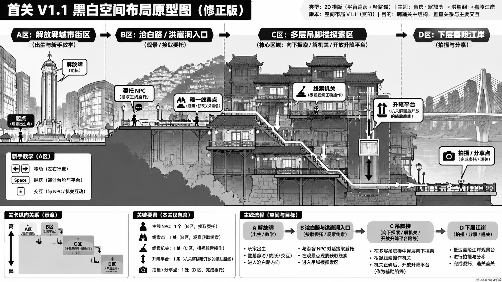

# 首关美术风格规范与场景原型

<a id="topdown-art-20261119"></a>

## 现行视觉重构：斜俯视地面与真实可进入建筑（2026-11-19）

负责人已确认 2D 斜俯视探索，保留温暖手绘卡通、重庆街巷／立体建筑与夜景方向；《元气骑士》只参考视角和地面走动，不复制像素素材／战斗。当前全部横版实机与旧概念图仍是旧方案素材／历史证据，**不是新视角参考图或已可用资产**。

新视觉目标：玩家在可辨认的街面、院落、门口与室内地面活动；建筑有侧面／立面和体积，墙／家具的基部与真实阻挡对应。纪念碑不等于整个 A 区，A 还需要广场、商业街和街巷可走空间；B 的高处观景、C 的楼层街廊与室内、D 的桥水江岸必须各有景观与活动范围。

2026-11-21 C区空间纠偏（组合范围CONFIRMED，具体构图PROPOSED／TO_VALIDATE）：以[唯一关卡方案](HONGYADONG_LEVEL_DESIGN.md#c-exploration-rework-20261121)组织高差、五栋可入建筑和穿楼；本轮不生成参考图、素材或重做UI。基础样块阶段就要读出依坡挡土墙、层叠门面、悬挑木廊、楼下支柱、屋顶临另一街及远处江桥的关系，不能只在平铺房屋上贴“重庆”标签。至少两处视点显示邻层去向，走到下一层可回望同一楼体；看见不等于当前碰撞面可走。可入门洞／有理由暂闭的门／纯背景窗墙采用不同表现，所有门面与真实入口一致，触控HUD不遮关键门洞。可辨色、材质和基础立面用于玩法读图，正式手绘精修仍后置；当前程序化截图与本方案都不冒充最终比赛美术或已通过负责人观感验收。

| 项目 | 新方案制作要求（具体参数 PROPOSED） |
| --- | --- |
| 地面与建筑 | 地面二维玩法平面＋斜俯视建筑立面，不用整张横版剖面当俯视地图；可走路面、入口、边界与装饰分清。 |
| 人物方向 | 准备适用于地面八向走动的方向表现；可用有限方向美术／翻转满足可读性，最终方向数量、比例、帧数、时长待小样，不以旧侧脸行走图完成新动作。 |
| 遮挡／层序 | 建筑前后关系与人物脚底位置一致，避免全身被墙／屋顶遮住或走在家具上。层序／透明方案先验证，不把“屋顶自动淡出无缝入屋”当新增必做。 |
| 室内 | 进入后有真实地面、墙、可接近的对象和明确出口；独立小地图与室外同一材质／比例，不能只弹一张图或文字。 |
| 线索／物品 | 线索靠形态、摆放、内容及反馈可观察，不只靠红圈和任务标签；关键道具与收藏外观／提示可区分，但不提前用颜色给出所有答案。 |
| UI | 目标／线索记录、任务道具与收藏反馈、纪念册／图鉴、成就、暂停／标题／继续。手机虚拟摇杆＋交互取代旧左右／跳跃作为主控，避免遮挡门口与物件。 |

建议后续只先定一张“可游玩的街区＋室内”构图和一个适合该视角的人物方向小样，再制作必要模块。不能再次连续海选大批概念图拖延可玩验证；也不能用粗糙背景加地名宣称景点成立。旧 A-01 五屏参考图仍归档，尺寸与认可记录不重写，但其横版构图不能直接投产为新地图。

具体区域／室内图与互动拓扑统一见 [关卡主文](HONGYADONG_LEVEL_DESIGN.md#topdown-first-chapter-20261119)，产品／实现状态见 [总规划](FULL_GAME_CONTENT_AND_LEVEL_EXPANSION_ARCHITECTURE.md#exploration-reboot-20261119)与路线图。所有新素材仍需实际文件、来源、许可、哈希与实机核对后才能登记；本轮没有生成／导入新图或修改旧资源。

---

## HISTORICAL：横版／建筑剖面美术规范与原型记录

下方旧“2D 横版＋2.5D”构图／动作、C 局部优先和旧截图保留，未被改变的手绘冷暖、来源与可读性原则仍可参考；不据旧图生成新的碰撞或声称新视角通过。

项目：《坡坎之间》（当前中文项目名称；英文名称未确定）

名称同步（2026-11-15）：当前项目名称为《坡坎之间》（CONFIRMED），英文名称未确定；旧工作名及历史记录按[当前名称决策](DECISIONS.md#project-name-pokan-20261115)追溯。本次仅同步项目归属名称，不改变本文设计状态、玩法或验收范围。

记录日期：2026-11-14。用途：为策划、美术与开发窗口提供同一份视觉依据、场景原型方案和制作顺序。本次交付设计文档并归档两张既有参考原图，不代表正式游戏资产、代码或实际视觉切片已制作。

## 2026-11-19 现行制作顺序：先整关 Demo，再美术精修

负责人已要求先完善网页小游戏 Demo 的空间、功能和界面，再优化美术。现行交付方案见 [H5 计划 V2](COMPETITION_H5_MVP_SCOPE_AND_DELIVERY_PLAN.md#demo-first-v2-20261119)，具体空间仍见[首关空间主文](FIRST_LEVEL_GRAYBOX_SPATIAL_PROTOTYPE_V1.md#competition-demo-space-20261119)。下方 C 局部优先／先补参考再编码的记录保留为此前阶段流程，不再成为整关 Demo 的新增前置；已归档参考和受限小样认可不撤销。

Demo 阶段也必须有基本地点身份：A 的纪念碑轮廓与城市街面、B 的高处观景与楼群、C 的真实木廊／楼梯和建筑剖面、D 的低处江水与桥梁；允许先使用简化模块，不接受仅靠文字命名。待实际空间和产品流程走通，再统一手绘纹理、角色细节、冷暖光、前后层次和动画质量。不先为所有区域补最终图，也不将粗糙样块升级为正式美术。

`92ea489` 已实现 C 连续楼梯和 R1 表现，H5-02-R1 开发状态 DONE（待审）；历史功能证据不证明负责人美术通过，H5-02 整体原 FAIL 保留。本轮只查看已有截图并规划，无新实机、美术资产或构建产物。新候选几何、素材规格与最终观感仍待验证，单项任务只从路线图进入。

<a id="visual-anchor-plan-20261115"></a>

## 2026-11-15 比赛版视觉与场景方向收敛方案 V1

方案状态：PROPOSED，待负责人审查。过程要求已明确：先完成视觉定锚与参考补齐，再恢复代码实施。本轮不改视角、不改源码、不生成新的代码 READY 卡。现行 CONFIRMED 仍是横版侧视操作＋2.5D 山城建筑表现＋手绘卡通；“方向已确认”与“当前画面符合方向”是不同结论。

### A. 当前事实与问题拆解

核对基线：GitHub main、origin/main、HEAD 均为 06b203d954c86bed1900af0c8205675a8590787e；开始时五份 Work 文档已有未提交修改，未发现 H5-02-R1 源码实现。已检查首关场景／art／actor、关卡与控制设计，查看 H5-02 的 A 出生、B 对话、C 概览及原图 A；本轮不重跑游戏测试或构建。

| 问题 | 当前证据 | 前置阶段应消除的歧义 |
| --- | --- | --- |
| A 地点身份不足 | 解放碑由少量矩形／三角形与文字组成；街面、沿街立面和地标比例未形成识别组合。去掉文字后难以说明出生在何处。 | 地标主轮廓、与人物的尺度关系、城市街区而非空中台面、进入 B 的方向。真实资料只校准形态，不冒充精确游览路线。 |
| B 入口与全景不足 | 门框、文字和独立木平台承担入口表达，建筑群／江岸与观景高差没有形成清楚构图。 | 沧白路高处街道／栏杆、洪崖洞建筑群与江景的关系；年轻游客的站位及唯一核心线索如何被看见。 |
| C 空间没有成为建筑探索 | 独立矩形台面仍是主要支撑，楼梯与走廊多是画在背景中；玩法楼板与装饰建筑分离。 | 玩家在建筑哪一层、如何沿真实楼梯下行、哪些廊道可走、哪些属于背景。不得仅把平台涂成木色。 |
| 2.5D 表达不完整 | 已有 depth／scrollFactor 和远景代码，不是技术上完全没有分层；但体块、前后遮挡、侧墙／屋檐厚度、光影和真实路线附着关系不足。 | 各区用同一四层关系与材质语言，玩法面固定世界坐标；视差只帮助远近，不让建筑与玩家脚下路线漂移。 |
| 人物风格与动作未统一 | 主角是新 SVG，游客仍是圆／矩形占位造型；actor 主要把单姿图翻转、摆动和缩放，没有清楚的迈步／起跳／落地参考。 | 同板对照主角与游客的线条、比例、配色、脚底基线；明确动作关键姿态，不能让开发凭“卡通”各画一套。 |
| 参考包不足 | 原图 A/B 两张 PNG 已真实归档且哈希一致，另有 UI 线框与 8 个运行 SVG；缺的不是“完全没有图”，而是已评审的四区构图、人物同板与动作说明。 | 区分总体气氛图、空间概念图、角色／动作参考、可拆分素材和实际游戏截图，各自不冒充对方。 |
| 原型与比赛样片差距 | 主线、输入、状态和资源加载已有有限 PASS；地标识别、建筑探索及美术观感未达标，H5-02 整体 FAIL 保持。 | 功能／空间／美术分开验收，不将测试 PASS、SVG 数量或图片归档等同正式视觉成立。 |

上一轮任务锁住旧几何而要求连续建筑体验，边界过窄；随后又直接安排改 C 地形，仍缺少图稿与人物动作目标。最新安排先解决这两个前置缺口，不继续让代码窗口自由猜测整套画面。

### B. 是否切换俯视：本轮不建议

从横版平台探索切到四／八方向俯视探索，是重大玩法与内容方向变更，不能仅称相机调整，也不会自动解决美术粗糙。

| 方面 | 保留横版并纠偏 | 切换俯视需要重新判断／实施 |
| --- | --- | --- |
| 玩法 | 保留走跳、楼梯／木廊、单线索／单机关，落实既有建筑探索原则。 | 跳跃／高差／升降交通的意义、探索路线和谜题接近方式重新设计，不能默认删除已有玩法。 |
| 地图 | 在已有 A—D 身份及总体下行下纠正构图和受限 C 几何。 | 四区平面布局、障碍和通行关系重排；当前侧视台面／楼梯坐标不能直接复用。 |
| 控制／物理 | 复用 PlayerMotor、输入聚合与已验证跳跃／支撑能力。 | 增加第二地面移动方向，重做相关移动、碰撞／支撑及触控映射；旧跳跃控制不能原样当俯视控制。 |
| 镜头／美术 | 修复现有边界、层次、尺度与素材语言。 | 改视域与遮挡规则、建筑视图、人物多方向素材和动作；美术参考仍须重新补齐。 |
| 代码与测试 | Phaser／TS／H5、共享核心和当前状态协议继续使用。 | 工具链及部分事件／进度逻辑可复用，但当前物理适配、恢复锚点和主线操作用例需重新验证；不能把旧测试结果搬到新玩法。 |
| 比赛成本 | 主要投入素材／构图定锚和一段可玩空间纠偏。 | 多项重做与新的交互／设备回归会占用比赛前主要余量，缺少依据把它估成“小改一天”。 |

当前计划以 12-01 为内部候选封版目标，距 11-15 约两周；它不是本轮新核验的官方截止。本轮不承诺精确重做工期。若以后负责人选择俯视，应单独形成明确玩法与范围决策，再估算、验证，不能夹在当前美术任务中实施。现有方向和代码均保留。

### C. 视觉定锚与最小参考包（全部候选，尚未制作／评审）

建议只做一套主风格、一轮成组参考与一次集中修订，不先绘制整关最终资产。总体继续手绘卡通、温暖夜景与城市生活感；候选 HEX、尺寸、帧数、镜头比例及人设细节不冻结。

| 参考项 | 必须说明的内容 | 首轮精度／边界 |
| --- | --- | --- |
| A 解放碑城市街区 | 地标轮廓与可读尺度、沿街建筑、街面／台阶、人物及通往 B 的方向。关掉大号地名后，地点身份仍应主要靠画面建立。 | 第一张重点视觉定锚图；采用可与当前 1000×580 画幅对照的侧视构图，不改代码分辨率。 |
| B 沧白路／洪崖洞入口 | 高处街道／观景边缘、洪崖洞建筑群全景、江景与游客站位；标唯一线索位置，不添加新谜题。 | 小构图／明暗稿即可，先确认高差和“城市入口”身份，不用整区完成稿阻塞开工。 |
| C 吊脚楼探索 | 两三层可见剖面、室内外木廊、主要楼梯、唯一装置与下层接口；配单独的可走路线／遮挡叠图。 | 首个可玩空间的定锚图；复用原概念图 A 的风格方向，图上机关／方向不自动确认，不直接转成碰撞图。 |
| D 下层嘉陵江岸 | 江岸步道、栏杆、桥梁／水面倒影及拍摄点，与 C 的下行关系。 | 小构图／明暗稿，避免只是另一块台面加“嘉陵江”文字。 |
| 主角＋年轻游客 NPC 同板 | 同一线条／笔触、头身比例、服装材质、光源与色彩；并排对照脚底基线及在亮／暗背景中的识别。 | 一张人物参考板，不新增姓名／身世／职业规则；形象、配色和比例均待审，不制作完整角色系统。 |
| 行走／跳跃／交互表现板 | 行走的接触、承重、经过与迈步；跳跃的起跳、上升、顶点、下降与落地；驻足、朝向与 E 交互反馈。 | 少量关键姿态与说明即可，不是最终精灵表或冻结帧数。脚底不滑、身体与地面关系清楚；短／长跳沿现有规则，不借美术改参数。 |

每张场景图标出：远景／中景／玩法层／前景、玩家尺寸／脚底、可走边缘、关键对象和主要遮挡。三维体积来自建筑侧面、屋檐／楼板厚度、前后遮挡与冷暖光，不新增景深操作；层数存在不等于允许每层背景都可进入。

优先级分两种：第一张“地点与共同画风”定锚选 A，优先解决进入游戏第一眼没有重庆城市身份的问题；第一段“真实建筑空间与操作”验证仍选 C，控制后续工程范围。这是本轮 PROPOSED 排序，不把原 C 优先制作历史改写成 A 已被正式批准；B／D 小稿与非关键服装细节不应成为 C 样段无限等待项。

比赛版目标下调为“地点可识别、风格统一、路线可读的一张可玩样片”：允许简化远景、复用建筑模块、减少动画帧和装饰密度，暂缓完整室内生活模拟、复杂光照、丰富 NPC／支线与成套最终美术。不能下调到几何块＋地名，不能牺牲玩家脚底／平台边缘／线索判断，也不要求逐像素复刻原概念插画。

现存原 PNG 保留；候选参考包建议放 docs/assets/art-direction/visual-anchors-v1/。本节方案初稿当时尚未生成新参考；后续 H5-02-PRE 已按本方案制作并登记 PROPOSED 候选包，见下方实施附录。真实资料用于地标形态识别，须记录来源与授权用途；参考照片不直接作为已获商用许可的游戏贴图。生成图亦须标 PROPOSED／非实机，记录实际文件／格式／尺寸／SHA-256；没有文件就 NOT RUN，不建占位图。

### D. 开发前短链路与开工门槛

1. 先整理现有参考与缺口，按上表做最小参考包；优先 A、人物同板和 C 路线构图，B／D 先用小稿。一轮制作／筛选加一次集中评审，建议给 1—2 个工作日的准备预算；这是资源齐备时的估算，不是工期保证。
2. 负责人／策划美术窗口集中判断地点、统一画风与角色是否符合预期。只认可图稿的设计范围，不因此认可真实碰撞、最终人设或资源生产完成。
3. Work 用 C 叠图核对主路线、楼梯、机关／门／平台与恢复边界，列出将来需改的最小文件和风险；不在此时实现坡面或改任务。
4. A／共同风格、人物同板及 C 构图／主要路线具备明确评审记录后，才细化并重新下发 H5-02-R1 的代码卡。恢复开发前仍须实际检查仓库状态；不能直接执行保留的旧 READY 提示词。
5. 首段真实游戏截图＋实际走梯／交互记录再评审；通过后才把同一语言推广 A—D 和后续 UI。H08 真机缺口并行保留，不由参考图或模拟替代。

本轮尚不具备直接恢复 R1 代码实施的条件。门槛不是“所有图都最终定稿”，而是关键视觉目标和 C 路线不再让开发猜。B／D 小稿、具体帧数、非关键装饰可保持 PROPOSED，不追加大型前置文档或审批队列。

### E. 可交给 Codex 的前置委托

HISTORICAL（2026-11-15 准备阶段）：当时仅允许资料／参考准备，不是新功能开发任务。完整交接提示词放在唯一入口 [H5-02-PRE 视觉定锚前置委托](DEVELOPMENT_ROADMAP.md#h5-02-visual-prep)。Codex 可整理已有素材与元数据、按经审查 brief 准备候选稿或标明缺少的绘图能力；不能凭文字再拼一套粗糙资源并直接装进游戏。2026-11-16 受限小样认可与现行放行见下方 Work 核对记录；美术成品通过仍不由 Codex 自行宣布。

本轮分析未生成新图、未运行游戏／测试／构建、未修改源码／碰撞／依赖，也未执行 Git Commit／Push。新参考的制作、审核与游戏内视觉验收均未完成。

<a id="h5-02-pre-reference-appendix-20261115"></a>

### H5-02-PRE 资料／资产登记附录（实施记录）

状态：PROPOSED 候选参考包已实际归档，等待负责人、策划与美术评审。以下只登记 H5-02-PRE 的资料与资产，不改变上方方案正文、正式设计或 CONFIRMED 决策。

实际候选包位于 [visual-anchors-v1](assets/art-direction/visual-anchors-v1/REFERENCE_MANIFEST.md)，共登记 8 张有生成记录的同方向候选稿：A-01、A-02、B-01、C-01、C-02、D-01、CH-01、ACT-01。全部为“设计参考，非实机”，记录来源、用途、格式、尺寸、字节、SHA-256 与待审状态；A-01 附实际生成记录，C-02 只表达评审路线，不是碰撞图。

本轮分类边界：

| 类型 | 实际文件／来源 | 本轮用途 |
| --- | --- | --- |
| 总体风格概念 | `assets/art-direction/first-level-visual-concept-v1.png` | 保留原图，只参考手绘夜景、木构剖面和暖光层次。 |
| 总体空间概念 | `assets/art-direction/first-level-layout-v1.1.png` | 保留原图，只参考 A—D 空间关系；不是碰撞或精确路线。 |
| 目标候选参考 | `assets/art-direction/visual-anchors-v1/*.png` | 评审地点识别、建筑剖面、人物统一和动作语言；不能直接充当运行资源。 |
| 当前运行素材 | `../src/rendering/phaser/assets/h5-02/` | 8 个原创 SVG 和来源记录；只证明当前版本资源加载，不代表视觉达标。 |
| 当前实机截图 | `../test-results/h5-02/run-2026-11-15T14-24-05-892Z/` | 功能自动化历史证据；整体视觉／空间审查仍为 FAIL。 |

当前画面问题到后续切片的对应关系：

| 当前画面 | 目标参考 | 后续切片必须解决 |
| --- | --- | --- |
| A 去掉文字后地点身份弱。 | A-01 用钟楼地标、街谷、店面、台阶和街面组合建立地点。 | 以真实出生点和镜头边界重构图；不改现有碰撞。 |
| B 入口像门框加独立平台。 | B-01 建立高处街道、观景边缘、吊脚楼群与江面高差。 | 单线索位置、游客站位和全景可读性须评审；不新增谜题。 |
| C 是独立矩形台面，楼梯多在背景。 | C-01／C-02 把上层街巷、两段楼梯、中层木廊、单装置和下层接口放进同一剖面，并标出评审路线。 | 用真实 Matter 重新验证坡面、接缝、支撑、镜头和遮挡；叠图不转碰撞。 |
| D 像另一块台面加地名。 | D-01 用上层木构、江岸、桥梁倒影和拍摄点建立下层空间。 | 核对拍摄点、升降出口、恢复锚点和水面背景边界。 |
| 主角与游客风格、比例不统一。 | CH-01 统一线条、材质、头身比例、光源和脚底基线。 | 由负责人／美术确认后重新制作可拆分角色资源，不直接切图上线。 |
| 动作只有单姿翻转／摆动。 | ACT-01 提供接触、承重、起跳、顶点、下降、落地和交互姿态。 | 只映射现有速度／接地／暂停状态；帧数和参数不由此冻结。 |

HISTORICAL（候选包交付时）：A 共同画风、人物同板和 C 主路线尚待明确评审；B／D 可为小构图，当时 H5-02-R1 为 WAITING_DESIGN。真实运行、碰撞适配、生产素材、最终色板、最终帧数和美术成品验收尚未由参考包完成；H5-02 整体保持 FAIL。当前有限认可与执行状态见下节。

### 2026-11-16 Work 核对与负责人小样认可

核对基线 `33c53a964e21ada9d700d582d0be2acc4c612dc8`，开始工作区干净。8 张 PNG 均可读取，实际尺寸与 Manifest 一致，SHA-256 全部匹配。Work 本轮实际查看 A-01、C-01／02、CH-01、ACT-01；此为文件与构图技术核对，没有重新运行游戏测试或构建。

负责人明确回复“认可，按上述约束制作小样”：采用 A-01 暖夜街区、C-01 木构剖面、CH-01 人物笔触作为试制方向。正式范围见 [受限小样确认](DECISIONS.md#visual-sample-approval-20261116)，现行实施卡只在 [H5-02-R1](DEVELOPMENT_ROADMAP.md#h5-02-r1-building-exploration)，状态 READY、尚未实施；不新增第二份任务队列。

技术落地须处理：

- C-02 未清楚区分 C3 上站、阻断边界、升降通路与下层 D，底廊有同层直通江岸的解读风险。该风险不是已证实的游戏漏洞；实际几何必须保持机关解锁与升降通路的必要性，不照图搬装置、添加捷径或新增谜题。
- C-01 的装置绘画位置与当前较高 C 平台的机关配置不同。图稿认可不批准迁移机关；先保留原接口，在 C 内用连续楼梯／木廊连接。不能落地时报告冲突，不擅自把候选 C3-02 定案。
- C-01 中人物与 CH-01、ACT-01 的发型、帽饰和配件不同。CH-01 定试制笔触，ACT 只参考承重／起落姿态，生产资源须统一同一主角；图中人物不产生新 NPC。最终比例／服装细节／帧数／时长仍待评审与实际缩放验证。
- C-01 为 1672×941，C-02 为 1671×941，叠图只表达路线语义，不当作像素级配准、碰撞或工程尺寸。资源要按真实楼板／坡面模块化制作，玩法建筑不得随背景视差漂移。
- 本轮 A 只提供共同冷暖光／街区材质参考，不实施五屏扩容；B／D 最终画面、全套 NPC、完整 UI、动作量产规格均不是本卡前置或新增验收。

候选原图继续保留“PROPOSED／设计参考，非实机”，增加“试制方向有限认可”说明；认可记录不等于最终美术通过。H5-02 原交付仍 FAIL，H5-01 真机缺口仍 BLOCKED；新小样的真实运行、坡面适配及成品观感均须后续独立验收。


## 2026-11-15 H5-02 产品观感与空间审查

负责人反馈当前画面粗糙、场景偏向跳台闯关，并已明确“保留横版侧视，重做建筑探索空间”。Work 对照实际桌面／触屏截图、图 A 与源码后，记录当前结论：功能自动化证据 PASS 保留，建筑空间／美术观感 FAIL，不能以资源加载成功宣称本视觉任务已完成。

具体差异为独立矩形台面仍承担主通路、楼梯大多仅在背景、玩法与建筑脱节、材质／光影和生活层次不足、正常画面技术标签／圆点过多；相机被加上整视口余量并由 art.update 重设，也超出原任务边界。先前锁定旧碰撞只贴合素材的任务范围同样需要纠正。问题依据是实际效果，不把 SVG 文件格式本身当成失败理由。

HISTORICAL（被本轮前置门槛取代）：此前下发 [H5-02-R1](DEVELOPMENT_ROADMAP.md#h5-02-r1-building-exploration)：允许受限重做 C 静态路线，实现真实可走楼梯与连续木廊／建筑剖面，把局部跳跃恢复为辅助；目标是一段可评审真实场景，不先扩展菜单或批量推广旧样式。具体位置、资源与人设不冻结，原图和历史报告均保留。原 H5-02 开发报告美术 NOT RUN 是当时记录，现已有负责人否定反馈及 Work 对照审查，不继续写成“观感无人审查”。

## 图片归档与采用状态

2026-11-14 本轮现行：已从负责人引用的[产品与游戏策划会话](chatgpt-conversation://6aedade9-f53c-83e8-b658-0e5cf7d5fe16)取得两张真实附件，逐张查看标题与内容，原样复制到下表路径。源文件 PNG 签名／格式及解码完整性核对通过，源／目标字节和 SHA-256 一致，归档完整性 PASS；未裁剪、改色、重编码或重新生成。

| 图片 | 用途／识别依据 | 仓库相对路径（相对本文） | 实际文件记录 |
| --- | --- | --- | --- |
| A：首关核心视觉原型图 V1 | 图内标题“首关核心视觉原型图 V1”，手绘夜景、暖光、建筑剖面；只作风格参考，不是精确地图。 | `assets/art-direction/first-level-visual-concept-v1.png` | PNG，1672×941，3,752,618 字节，原样归档／完整性 PASS。 |
| B：首关 V1.1 黑白空间布局原型图（修正版） | 图内标题含“修正版”，明确 A 解放碑与玩家出生、新手教学、B 入口、C 向下、D 下层江岸；是负责人指定的空间概念参考。 | `assets/art-direction/first-level-layout-v1.1.png` | PNG，1672×941，2,992,314 字节，原样归档／完整性 PASS。 |

源文件与 SHA-256（源／目标相同）：

- 图 A 源名：`af1b1dea6cf9e89a84d1b477500d1cc7.png`；SHA-256：`023467d4a9175c70f1d3f92ea1d62f8030f8531516ea6b6e8ed3954d9b2d6a77`。
- 图 B 源名：`b465f1b51f6c0c34e294cf134305d631.png`；SHA-256：`8e56b09b17a1a3d1df159712accfe2384b559a7c3ec851a11b3f60dc90c0d539`。




两图不是精确坐标、碰撞图或已制作的游戏内素材，不能据图冻结方向／停靠、角色尺寸、物理、镜头或色板。图 A 的上行箭头与装置细节仅为画面参考；图 B 的机关画在偏上层，不等于已批准 V2 的 C3-02 摆位，也不能据图另加机关或核心线索。文字正式决策优先，具体机关层位与当前代码的差异见[全关空间方案第 2 节](FIRST_LEVEL_GRAYBOX_SPATIAL_PROTOTYPE_V1.md#2-现有工程空间基线)。

HISTORICAL：此前负责人指定图片用途时可访问附件中缺原图，因此记录为“归档 BLOCKED、未查看／复制／记录哈希”，这是当时事实；本轮已解除文件归档阻塞。旧版未明确解放碑出生点的黑白初稿继续只留 HISTORICAL，不拿来替代当前修正版。图片完整性 PASS 不代表图稿布局评审、实际空间连通、可玩性或碰撞验收 PASS。

## 全关空间原型 V1 与建筑层次同步（PROPOSED）

完整空间提案入口为 [FIRST_LEVEL_GRAYBOX_SPATIAL_PROTOTYPE_V1.md](FIRST_LEVEL_GRAYBOX_SPATIAL_PROTOTYPE_V1.md)，和关卡 C 区 V2 互相引用：全关 V1 汇总 A 解放碑体块、B 全景与唯一线索、C 建筑剖面／楼梯／木廊、D 下层江岸，C 详细分区仍在 V2，不增加 C 区 V3。当前机关位于较高的 C 平台、V2 候选机关在 C3-02，不能靠画一张装饰图假装已完成位置同步。

建筑占位应读出四层关系：远景山／江／桥，中景吊脚楼体块，二维玩法层的楼板／楼梯／NPC／唯一机关，前景屋檐／灯笼／电线等；可站上缘、落点和主角清晰，背景墙／屋檐不能暗示虚假平台。楼梯视觉与隐藏连续坡面、装饰／碰撞分离继续遵循既有规则，具体几何／遮挡／镜头验证仍 NOT RUN。

A-GB-01—03、B 细分重排与 C3 站点等都是候选空间标签，不是正式资产规格或新增业务身份。C-H 仅作完整版外部环路构图参考，不必在当前 MVP 画成可到达捷径；不加收藏／支线／观察门槛。原型制作顺序、颜色／比例／UI／动画等仍按本文 PROPOSED，图 A 的归档不等于已交付 V1.3 彩色方案或游戏内视觉切片。

## 1. 状态与正式依据

| 内容 | 状态与含义 |
| --- | --- |
| 视觉方向 B | CONFIRMED：2D 横版玩法 + 2.5D 山城立体建筑表现 + 手绘卡通风格。依据：负责人本次明确指示，正式记录见 [DECISIONS](DECISIONS.md#2026-11-14视觉方向-b二维玩法与-25d-山城手绘卡通表现)。 |
| 首关主线与谜题 | 沿用 CONFIRMED 的 A → B → C → D、主动对话后接委托、单线索单装置、升降平台开路、指定位置拍摄分享及永久／临时恢复规则，见 [关卡设计](HONGYADONG_LEVEL_DESIGN.md#首关-mvp-设计冻结)与[任务设计](QUEST_SYSTEM_DESIGN.md#首关-mvp-主线任务与通关)。 |
| 四层构图、色板、资产与角色／UI细化 | 本文的制作方案为 PROPOSED，供原型验证；不把建议尺寸、HEX、格式、比例、帧数或镜头参数升级为正式约束。 |
| HISTORICAL：D12-A1 实现观察 | `858f7fb` 的源码观察保留历史，不作为本轮当前实现。`68ad83d` 静态空间基线见[全关方案第 2 节](FIRST_LEVEL_GRAYBOX_SPATIAL_PROTOTYPE_V1.md#2-现有工程空间基线)，两者均不等于设计批准或完整运行／美术验收。 |
| 首关空间与 C→D 路线 | CONFIRMED：方案 A，解放碑出生／教学 → 沧白路与洪崖洞入口 → C 自上而下探索 → 下层嘉陵江岸 → 拍摄分享；正式依据见 [路线决策](DECISIONS.md#2026-11-14首关空间布局与-cd-方案-a)。设计处置已明确，D12-A3 已有下行空间交付记录、待 Work 审查；本提案完整空间与新乘坐规则的实现不由此推定完成。 |
| 图稿／切片／验收 | 用户指定图 A／B 的用途与图 B 采用地位已明确；原图本轮已归档且完整性 PASS。V1.2／V1.3、游戏内切片及实际验收未执行，不以路线确认代替图稿／游戏验证。 |

### CONFIRMED：视觉方向 B

1. 保持二维横版操作逻辑，主角沿已定义的二维地形移动、跳跃和交互。
2. 通过多层建筑、建筑剖面、远近景和前景遮挡表现空间纵深。
3. 使用重庆山城建筑特色作为参考，允许构建虚构城市，不默认复刻现实地理路线。
4. 重点表现吊脚楼、错层街道、石阶、木走廊、悬挑阳台和江岸。
5. 整体轻松、活泼、温暖，具有探索冒险感。
6. 首关以山城夜景为主要视觉主题。
7. 不引入需要复杂三维角色控制的玩法。

这里的 2.5D 指视觉纵深，不是新增第三移动轴、三维角色控制、透视碰撞或新渲染引擎。现有 Phaser 共享渲染、Web／Electron 同一核心、Matter-first 候选路线及固定步规则不变。既有碰撞设计中“美术轮廓与碰撞分离”“台阶外观与连续坡面”继续适用，见 [PLAYER_CONTROL_DESIGN](PLAYER_CONTROL_DESIGN.md#4-碰撞系统-collision-system)。

## 2. 当前灰盒与美术基线

核对了 README、相关正式设计及以下实际文件；路径供定位，不表示本次修改它们。

历史观察边界：本节及后文关于“上层 D／上行代码”的实现描述来自 D12-A1 基线。路线图后续已记录 D12-A3 下行空间实现交付、待 Work 审查；本次 V2 文档任务不复验该交付，也不将旧实现描述冒充当前源码结论。V2 的子区／跳跃／外环仍只是提案，不因已有空间实施而算已完成。

| 文件 | 当前观察与制作影响 |
| --- | --- |
| `src/rendering/phaser/first-level.ts` | 首关由 Phaser Canvas 基础图形构成，已有重复建筑轮廓、窗灯、灰色地形、交互圆点和范围椭圆；尚非手绘资产或四层完成场景。当前画布 1000×580 只是工程配置，不冻结为逻辑分辨率。 |
| `src/physics/matter/first-level-world.ts` | 独立首关几何、路线门、真实升降平台与初始快照对象；现行 C 地面在较低处，D 为上层平台，详见第 7 节。 |
| `src/core/first-level.ts` | 具有独立 Level／Checkpoint 身份、游客／线索／吊臂／拍摄点，使用原事件事务链；左右吊臂是当前占位选项，不作为最终装置造型。 |
| `src/core/graybox.ts`、`snapshot.ts`、`recovery.ts` | 共享模拟、初始备份、永久效果协调与恢复；渲染替换不能重新生成业务身份、覆盖快照或改变任务状态。 |
| `src/platform/web/main.ts`、`style.css` | D12-A1 基线中默认首关与调试入口并存；页面 HUD 和画布提示需按实际体验整理。该基线的 NPC 打开对话即提交问题单列 D12-A2；其后时序／UI 改动按开发交付与审查记录，不在美术文档中判定完成。 |

本次没有重新运行游戏、物理测试或三端验收；历史 D12-A1 自动化通过只证明当时实现范围。2.5D 分层、手绘资产、下层江岸方案及本文验收均不能据此记 PASS。

## 3. 四层画面结构（PROPOSED）

以下是落实已确认方向的候选制作规范；层间距离、视差倍率、透明度和实际资源划分通过原型确定。

| 层级 | 表现内容与任务 | 遮挡与可读性 | 视差建议 |
| --- | --- | --- | --- |
| 远景 | 深蓝／蓝紫天空、山脉、江面、桥梁与城市天际线，交代夜景尺度和江岸方位。 | 轮廓简化、对比偏低；桥梁和窗灯不画成可站立边缘。江水倒影不伪装成通路。 | 相对镜头最慢，天空可接近固定；具体倍率 PROPOSED。 |
| 中景 | 成组吊脚楼、错层街道、背后楼层和支撑结构，展示山城层叠关系。 | 用明暗、接缝和建筑剖面分出层次；未接入二维路径的楼梯／门洞不采用与玩法路径相同的入口语言。 | 比远景快、比玩法层慢；不要让背景移动看起来像真实平台运动。 |
| 玩法层 | 玩家、NPC、可站立地面、石阶／坡面、木走廊、装置、路线门和升降平台。 | 地面上缘和落点清楚，角色与背景可分；剖面去掉朝向玩家的墙体，保留承重与楼层线索。 | 与真实世界坐标一致，不使用装饰视差改变角色、碰撞面或交互位置。 |
| 前景 | 屋檐、灯笼、电线、招牌、植物等局部轮廓，形成框景与空间穿插。 | 以画面边缘、顶部为主；不能遮住主角、落点、装置反馈、唯一线索或交互提示。透明／淡出规则尚待验证。 | 可略快于玩法层，但不制造错误碰撞／路线判断；强度待原型比较。 |

候选构图原则：大块冷色背景承托少量暖光；可行走面使用稳定的边缘和材质节奏，重点交互用局部形状／明暗区别。倾斜屋顶、侧墙和透视立面提供体积，但实际路线仍是一条二维支撑关系。关键入口与跳跃落点附近减少前景密度；不要用灯光闪烁或过量招牌与核心线索竞争。

建筑剖面只为展示已有通路，不增加房间探索、室内外切换、隐藏任务或机关。需要通过遮挡淡出展示通路时，先在静态原型说明触发条件，具体实现不在本次确认。

## 4. 夜景色彩与反馈语义（PROPOSED）

下列 HEX 全部是首轮候选，需在真实游戏截图、灰阶检查及 Web／Electron 中验证。任何值都不是冻结色板，也不沿用当前代码颜色作为最终标准。

| 色彩角色 | 候选 HEX | 用法 |
| --- | --- | --- |
| 深蓝天空 | `#172A46` | 主夜空与较暗大面积背景。 |
| 蓝紫远山／天空过渡 | `#47456B` | 天际线、远山与夜景过渡。 |
| 木棕建筑 | `#795641`、`#A77A54` | 木柱、横梁、走廊与受光立面，避免全图同亮度。 |
| 灰色石阶 | `#747B86` | 石阶、挡土墙与基础；可走边缘另以亮度和轮廓分离。 |
| 暖黄色窗灯 | `#F4C875` | 窗灯、少量环境暖光，普通灯光不默认表示可交互。 |
| 橙色灯笼 | `#E8914E` | 前景／环境点缀，不到处作为任务引导箭头。 |
| 蓝绿色江水 | `#2D777D` | 江面与简化倒影，亮度低于主要交互反馈。 |
| UI浅色文字 | `#F4E9D2` | 正文／提示，与深色面板组合；对比效果待真实窗口验证。 |

交互语义建议：

- 可交互：统一外轮廓／小型图标与 E 提示，辅以暖色强调；环境暖灯与交互强调在形状、位置上区分，不能只靠颜色。
- 核心线索：灯带／图形使用可辨认的方向和重复纹样，与同一装置上的符号对应。线索专用关系不在其他装饰上随意复用；不新增“先读取才允许解谜”的硬门槛。
- 未操作选项：同等视觉权重，不预先给正确项成功绿、错误项失败红。绿色可在业务成功后辅助确认，必须同时有动作／符号／文字结果。
- 可重试错误：短暂偏橙红强调、未连接符号和“可重新尝试”反馈，随后回到可操作状态；避免永久损坏、死亡或锁死的视觉暗示，不新增惩罚。
- 路线开放／任务完成：平台或连接件的真实变化与图标／文字同步；事务尚未成功不能仅靠动画提前显示永久完成。内部 ID、请求或事务术语留在诊断区。

## 5. 模块化资产与碰撞分离（PROPOSED）

先服务一段可玩场景，优先复用轮廓、材质与连接件，不以收集所有可能资产为开工前提。资源尺寸、网格、纹理分辨率、图集、切片方式、文件格式和命名规则均待制作验证。

| 资产组 | 最小模块与变化 | 使用位置／组合注意 |
| --- | --- | --- |
| 石阶、坡道、挡土墙 | 阶梯正面／侧面、转角、石材基础、坡道端头。 | A／C 地面连接；台阶贴图与现有连续支撑面分开制作。 |
| 木柱、横梁、木平台 | 立柱、横梁、斜撑、平台面、端头。 | C 区吊脚楼骨架和玩法面，用端头处理相邻模块接缝。 |
| 墙体、窗户、屋檐 | 实墙／剖面墙、暗窗／亮窗、屋面边缘和角部。 | 中景立面与玩法剖面分别组合；屋檐不默认可站立。 |
| 木走廊、阳台、桥梁 | 直段、转接、护栏、悬挑支撑、小型连桥。 | B 观景与 C 路径；桥梁装饰与可走小桥使用不同轮廓。 |
| 吊脚楼剖面 | 楼层切面、柱脚、背墙、门洞和楼板连接。 | C 核心识别资产；不为每层另造整栋建筑，不制造不存在的可进房间。 |
| 单装置与升降平台 | 一个装置主体、左右控制位、线索对应件、锁定／启动状态、轿板／导轨。 | 保持单装置结构；导轨、绳索为表现，真实承载面和路线状态由已有物理／业务决定。 |
| 环境装饰 | 灯笼、招牌、电线、盆栽、局部屋檐。 | 小量变化复用；前景与背景实例分层，避开核心线索。 |
| 远中景资产 | 山形、桥梁剪影、建筑群、江面和窗灯／倒影片段。 | A–D 共用世界基调，不以装饰资产新增碰撞或任务。 |

美术资产可记录可见轮廓、建议支点、连接边和受光方向，供后续对齐；这些注释不是碰撞配置或正式 API。不得通过改贴图透明边缘或缩放整幅建筑来偷偷改变可走宽度、跳跃距离和承载位置。普通墙地与装饰的碰撞仍按已有简化原则处理；特殊单向平台需有稳定、可辨认的画面语言，不能把所有木走廊都画成同一种单向平台。

移动平台资产锚点须跟随真实 Body；绳索、导轨、灯光或动画不能驱动物理时钟，隐藏／最小化后的表现继续与实际模拟一致。恢复后美术重建按逻辑对象与永久效果重新同步，不能把已开路线重新画成关闭。

## 6. 角色、动画与 UI 方向（PROPOSED）

| 对象 | 视觉方向与最小需求 | 不冻结的内容／边界 |
| --- | --- | --- |
| 主角 | 轻便的探索者轮廓，头身关系略夸张、动作清楚，以小面积暖色与背景区分；侧面朝向和脚底落点易识别。 | 身份细节、服装、配色、尺寸和比例待确认；不因旧项目名添加配送制服或强制背包系统。 |
| 游客等 NPC | 温暖卡通轮廓，通过姿态、服装块面和交互标记区别于主角；首关先覆盖既有游客。 | 不为美术增加新 NPC 任务；旧暂定姓名／年龄／完整对白仍待确认。 |
| 最小角色动画 | 待机、移动、起跳／空中／落地、交互姿态；NPC 待机和对话反应。 | 帧数、速度、过渡时长、骨骼／逐帧方案均 PROPOSED；动画响应业务和运动，不决定支撑／接取／通关。 |
| 对话框 | 深色半透明或纸张质感候选面板，清楚的说话者、短文本与结束提示，保留背景中的角色／空间定位。 | 尺寸、字体、翻页与打字效果待验证；完成对话后的接取语义不变，不加接取／拒绝弹窗。 |
| 当前任务提示 | 单一主要目标、明确状态与必要交互提示，避免画布／网页双重面板互相遮挡。 | 具体位置／字号／图标待原型；不显示事务编号，不把内部处理中显示为已成功。 |
| 任务日志 | 沿用既有独立任务日志方向，用简洁手账页区分当前／完成与目标摘要。 | 本次只做视觉方案，不新增完整日志实现或首关必做收集项。 |
| 旅行纪念册 | 手绘纸页、建筑小图、照片与记忆卡片的视觉组织候选；与夜景拍摄反馈保持同一材质语言。 | 名称、页面数量、收藏配置、奖励与功能范围仍待原有设计确认；不作为首关新增验收门槛。 |

界面需在 Web 与 Electron 的真实客户区可读；主角、落点和交互对象优先于边框与装饰。控制锁、暂停、错误状态的视觉反馈服从现有协议，UI 动画不能自行开放控制。

## 7. C→D 路线冲突与处置建议

### 现行：方案 A 已确认，实施细节待验证

负责人已明确采用方案 A。现行主线为解放碑出生与教学 → 沧白路与洪崖洞入口 → 多层吊脚楼向下探索 → 下层嘉陵江岸 → 指定位置拍摄／分享 → 首关完成。ART-ROUTE-01 不再等待重新选择路线；当前上行代码与正式下行设计之间的实施差异仍存在，本次只改文档。

图片 B 修正版是正式空间概念参考，未明确解放碑出生点的初稿不再适用；图片尚缺，不声称已核对图中文字或完成归档。A 区不能简化为不含解放碑身份的普通街道／洪崖洞出生点。

C→D 的整体下行不等于升降平台必须单向向下。平台具体运行方向、端点／停靠点、往返方式、速度及与步行通路关系仍 PROPOSED，后续需结合已确认下层 D 设计验证，不从概念图箭头或代码现值擅自冻结。坐标、碰撞、锚点和镜头也未因概念图采用而确认。

### HISTORICAL：确认前的冲突与推荐记录

以下保留原分析，其中“等待负责人确认路线”已被上述方案 A 的正式确认取代；“当前实现”指读取的 D12-A1 基线，不是最新正式设计。

冲突编号：ART-ROUTE-01。状态：**待负责人确认处置**。这不是本次新增的已确认路线决策。

| 项目 | 已确认关卡设计基线／本次推荐 | D12-A1 实际实现 |
| --- | --- | --- |
| 探索方向 | C 沿多层楼梯与木走廊整体向下，最终接江岸下层 D；以原有关卡规则为优先。 | B 高处进入较低 C 后，升降平台向上送往 D，上层 D 承担终点。 |
| 源码几何 | 不在本文件冻结新坐标。 | `c-ground` 中心 y=575、高70，上缘约540；`d-upper-ground` 中心 y=310、高60，上缘约280。屏幕坐标 y 越小越高。 |
| 平台和观景点 | 推荐以向下连接江岸组织出口；平台运行范围、D 位置和安全路线待处置确认后设计。 | `FIRST_LEVEL_LIFT.fromY=549`、`toY=309`，从 C 低点上升；D 拍摄点位于 `(1830,258)`。不是仅靠美术名称造成的差异。 |
| 建筑构图 | 吊脚楼剖面由上至下展开，柱脚与江岸形成收尾，水面／桥梁在下层终点可见。 | 高处 D 需要上层支撑、向上导轨与高位观景构图；不能仅贴一张江水背景假装路线已符合。 |

路线示意仅表达差异，不是最终地图或坐标：

```text
原设计／推荐：B 高处 → C 上层 → C 中层 → C 下层 → D 江岸下层
当前实现：  B 高处 → C 低处 → 升降平台向上 → D 上层平台
```

推荐：优先保持已确认的 C 区向下探索及 D 江岸终点设计，调整实施路线来对应它。**推荐及其具体实施仍为 PROPOSED，须负责人确认**；本次不修改代码或把当前上行实现追认为新规则，也不覆盖旧确认记录。

影响范围：

- 地图：C/D 高差、升降平台端点、入口／出口、门体、地面衔接与回程可达性需一起检查，不能只反转平台速度。
- 美术：剖面楼层、柱脚／地基、导轨、江岸护栏、桥梁与倒影构图、相机取景及前景遮挡会受影响；绑定现有坐标的成品易返工。
- 恢复与验证：后续若获准改图，需复核初始／备用锚点、失败区、临时平台快照、永久开路效果和真实通行；这是影响清单，不是本次开发授权。
- 叙事：只处理相对空间关系，不趁机改变 NPC 委托、唯一线索／装置、拍摄分享条件或虚构地名。

确认前可继续材料语言、模块草图、色板试验及两种路线的标注草图；不得把任一新拓扑当作已批准布局下发正式资产或碰撞实施。最终 C/D 高差布局、与之绑定的 V1.2／V1.3 定稿和游戏内切片接入应等待处置明确。

## 8. A／B／C／D 场景原型方案

四区地点、出生职责与总体下行路线为 CONFIRMED；以下材质、构图、模块和动画表现继续 PROPOSED。A／B／C／D 对应本次明确的真实地点定位，但整体空间为游戏化压缩，不是精确现实步行路线；不再用泛化 A 街巷取代解放碑出生区。

### A 区：解放碑城市街区——出生与新手教学

- 视觉目标：明确解放碑周边城市街区的出生身份，温暖且易辨识，让玩家看清角色、路面与下一处高差；不能只画普通街巷或在洪崖洞出生。
- 建筑结构：石阶与挡土墙托住街巷，两侧木／砖混合立面和小型悬挑阳台形成向右的入口节奏；不要求制作额外室内空间。
- 远中近景：远处山形／少量灯火；中景错层立面；玩法层为安全路面与教学段；前景用局部屋檐、灯笼和植物框住两端。
- 可复用资产：石阶、挡土墙、墙窗、阳台、屋檐、少量招牌和灯笼，后续延伸到 B/C。
- 与玩法关系：玩家在解放碑周边出生，完成左右移动、跳跃、主动交互教学，再进入 B；首关不增加历史卡、隐藏收藏或额外支线。
- 替换要求：后续实施须把出生身份明确呈现为解放碑周边，不能仅沿用普通街道占位图。具体出生锚点和可走地面仍需独立工程验证，本次不修改当前代码／碰撞。

### B 区：沧白路与洪崖洞入口——高处观景平台

- 视觉目标：从解放碑街区抵达沧白路与洪崖洞入口，展示洪崖洞整体建筑和江景，读出后续吊脚楼与江岸方向。
- 建筑结构：石基／木结构支撑的悬挑阳台，护栏留出游客与线索的位置；栏杆为装饰时不伪装成新的可站平台。
- 远中近景：远景桥梁、山形与城市天际线；中景展示 C 建筑群；玩法层保留游客、唯一线索及通路；前景屋檐不挡游客和线索。
- 可复用资产：阳台、护栏、木柱、窗灯、桥梁剪影和建筑群。
- 与玩法关系：主动完成游客对话后自动接委托，观察唯一环境线索；全景是视觉揭示，不增加新任务或独立调查目标。
- 替换要求：保留实际交互范围和控制协议，图像／短镜头候选不能擅自延长控制锁或改变 SimulationTick；镜头演出时长／触发细节待验证。

### C 区：多层吊脚楼与单装置

- 视觉目标：作为优先视觉切片，体现支撑在坡地上的层叠建筑、剖面通路与木走廊，主路线能被连续辨认。
- 建筑结构：上／中／下层剖面、木柱横梁和斜撑，以楼梯、木走廊和悬挑平台连接；主线自上而下，单装置正确操作开放升降平台辅助路线，最终连接下层 D。平台运行方向和停靠点未确认。
- 远中近景：远处山体／水面灯光；中景吊脚楼立面；玩法层突出楼板、石阶、单装置与平台；前景木梁、灯笼和电线控制在安全框景范围。
- 可复用资产：剖面、木柱、横梁、平台、楼梯、护栏、导轨与装置状态件，避免每个楼层单独绘整张图。
- 与玩法关系：保持一条来自 B 的核心线索、一个装置、一个正确操作及错误可重试；美术显示同一装置的选项，不新增多机关链。解锁永久保留，平台瞬时位置可回退。
- 替换要求：分层稿标注实际物理面与正式下行设计之间的差异，不能把上行代码包装为已符合方案 A。具体图稿不作为碰撞／坐标依据；后续实施单独安排，贴图对齐真实平台，恢复后开路表现正确。

### D 区：下层嘉陵江岸——观景与拍摄分享

- 视觉目标：用桥梁、江水倒影、暖灯建筑和开阔画面形成首关收尾，拍摄位置明确但不被大面积 UI 遮挡。
- 建筑结构：位于 C 主线下层的嘉陵江岸平台，石基／护栏与出口衔接、柱脚交代高差；相对层级已确认，具体高度与通路坐标未定，当前上层 D 代码尚未同步。
- 远中近景：远景桥梁／对岸灯火；中景江面与简化倒影；玩法层为观景平台和拍摄标记；前景仅少量灯笼或栏杆端头。
- 可复用资产：石基、护栏、江面、桥梁、灯火／倒影、拍摄标记和明信片式结果框。
- 与玩法关系：沿用主线接取、机关成功、路线开放、指定位置、拍摄分享成功的联合通关条件。照片和分享只作游戏内表现，不增加外部发布功能。
- 替换要求：不能靠贴图将现有上层平台伪装为下层江岸；后续按方案 A 验证平台高度、桥水取景与真实碰撞。图片只作概念参考，完成面板与交互位置一致，美术不触发额外奖励或完成事件。

### C 区 V2：建筑剖面与外部隐藏空间表现（PROPOSED）

2026-11-14 补充：完整空间提案集中见 [C 区 V2](HONGYADONG_LEVEL_DESIGN.md#c-区完整空间布局-v2proposed)。本节只细化视觉方案，不把 J1／J2／J3、井道行程、隐藏物件或资产规格升级为正式实施要求；当前 MVP 不加入 C-H、隐藏收藏、支线、文化观察或老店主。外部绕行方案 B 的方向保持已有 CONFIRMED，其具体路线与表现仍待验证。

| 空间 | 剖面／纵深表现建议 | 与真实玩法的对应 |
| --- | --- | --- |
| C1 上层入口 | 从 B 出口框景展示上下楼板、木柱和部分下层通路；C1-01 入口、02 外侧木廊、03/S1 楼梯有连续建筑支撑。 | 玩家看见向下探索方向；远处可见空间不假装立即可达，不添第二机关。 |
| C2-A 内部木廊 | 朝玩家的前景墙体局部打开，显示半开放室内、楼板、横梁及跨建筑短桥；用桥面破损轮廓交代 J1 候选。 | 木廊／桥面是可走玩法层，后墙和窗外楼群是中景；起跳、宽落点与安全承接清楚，不能用透视缩短图形距离冒充物理可达。 |
| C2-B 中央错层 | 以楼梯 S2、上层木廊和中层开放平台显示高差；外侧阳台可提示完整版 C-H 分支入口。 | 主楼梯的方向应可读；C-OBS-01 只可作文化观察候选，不出现机关答案、操作方向或第二套主线线索。 |
| C3 机关／井道 | 通道、一个木结构／简化绞盘装置、一个平台井道彼此关联；支撑和导向结构体现自动开路结果。 | 左右操作位属于同一装置；成功才呈现开路，平台不成为第二谜题。V2 向下行程仍是提案，方向／端点／安全停靠不由图稿冻结。 |
| C-H1／H2 外缘绕行 | 同一建筑外墙、立柱、悬挑木廊与远山／江景形成外部绕行；入口用候选小门／栏杆缺口，不增加谜题锁。 | 仅完整版候选；J2 是合理短跳而非连续高难度跳跃，前景不能掩盖真实平台边缘。 |
| C-H3 与回廊 | 檐下小平台、可观察江岸的窗口／框景、外侧短梯或维护廊回到 C2-B；风铃纪念章和旧招牌只作未来对象候选。 | 能看见 D 不等于能落入 D；回接仍在 C2-B，不引导绕过 C3 或机关。J3 是否设置待定。 |

画面继续采用横版侧视玩法平面和 2.5D 建筑体积；前景局部打开只是表现方式，不引入第三移动轴或额外室内切换系统。背景以远山、江面、桥梁与其他吊脚楼建立纵深；屋檐、灯笼、电线、植物和招牌作前景框景，不严重遮挡主角、落点、线索与机关反馈。

主线和隐藏路线建议用可读程度／视线引导区分：主线楼梯、连接走廊与去向连续清楚；完整版隐藏入口可较含蓄，但一旦进入，其可站立边缘和返回方向仍必须清楚。两者都不能与纯背景建筑混淆，不用隐藏前景制造“猜碰撞”。装饰不伪装成支撑，建筑剖面必须对应将来真实可玩的路径；新模块仍复用第 5 节资产，不据本节建立新物理或资产管线。

后续 V2 图稿／切片需核查 J1 落点可读、剖面楼梯层级、隐藏环路回接、前景遮挡、文化观察与机关线索分离，以及恢复后的已开路线／平台表现。当前这些 V2 检查均 NOT RUN；图稿不能证明无捷径或平台恢复安全，具体参数和最终美术保持 PROPOSED。

乘坐控制补充：负责人已确认 [C3—D 升降平台乘坐操作方案 A](DECISIONS.md#2026-11-14c3d-升降平台乘坐操作方案-a有限自由操作)，行驶时有限左右调整、禁跳／禁中途上下，到站完全停稳对齐后自由上下且无额外按键。具体 C3-03 上层站点与 D 站点／沿江步道、竖直轨道和双站运行组织仍为提案；自动往返、空载、循环、停靠时间与资源尺寸不因本次确认定案。

后续视觉方案应清楚区分“正在运行”和“停稳且对齐后可上下”，提示与真实控制／物理状态一致，不能只因中途暂停、零速度或灯光动画就显示可离开平台。站台边缘、平台接缝、安全可站范围与等候区域需要可读，前景不得遮挡；具体图标、文字、材质与对齐容差仍 PROPOSED，不靠美术假装真实对齐。这是表现规范补充，不新增玩家上下车交互、不制作或导入任何概念资产，也未执行视觉切片／运行验收。

## 9. 原型阶段与游戏内视觉切片计划（PROPOSED）

此处 V1.1／V1.2／V1.3 是美术原型版本，不是工程 M1.x。图片 B 修正版已由负责人指定采用，原图本轮归档／格式尺寸与哈希核对 PASS；空间布局评审及 V1.2／V1.3 与游戏内制作／运行仍 NOT RUN。

| 阶段 | 工作与产物 | 进入下一阶段的检查 | 当前状态 |
| --- | --- | --- | --- |
| V1.1 黑白空间布局图 | 采用负责人指定的图片 B 修正版，明确解放碑出生、B 入口、C 下行与 D 下层嘉陵江岸；概念坐标与代码差异另标。 | 原图入库核对确为修正版；不能用旧初稿顶替，不冻结平台方向／停靠点和碰撞。 | 采用地位 CONFIRMED；原图归档／完整性 PASS，空间布局评审 NOT RUN。 |
| V1.2 灰阶场景图 | 在批准的布局上，用灰阶区分四层、角色、落点、装置和前景；先细化 C，其他区保持结构稿。 | 不靠颜色仍能读出主线和关键对象，剖面不会暗示不存在的路径，前景不遮关键信息。 | NOT RUN |
| V1.3 彩色风格图 | C 区主风格图配同一色板的 A/B/D 小稿，展示夜景暖冷、材质、线索与错误／成功反馈；标注候选 HEX 和模块拆分。 | 山城夜景辨识、四区一致性、UI 可读与色彩语义通过评审；不把图稿通过等同物理验证。 | NOT RUN |
| 游戏内 C 区视觉切片 | 后续单项开发授权后，在共享 Phaser 场景替换一段已批准 C 区玩法面、建筑层次、单装置和平台表现，使用实际主角／UI 观察。 | 对照真实碰撞、交互、暂停／恢复与永久开路；记录 Web 和 Electron 同版本证据，不重写核心。 | NOT RUN |
| 补齐 A、B、D | 复用 C 已验证模块，依次补 A 入口、B 全景／游客／线索、D 江岸收尾及局部 UI。 | 连续走完主线，检查过渡、镜头／遮挡与通关反馈；D 须遵循已确认的路线处置。 | NOT RUN |

制作顺序是 C 优先，随后 A → B → D；V1.1 仍先看 A–D 全局。方案 A 现已确认，不再重复做上／下行选择；原图已完成归档核对，精确布局与工程参数仍待验证。本次不生成替代图片、不导入正式资源、不改地图或启动场景，下一开发任务以独立授权为准。

HISTORICAL：此前 D12-V1.1 只安排现状／候选对照与 C 剖面，属于确认前候选研究；该旧安排保留在[路线图](DEVELOPMENT_ROADMAP.md#7-当前任务与持续记录)，现由负责人本次指定的图片 B 修正版与正式方案 A 优先，不要求重新选择路线，不提前记图片归档或游戏验证 PASS。

## 10. 视觉验收与记录模板（PROPOSED / TO_VALIDATE）

以下为未来评审的候选验收口径，当前均 NOT RUN。先判断是否存在明确缺陷，不虚构量化分数、帧率、性能或对比阈值；数值指标需要原型证据和后续确认。

| 编号 | 核查项 | 候选通过条件与证据 |
| --- | --- | --- |
| VA01 | 山城辨识度 | 不依赖地名文字，能看到吊脚楼支撑、错层街道、石阶／走廊及江岸关系；保存全景和 C 局部图。 |
| VA02 | 平台可读性 | 角色、可走地面上缘、跳跃落点和真实移动平台清楚；背景／装饰不被误认成支撑。灰阶对照与真实游玩截图分别记录。 |
| VA03 | 建筑层次 | 四层有可读远近关系，剖面显示已存在通路，视差不造成平台位置误判；图稿与游戏内检查分开。 |
| VA04 | 主路线可读性 | 从 A 到 D 的空间方向与已确认路线处置一致，C 向下探索意图明确，无视觉引导进入不存在的门洞／落点。 |
| VA05 | 交互与线索辨识 | NPC、同一装置、平台和拍摄点可识别，唯一核心线索有对应形状；不靠预标绿／红泄露答案，错误可重试与成功状态有非颜色反馈。 |
| VA06 | 前景遮挡 | 在主角经过、起跳／落地、乘平台、看线索和操作装置时，前景不遮关键信息；逐点截图或录像，不能只看一张静帧。 |
| VA07 | Web／Electron 一致性 | 同版本、可比较客户区中，层序、字体可读、提示、遮挡及暂停恢复表现一致；实际环境与截图成对记录。未执行 Edge 或其他尺寸不推断兼容。 |
| VA08 | 业务／碰撞保持 | 换装饰后仍按真实平台承载与原交互完成主线，恢复后任务和 OPEN 路线保留，无动画驱动物理或重复业务。美术图稿无法单独证明此项。 |

每条记录：原型／构建版本、关卡与位置、平台及客户区、测试目标、前置条件、操作步骤、预期、实际、截图／录像路径、问题及复验记录。状态使用 PASS／FAIL／BLOCKED／NOT RUN；非关键表现问题另记 Warning。影响路线／碰撞／玩家安全／线索判断的视觉错误属于既有 Critical Error 范围，不能为了通过美术验收降为装饰 Warning。

图稿评审通过、真实游戏切片通过与玩家人工手感验收是不同证据，不合并记账。方案 A 已明确，VA04 现按 C 下行、D 下层嘉陵江岸检查；图片本轮已归档并核对身份／完整性，未来场景切片实施及实际验证仍 NOT RUN，不因确认路线自动通过。

## 11. 待确认事项与交接范围

- ART-ROUTE-01 的设计选择已确认方案 A；仍待设计／验证的是具体工程布局、升降平台运行方向与停靠点、门／通路／锚点衔接及地图同步任务。本次不再将是否选择下行列为待确认。
- 色板 HEX、材质笔触、轮廓／明暗比例、视差倍率、前景淡出、镜头范围与运动参数。
- 资产尺寸／网格／图集／导出格式、角色比例与服装、动画方式／帧数／时长。
- 对话、任务提示／日志、旅行纪念册的具体布局、字体、图标与最终素材；任务／奖励功能按既有范围，不能由 UI 草图擅自增加。
- A–D 最终空间坐标、升降平台端点及安全锚点／碰撞调整，需在独立工程任务中按已确认方案 A 设计与验证，不把概念参考图当作数值配置。

当前正式依据包含视觉方向 B，以及负责人本次确认的首关地点定位／出生职责／C→D 方案 A 和图片用途；具体美术与工程参数仍 PROPOSED。旧地图提案、未明确解放碑的初稿、上行平台提案及测试记录保留为历史，不再与新决策并列为现行路线；图片缺失不能伪造补齐。本次文档维护不自动启动代码开发。
