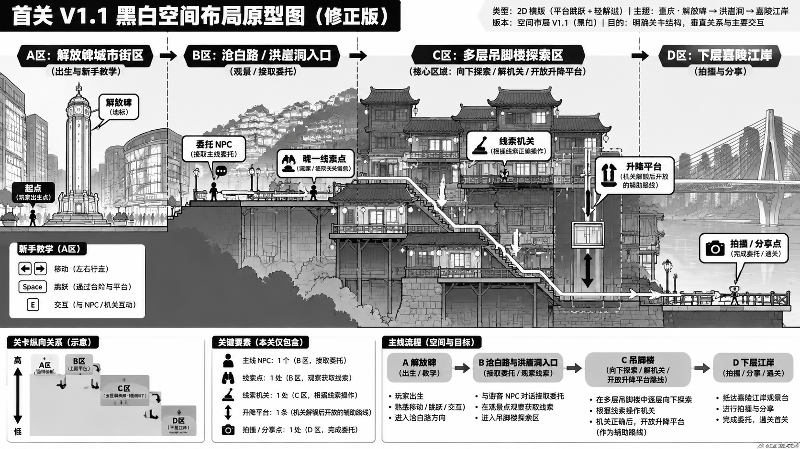

# 首关完整空间灰盒原型设计方案 V1

**HISTORICAL（2026-11-19 后续重构）**：本文件保留旧横版空间、7—9 屏试制与原概念图／坐标记录，不再作为现行斜俯视地图依据。负责人已确认八向探索、独立室内、3—4 个节点、选做收藏、本地存档与 30—45 分钟完整首章目标，见 [最新决策](DECISIONS.md#topdown-exploration-reboot-20261119)。新首章唯一详细空间见 [HONGYADONG_LEVEL_DESIGN.md 现行章节](HONGYADONG_LEVEL_DESIGN.md#topdown-first-chapter-20261119)。下方历史确认／提案与开发许可不自动延续到新方案，旧文件／图片／测试不删除。

项目：《坡坎之间》（当前中文项目名称；英文名称未确定）

名称同步（2026-11-15）：当前项目名称为《坡坎之间》（CONFIRMED），英文名称未确定；旧工作名及历史记录按[当前名称决策](DECISIONS.md#project-name-pokan-20261115)追溯。本次仅同步项目归属名称，不改变本文设计状态、玩法或验收范围。

文件：`docs/FIRST_LEVEL_GRAYBOX_SPATIAL_PROTOTYPE_V1.md`

设计基线：GitHub `main`，Commit `68ad83d97dff784a7288deb2230a7393de170389`

文档状态：**PROPOSED（待负责人审查）**

<a id="competition-demo-space-20261119"></a>

## 2026-11-19 比赛 Demo 空间修订候选（同一首关，不新增另一套地图）

负责人已明确当前场景过小、地域特色不足，改为先完成整关 Demo、再优化美术。后续已逐项确认 7—9 屏宽／约三层、主线加观景驻足而不加支路、先沿用初始恢复，见 [Demo 范围确认](DECISIONS.md#demo-01-scope-confirmed-20261119)。仅这些范围为 CONFIRMED；下文具体像素／地形／楼层连接／镜头及每区分配仍 **PROPOSED／TO_VALIDATE**，不升级 J1 必经或 C 区 V2 全部细节。交付顺序见 [H5 计划 V2](COMPETITION_H5_MVP_SCOPE_AND_DELIVERY_PLAN.md#demo-first-v2-20261119)，唯一实施入口是路线图 DEMO-01。

### 当前尺寸与修订目标

`92ea489` 的真实世界仍为 2050×760，画布 1000×580、默认 zoom=1，约两屏宽。C 已有三段实际楼梯与走廊，这些应复用；问题是四区整体挤在很短的验证场中，不是重新证明楼梯是否存在。

负责人已确认 **7—9 个当前逻辑屏幕宽、约三层建筑**的 Demo 试制范围。建议总高差范围仍为约 3—4 个逻辑屏幕；以当前画布参考，世界可先试 **7000—9000×1600—2200**，这些像素／高差是 TO_VALIDATE，不是全部参数冻结。屏宽不等于 CSS 屏幕像素，验收需记录实际世界与相机覆盖关系。若区间内的路程没有地标、视野或建筑空间意义，应先紧凑重排各区；确需超出已选屏数范围则报告理由，不靠空路凑数或擅自扩容。首轮预计约 5—8 分钟体验需真实玩家试走，不用强制等待凑时长。

| 原有区域 | 试制空间预算／组织 | Demo 的辨识与玩法要求 |
| --- | --- | --- |
| A 解放碑出生街区 | 约 2—2.5 屏宽：广场→短商业街→上接 B 的山城过渡；之前 A-01 “约五屏”是概念图目标，未冻结为工程要求。 | 地标与人物有明显尺度差，纪念碑浅色主体／钟面配街面和商业立面；出生安全、移动／短跳教学清楚。不增加强制 A 区任务。 |
| B 沧白路／洪崖洞入口 | 约 1—1.5 屏宽，上层街面与观景阳台。 | 能看到下层楼群、江面／桥梁和后续去向；原游客与唯一环境线索有可读停留面。不是从 A 一步跨到机关。 |
| C 多层吊脚楼 | 约 2.5—3 屏横向展开，至少三个可辨认楼层；楼梯与木廊交替连接，可有楼层内转折，但不新增分支任务。 | 原有 B→机关→C3 通路总体下行。原机关职责与身份不变，候选图的 C3-02 不构成迁移授权；先以原功能相对顺序装配，若需改变职责／顺序另报负责人。 |
| D 下层嘉陵江岸 | 约 1—1.5 屏宽，有离开升降下站后到取景位的短江岸步道。 | 必须低于 C3；能辨认桥、水和对岸／吊脚楼灯火，按原条件主动拍摄分享。升降井道不能由同层木廊或自由落下直接绕过。 |

各区预算按相邻构图可复用视野调整，不要求简单相加／每区一个独立 Phaser Scene。保持同一张连续地图；C 楼层高差与上述总高不机械等分。出生点、主楼梯长度／角度、门／平台端点、失败区、相机边界和锚点由实际走通结果决定，不把概念 PNG 当坐标图。

### Demo 结构的硬约束

1. A 解放碑出生→B 高处揭示／正常对话接委托／唯一线索→C 楼梯木廊／唯一机关→C3 升降上站→D 下层江岸／拍摄分享，顺序与通关条件不变。
2. 主要垂直连接走楼梯，横向走木廊；C 主通路不用跳跃也能到机关与 C3。A 仍可保留安全短跳教学，不把 J1 变成新必经挑战。
3. Demo 的空间探索通过楼层、室内外剖面、不同视线和安全驻足面实现，不增加 C-H、J2／J3、隐藏收藏、老店主、文化调查条件或支线。新增可站区域不得形成绕过原机关／门／升降通路的捷径。
4. 扩图后沿用现有功能／物理算法和稳定身份；布局中的所有派生位置必须同步到交互、出生／备用锚点、初始快照配置、失败区、升降、相机与世界校验。失败恢复先临时状态、再永久效果，已开路线仍开。
5. 更大地图先复用当前初始备用检查点，不顺便建设正式检查点网络、跨关进度或快速旅行。若复活路程不可接受，先减无意义路程并报告，不能擅改恢复语义。
6. 一次空间 Demo 应交 A／B／C／D 四张真实截图与从出生到通关的操作记录；先验收空间和地点身份，再在同一几何上精修美术。旧概念、V2 细分和下面历史尺寸分析保留，均不得与本候选并列当成已实现地图。

记录日期：2026-11-14

后续范围说明（基于 `2547b32`）：负责人已确认 [Large Semi-Open Levels](DECISIONS.md#2026-11-14large-semi-open-levels大型半开放关卡) 长期规模方向，旧“小／紧凑”不再作为空间上限；本文仍是首关唯一综合空间提案入口，其具体布局、J1、隐藏几何与平台调度状态不因规模确认升级。完整游戏章节／扩展架构见 [总规划](FULL_GAME_CONTENT_AND_LEVEL_EXPANSION_ARCHITECTURE.md)，不在该规划另建首关地图，不改变 A—D／单谜题／任务／通关／恢复或当前 MVP，D12-A3 仍待审查。下列原基线与归档记录保留追溯，本轮未重跑游戏测试。

来源：负责人本轮提供的同名文本草案与[产品与游戏策划会话](chatgpt-conversation://6aedade9-f53c-83e8-b658-0e5cf7d5fe16)。已重新读取上述 main 的八份指定文档，并核对本地 HEAD／Git blob 一致；源码数值仅作静态观察，未运行游戏、构建或测试。本轮开始时工作区干净。

本文是全关空间原型的综合提案入口，不是第二套正式关卡规则或开发任务队列。[DECISIONS](DECISIONS.md) 管正式决策，[关卡主文](HONGYADONG_LEVEL_DESIGN.md) 管关卡行为与 C 区 V2，[玩家控制](PLAYER_CONTROL_DESIGN.md) 管碰撞／暂停／恢复，[美术文档](ART_DIRECTION_AND_SCENE_PROTOTYPE.md) 管风格与资产登记，[任务文档](QUEST_SYSTEM_DESIGN.md) 管任务／进度；实施只从 [DEVELOPMENT_ROADMAP](DEVELOPMENT_ROADMAP.md#7-当前任务与持续记录) 进入。本提案与 C 区 V2 是全关汇总与 C 区专项的关系，不创建 C 区 V3，不覆盖历史。

| 内容 | 状态与边界 |
| --- | --- |
| 解放碑出生、B 全景／年轻游客／唯一线索、C 总体下行／单机关、D 下层江岸与既有通关条件 | CONFIRMED，按现行正式决策引用，不由本文重新批准。 |
| C3—D 乘坐有限自由操作 | CONFIRMED，八条行为规则见第 7.2 节；具体实现仍待验证。 |
| A 内部分段、B 子区重排、C 区 V2 细分、J1 必经、连续地图组织、站点与双站调度 | PROPOSED；文中建议和示意图不能自动加入当前 MVP 验收。 |
| 几何／承接、平台安全范围／对齐、运行参数、恢复停靠、镜头／遮挡 | TO_VALIDATE；参数未冻结，本轮不验收代码。 |
| 两张原图 | 原样归档及完整性核对 PASS，见第 16 节；不是正式游戏资产制作或空间／物理验收 PASS。 |

只有已有明确确认的规则标 CONFIRMED；新增细节整体 PROPOSED。D12-A3 保持 DONE（待 Work 审查），不启动 D13，不生成开发提示词。

---

## 1. 设计目标

### 1.1 核心目标

在不改变首关已冻结主线、任务、机关和通关条件的前提下，将目前的首关可玩功能切片扩展为一张具有完整建筑空间、层次关系和探索感的横版 2D 灰盒关卡。

玩家打开游戏后，应当能够看到：

- 解放碑周边城市广场与街巷。
- 沧白路入口和高处观景平台。
- 多层错落、具有建筑剖面结构的吊脚楼群。
- 楼梯、木质走廊、悬挑阳台、建筑内部通道。
- C 区唯一机关与 C3—D 升降平台。
- 下层嘉陵江岸、江面和桥梁。
- 明确的主线通路、楼层关系和可交互对象。

### 1.2 美术与玩法目标

沿用已经确认的视觉方向 B：

**2D 横版玩法 + 2.5D 山城立体建筑表现 + 手绘卡通风格。**

2.5D 只负责视觉纵深，不新增第三移动轴，不引入复杂三维角色控制。

场景需要同时满足：

1. 远处看起来是一座依山而建、层层叠叠的山城。
2. 近处能够清楚看见玩家实际可以行走的建筑空间。
3. 建筑结构能够解释不同楼层之间的连接关系。
4. 玩家能够理解自己为什么需要向下探索。
5. 场景能够为后续正式美术资产提供模块化制作基础。

### 1.3 本次不做

- 不新增传统战斗系统。
- 不新增冲刺、二段跳等移动能力。
- 不改写首关主线故事和通关条件。
- 不新增第二条核心谜题线索或第二个机关。
- 不将支线、隐藏收藏品加入 MVP 验收。
- 不制作正式美术资产、完整角色动画或最终 UI。
- 不改变 Phaser、TypeScript、Vite、Electron 及共享核心架构；Matter-first 仍为验证路线，Matter 不是已定最终物理引擎。
- 不改变现有业务 ID、事务和检查点架构。

---

## 2. 现有工程空间基线

当前源码已经具有首关共享空间配置：

[src/core/first-level.ts](../src/core/first-level.ts)

配置名称：

`FIRST_LEVEL_SPATIAL_CONFIG`

当前世界尺寸为：

- 宽度：2050
- 高度：760
- Phaser 画布：1000 × 580
- 玩家出生点：`(80, 278)`

当前主要地形：

| 区域 | 地形对象 | 当前中心位置 | 当前尺寸 |
|---|---|---:|---:|
| A | a-ground | (210,335) | 420×70 |
| A | a-step | (435,300) | 50×40 |
| B | b-terrace | (690,285) | 480×50 |
| C | c-stair-top | (980,305) | 60×50 |
| C | c-upper-ground | (1150,385) | 300×60 |
| C | c-middle-ground | (1350,460) | 140×60 |
| C | c-lower-ground | (1560,545) | 80×90 |
| D | d-riverbank | (1872.5,650) | 355×60 |

以上值已对照本基线的共享配置与 [Phaser 首关入口](../src/rendering/phaser/first-level.ts) 静态读取，均为工程原型值，不是最终设计参数。表中 x／y 为中心坐标，屏幕 y 向下增大；C3 当前地面上缘 y=500，D 上缘 y=620，D 已处于下层。它们不证明本文完整空间已经实现。

当前机关两个控制位中心分别为 `(1135,333)` 与 `(1235,333)`，靠近 C 上层地面（上缘 y=355），不是候选 C3-02 下层机关区域；当前升降平台为 `x=1645, fromY=509, toY=629`。**待设计同步项**：若采纳 V2 下层机关布局，后续需协调机关／线索对应、接近面、站点／门与恢复锚点；本轮不移动机关、不改碰撞／业务 ID，也不将这项候选布局差异判为当前代码验收失败。

静态读取场景绘制代码可见基础几何、建筑轮廓、背景剪影、角色占位、NPC、机关和文字；下列差距是相对于本提案的设计分析，不冒充本轮实际游戏画面／人工手感验收。

**当前差距：**

1. 建筑空间没有形成完整的多层体块。
2. 楼层之间的建筑连接关系还不够丰富。
3. C 区虽然存在三个高度层级，但没有充分表现为连续的吊脚楼建筑群。
4. 建筑内部与外部空间缺少明显的视觉区分。
5. A、B、C、D 的空间体量和视觉节奏还不够完整。
6. 前景、中景和远景目前主要是简单的图形组合。
7. 当前机关在源码中的位置属于较高的 C 区位置，与 V2 提出的 C3 下层机关空间组织不同，需要在后续布局实施前处理。

因此，本方案不是推翻 D12-A3，而是在其已有真实碰撞、业务和恢复能力上，重新规划完整的空间灰盒。

---

## 3. 全关空间总体结构

### 3.1 主线空间拓扑

空间原型建议沿用当前单场景连续地图，把 A、B、C、D 连成横版侧视路线；连续组织属于本方案 PROPOSED，不据此冻结场景加载／资源拆分架构。

整体路线：

**A 解放碑 → B 沧白路与洪崖洞入口 → C 多层吊脚楼 → D 下层嘉陵江岸。**

空间组织采用：

- 横向推进为主。
- 高度逐步下降。
- 楼梯连接主要高差。
- 木走廊连接同层空间。
- 局部短跳连接合理建筑间隙。
- 升降平台连接 C3 与 D 两个站点。

### 3.2 全关空间结构示意

```text
                       远景：山城建筑群、远山、城市灯火
        ─────────────────────────────────────────────

  A 区                    B 区                 C 区
  解放碑                  沧白路               多层吊脚楼

  [出生广场]────[街巷]──[入口]──[观景阳台]
      │                         │
  [纪念碑轮廓]             [游客 NPC]
                              │
                         [唯一环境线索]
                              │
                              ▼
                         C1 上层入口
                              │
                           楼梯 S1
                              │
                         C2-A 内部木廊
                              │
                         [J1 候选短跳]
                              │
                         C2-B 中央错层平台
                              │
                           楼梯 S2
                              │
                         C3 下层檐廊
                              │
                         [唯一核心机关]
                              │
                         [C3 上层站点]
                              ║
                         双站升降井道
                              ║
                         [D 下层站点]
                              │
  ───────────────────────[江岸木步道]──────
                                         │
                                    [拍摄分享点]

        D 区：嘉陵江、千厮门大桥、对岸城市夜景
```

注：

- 主线为实线方向。
- J1 是否必经仍为 PROPOSED。
- 升降平台的具体运行调度和端点参数仍待确认。
- 本图表示空间关系，不表示实际坐标、碰撞尺寸或比例。

### 3.3 区域空间比例建议

整体设计应避免四个区域平均分配空间。

建议：

- A：较短，突出出生和操作教学。
- B：中等，重点突出入口和全景揭示。
- C：占据全关最大空间，是核心探索区域。
- D：相对开阔，用于视觉收尾和任务完成。

具体屏幕数量、地图宽度和楼层高度通过灰盒实际体验验证，不沿用当前 2050×760 作为最终地图尺寸。

---

## 4. A 区：解放碑城市街区

**功能：出生、新手教学、城市序章。**

状态：区域身份与功能 CONFIRMED；具体内部布局 PROPOSED。

### 4.1 空间设计

A 区建议采用三个连续的空间段。

**A-GB-01：解放碑出生广场**

- 玩家出生在解放碑周边的城市广场。
- 解放碑纪念碑应在画面中具有明确辨识度。
- 玩家出生时可以看到纪念碑和周围城市建筑。
- 广场地面宽阔、平整，适合熟悉移动。
- 纪念碑是视觉地标，不是可攀爬平台。

**A-GB-02：城市步行街**

- 连接广场与街巷出口。
- 两侧出现商铺立面、招牌、路灯和建筑入口。
- 设置适量的地面高差和台阶。
- 让玩家熟悉左右移动、跳跃。
- 不设置复杂跳跃谜题。

**A-GB-03：山城过渡街巷**

- 出现逐渐抬高的街道和石阶。
- 建筑开始出现错层和悬挑结构。
- 远处逐渐出现吊脚楼群的轮廓。
- 通过地形和建筑方向引导玩家前往 B 区。

### 4.1.1 旧 A1—A4 与本方案编号对照

A-GB 是本提案的空间标签，不是运行时对象 ID；避免把旧 A1“抵达街口”误读为新出生广场。旧提案保留为 HISTORICAL，不将新旧两个顺序并列为现行路线。

| 旧提案标识／内容 | 本方案映射（PROPOSED） | 处理 |
| --- | --- | --- |
| 旧 A3 解放碑广场 | A-GB-01 出生广场 | 按已确认的解放碑出生职责提前为起点；具体广场几何仍提案。 |
| 旧 A2 商业步行街 | A-GB-02 城市步行街 | 保留过渡与基础教学，具体对象待设计。 |
| 旧 A1 城市抵达街口 | A-GB-03 的街巷连接功能 | 不再放在出生前，不意味着已批准新抵达剧情。 |
| 旧 A4 城市导览出口 | 合并进 A-GB-03 → B 的出口 | 不新增导览任务、历史卡或支线。 |

既有正式顺序始终是解放碑出生／教学后前往 B；`A-GB-01 → A-GB-02 → A-GB-03 → B` 仅是统一的内部布局候选。旧约 2.6 屏宽不是本提案地图指标。

### 4.2 A 区主要灰盒对象

| 对象 | 表现 | 碰撞 |
|---|---|---|
| 解放碑纪念碑 | 简化立体轮廓 | 不可攀爬 |
| 广场地面 | 宽阔石板地面 | 实体 |
| 街道 | 连续路面 | 实体 |
| 台阶 | 多级视觉台阶 | 隐藏连续坡面 |
| 商铺建筑 | 墙体和窗户体块 | 背景为主 |
| 栏杆 | 简单装饰 | 默认不作为支撑 |
| 街巷出口 | 明确的通行开口 | 由实际地形控制 |

### 4.3 A 区教学顺序

1. 玩家出生，熟悉左右移动。
2. 通过低矮台阶学习跳跃。
3. 通过 A 区教学交互了解主动交互操作。
4. 沿街道进入 B 区。

A 区不要求玩家完成历史卡收集，不设置额外支线或强制文化调查。

解放碑历史卡可作为后续完整版扩展内容，但不属于当前 MVP。

---

## 5. B 区：沧白路与洪崖洞入口

**功能：全景揭示、主线委托、唯一核心线索。**

状态：A+B 视觉呈现 CONFIRMED；B1—B4 具体布局 PROPOSED。

### 5.1 B1：沧白路过渡街区

空间组成：

- 城市道路。
- 石阶与挡土墙。
- 两侧建筑立面。
- 洪崖洞入口方向的视觉引导。

让玩家感受到从普通城市街区进入山城建筑群的变化。

### 5.2 B2：上层城市观景阳台

这是 B 区最重要的视觉空间。

建议构成：

- 悬挑观景平台。
- 石质基础与木质支撑。
- 木栏杆。
- 远处吊脚楼群。
- 江面和桥梁远景。

玩家进入观景阳台时，通过短暂镜头展示：

1. 吊脚楼整体建筑。
2. 上下错层的建筑结构。
3. 远处江面。
4. 桥梁和夜景灯火。
5. 后续 C 区的探索方向。

全景展示后恢复玩家正常控制。

### 5.3 B3：游客委托与线索区域（候选重排）

旧 B1—B4 也是布局提案：旧 B2 放 NPC、B3 文化街廊／可选画师、B4 示意图等内容保留历史，不是当前 MVP 待制作清单。本方案把委托与唯一线索靠近全景位置组织，B2／B3 的具体归属仍待审查；不增加第二 NPC／文化调查／第二张答案图，也不改变 B 全景与唯一线索的正式职责。

NPC 与唯一线索安排在玩家能够观察全景的位置附近。

**NPC：年轻游客**

- 使用清楚的角色轮廓。
- 有明确的交互提示。
- 玩家主动按键开始对话。
- 正常结束对话后自动接取《把山城夜景寄给远方》。
- 不出现接取或拒绝弹窗。

**唯一核心线索**

建议沿用当前原型灯带或具有方向性的建筑装饰；“左侧正确、右侧可重试”是本基线实现选择，不因本提案成为最终答案／造型的新增 CONFIRMED。唯一线索与一个正确操作的结构不变。

线索表达：

- 灯带沿吊脚楼向下延伸。
- 最终指向 C 区唯一控制装置的左侧操作位置。

要求：

- 只有一条核心线索。
- 不增加密码或第二个答案。
- 不提前把正确操作位标成绿色。
- 不要求玩家额外完成文化调查才能解谜。

### 5.4 B4：进入吊脚楼的过渡空间

建议采用：

- 半开放建筑入口。
- 木质走廊。
- 一段连续楼梯。
- 逐渐进入吊脚楼建筑剖面的构图。

玩家从 B4 进入 C1。

---

## 6. C 区：多层吊脚楼完整空间

**功能：核心探索、平台跳跃、唯一机关、升降平台开路。**

C 区是首关最重要的空间，也是本次灰盒设计的重点。

总体采用 C 区 V2 的分区方向，但本方案不把 V2 中所有 PROPOSED 内容升级为正式设计。

### 6.1 C1：上层入口与外侧木廊

空间组成：

- 吊脚楼上层入口平台。
- 外侧木走廊。
- 木柱与横梁。
- 斜撑结构。
- 建筑剖面。
- 第一段主楼梯 S1。

空间作用：

1. 从 B4 进入吊脚楼。
2. 第一次完整看到多层建筑内部。
3. 让玩家看到下方楼层和主线继续向下的方向。
4. 沿 S1 进入 C2。

灰盒对象：

| 对象 | 用途 |
|---|---|
| 上层木楼板 | 主路线支撑 |
| 外侧木走廊 | 横向移动 |
| 木柱和横梁 | 建筑体积表现 |
| S1 楼梯 | 垂直连接 |
| 建筑剖面墙 | 表现内部空间 |
| 屋檐 | 前景或中景装饰 |

### 6.2 C2-A：中层内部木廊

空间组成：

- 半开放室内。
- 木质地板。
- 内部走廊。
- 相邻建筑之间的短木桥。
- 局部高差。

建筑内部不能只是一条直线平台。

建议通过前后墙体、木柱、门洞和楼板表现空间深度，但实际可行走区域仍保持在二维玩法平面。

**J1：损坏木桥短跳**

这是现有 V2 提出的候选跳跃。

设计要求：

- 起跳边缘清楚。
- 落脚区域足够宽。
- 不需要像素级操作。
- 下方应有合理的安全承接或回归路径。

J1 是否成为 MVP 必经内容仍为 PROPOSED。

确认前不能仅因本提案给现有 MVP 加入 J1 必经门槛；沿用已批准的可通行范围，不据此擅自新建一条绕过 C3／机关的旁路。具体 J1 几何、承接／回归与主线连接需后续审查。

### 6.3 C2-B：中央错层平台

这是 C 区的主要空间节点。

建议包含：

- 中层开放平台。
- 上层木走廊。
- 主楼梯 S2。
- 建筑外侧悬挑结构。
- 未来隐藏空间的预留入口位置。

玩家可以从这里看见：

- 更低处的吊脚楼结构。
- 下层檐廊。
- C3 机关区域的大致位置。
- C3 与 D 之间的垂直交通结构。

这里不放第二条核心谜题线索。

未来可以设置 C-OBS-01 吊脚楼结构观察，但当前 MVP 暂缓。

### 6.4 C3-01：下层檐廊

空间组成：

- 建筑下层木质走廊。
- 木柱支撑。
- 悬挑楼板。
- 连接不同建筑的过渡平台。
- 通向机关区域的主路线。

这一层需要明显区别于 C1 和 C2：

- C1 以入口和外侧走廊为主。
- C2 以内部空间和错层平台为主。
- C3 以机关、下层建筑结构和交通连接为主。

### 6.5 C3-02：唯一核心机关区域

这是 C 区唯一核心机关。

建议机关造型：

- 一个木质控制装置。
- 一个机械转轴或简化绞盘。
- 两个可选择的操作位置。
- 一组与 B 区灯带对应的方向标记。

两个操作位置必须属于同一个机关，不得设计成两个独立机关。

机关流程：

1. 玩家到达装置附近。
2. 观察装置。
3. 主动按键操作左侧或右侧控制位。
4. 错误操作出现短暂反馈。
5. 错误操作可以重新尝试。
6. 正确操作后启动开路机制。
7. C3—D 升降平台路线开放。

不新增：

- 第二个机关。
- 多步骤机关链。
- 密码。
- 隐藏答案。
- 永久损坏惩罚。

机关成功与路线开放沿用现有永久进度规则。

### 6.6 C3-03：升降平台上层站点

机关区域附近设置平台等候空间。

要求：

- 具有明确的站台轮廓。
- 玩家能够安全站立。
- 平台到站后可以自由上下。
- 井道中间不能成为上下车区域。
- 玩家乘坐期间具有足够的站立空间。

该区域既是机关成功后的路线节点，也是未来平台运行的安全起点。

---

## 7. C3—D 双站升降平台空间

### 7.1 空间结构

候选采用 C3 上层站点与 D 下层站点之间的竖直交通井道，具体几何仍 PROPOSED；上层站点指高于 D 的 C3 站点，不把 C3 改成 C1。

空间表现建议：

- 建筑内部或外侧竖直井道。
- 木柱和横梁支撑。
- 平台轿板。
- 导向结构。
- 两端停靠站台。
- 清楚的上下层高差。

### 7.2 已确认的乘坐控制

依据 [2026-11-14 乘坐操作方案 A 正式决策](DECISIONS.md#2026-11-14c3d-升降平台乘坐操作方案-a有限自由操作)，本节仅摘要，不另建决策：

1. 运行期间允许小范围左右调整。
2. 左右调整受到安全承载范围限制。
3. 运行期间禁止跳跃。
4. 运行期间不允许在井道中途上下平台。
5. 到达 C3 或 D 后必须完全停止并与站台对齐。
6. 完全停稳后恢复完整移动和跳跃能力。
7. 站点可以自由上下，不需要额外上下车键。
8. 不引入高难度乘坐操作。

乘坐控制只能释放自身限制，不能覆盖其他控制 Owner、生命周期暂停或检查点恢复保护。中途暂停、异常停机或瞬时零速度不等于到站停稳对齐；对齐检测、承载边距与输入衔接仍 TO_VALIDATE，不把禁跳推广至普通移动平台。

### 7.3 平台运行方向与调度

最新正式文档中仍待确认的事项：

- 自动往返。
- 两端短暂停靠。
- 空载运行。
- 持续循环。
- 启程条件。
- 运行速度。
- 停靠时长。
- 具体尺寸和端点。
- 失败恢复后的停靠策略。

确认依据核对：负责人本轮交接称此前已同意“两站自动往返、两端短暂停靠”。本轮已读取引用会话的全部可返回内容（5 轮，`hasMore=false`）：其中自动往返／短停出现在助手方案中，明确用户回复“采用方案 A”对应的是上一条乘坐自由度问题；助手说“此前已同意”不能替代原始负责人确认。因此当前仍为 PROPOSED，本轮不修改 DECISIONS。此处不是否定负责人陈述，而是记录尚未核实原始确认的证据差异。

后续如补得明确确认，只能按所指的 C3↔D 自动往返方向与两端短停同步；不能连带确认空载、持续循环条件、发车触发、速度、时长、尺寸、碰撞端点或具体物理参数。当前源码存在原型往返也不构成产品批准。

### 7.4 失败恢复要求

- 平台瞬时位置和运行阶段属于临时状态。
- 机关完成和路线开放属于永久进度。
- 恢复后平台必须安全。
- 已开放路线仍然能够通行。
- 不要求玩家重新解谜。
- 不允许恢复后出现挤压、坠落或无法上下平台的状态。

恢复后具体停靠 C3、停留原位置或重新运行仍为 TO_VALIDATE。

---

## 8. D 区：下层嘉陵江岸

**功能：主线收尾、拍摄、分享和首关完成。**

状态：下层江岸定位及通关条件 CONFIRMED；内部布局 PROPOSED。

### 8.1 D1：下层交通站点与江岸入口

空间组成：

- 升降平台下层站点。
- 江岸入口。
- 沿江步道。
- 石质基础。
- 木质护栏。

玩家从平台离开后，进入江岸主路线。

### 8.2 D2：江岸观景平台

这是整关最后的视觉高潮。

建议表现：

- 开阔的江岸空间。
- 嘉陵江水面。
- 千厮门大桥风格化轮廓。
- 对岸城市灯火。
- 吊脚楼群的远景。
- 水面倒影。
- 夜景观景平台。

场景从 C 区密集的建筑剖面，过渡到 D 区开阔的江岸视野。

### 8.3 D3：拍摄与分享点

设置唯一主线拍摄交互点。

流程：

1. 玩家到达指定位置。
2. 确认委托已接取。
3. 确认 C 区机关成功。
4. 确认路线开放。
5. 主动进行拍摄与游戏内分享。
6. 永久记录任务完成。
7. 显示首关完成反馈。

拍摄分享是游戏内体验，不新增外部社交平台发布功能。

---

## 9. C 区隐藏空间与完整版扩展

当前 MVP 不实现隐藏路线、隐藏收藏或支线，但完整空间设计需要为后续扩展保留清晰的空间边界。

### 9.1 C-H 外部绕行环路

隐藏空间采用已经确认的方向方案 B：

沿吊脚楼外部绕行，形成建筑外侧探索环路。

候选结构：

```text
C2-B 中央平台
      │
      ▼
C-H1 外缘入口
      │
      ▼
C-H2 外部悬挑走廊
      │
      ▼
C-H3 檐下隐藏空间
      │
      ▼
外侧短楼梯／维护回廊
      │
      └────回到 C2-B 另一侧
```

必须形成：

`C2-B → C-H1 → C-H2 → C-H3 → C2-B`

禁止：

- 绕过 C3 机关。
- 直接进入 D。
- 提前启动升降平台。
- 产生第二套解谜答案。

该拓扑细节仍为 PROPOSED。

### 9.2 完整版扩展内容

| 内容 | 位置 | 设计目的 | 状态 |
|---|---|---|---|
| C-COL-01 风铃纪念章 | C-H3 | 隐藏文化收藏 | PROPOSED |
| C-SIDE-01 寻找旧木招牌 | C2 / C-H2 | 可选 NPC 支线 | PROPOSED |
| C-OBS-01 吊脚楼结构观察 | C2-B | 建筑文化探索 | PROPOSED |
| J2 外部短跳 | C-H2 | 探索挑战 | PROPOSED |
| J3 返回路线短跳 | C-H3 | 环路连接 | PROPOSED |
| A 区解放碑历史卡 | A 区 | 城市文化收藏 | 后续扩展，不属于 MVP |

这些内容全部与主线隔离。

当前灰盒只需保留未来拓展的空间接口说明，不必建成可玩区域，也不能让它们出现在 MVP 的任务完成计数中。

---

## 10. 建筑与画面空间表现

### 10.1 四层画面结构

| 层级 | 主要内容 |
|---|---|
| 远景 | 夜空、远山、江面、桥梁、远处城市灯火 |
| 中景 | 吊脚楼群、错层街区、建筑立面、木结构 |
| 玩法层 | 玩家、地面、楼梯、走廊、平台、NPC、机关 |
| 前景 | 屋檐、灯笼、电线、植物、局部栏杆 |

所有碰撞和交互仍然发生在二维玩法平面。

### 10.2 建筑模块

灰盒阶段建议使用以下模块：

**基础建筑模块**

- 石墙。
- 挡土墙。
- 木柱。
- 横梁。
- 斜撑。
- 楼板。
- 屋檐。
- 墙体。
- 窗户。
- 门洞。

**通行模块**

- 石阶。
- 连续坡面。
- 木质走廊。
- 阳台。
- 悬挑平台。
- 短木桥。
- 建筑内部过道。
- 升降平台。
- 站台。

**环境模块**

- 灯笼。
- 店招。
- 电线。
- 植物。
- 江面。
- 桥梁剪影。
- 远景建筑群。

灰盒阶段使用方块、线条和不同灰度区分，不要求制作最终材质。

### 10.3 可行走面和背景区分

必须统一：

- 实际可站立的平台使用清晰连续的上边缘。
- 楼梯保留多级视觉外观，碰撞使用隐藏连续坡面。
- 普通楼板和走廊使用实体碰撞。
- 只有明确设计的特殊平台才使用单向碰撞。
- 远景屋檐、窗台、栏杆和建筑装饰默认不参与碰撞。
- 背景楼梯不能使用与真实主路线完全相同的视觉语言。

不能让玩家误以为某个背景阳台能够站立。

---

## 11. 摄像机与场景展示

以下全部是 PROPOSED，不冻结摄像机数值。

| 区域 | 摄像机设计方向 |
|---|---|
| A | 以玩家为中心，优先展示出生地标与前方教学路段 |
| B | 进入观景阳台时短暂展示整体建筑和江景，随后恢复玩家控制 |
| C1 | 展示上层入口和下方建筑层次 |
| C2 | 保持玩家、楼梯、走廊和落点清晰 |
| C3 | 让玩家理解机关、升降平台和下层空间的关系 |
| D | 适当扩大江岸和桥梁的视觉展示范围，形成开阔收尾 |

基本原则：

- 不突然丢失玩家位置。
- 不用镜头运动制造虚假平台距离。
- 不遮挡机关和唯一线索。
- 不因为摄像机切换改变物理或 SimulationTick。
- Web 与 Windows 使用相同的场景表现规则。

---

## 12. 永久进度、临时状态与恢复

继续沿用已确认的状态分类。

| 对象 | 分类 |
|---|---|
| 主线任务接取 | 永久 |
| 已完成主线目标 | 永久 |
| C 区机关完成 | 永久 |
| D 路线开放 | 永久 |
| 首关完成 | 永久 |
| 已发放奖励 | 永久 |
| 未来已获得收藏品 | 启用后永久 |
| 玩家位置与速度 | 临时 |
| 平台当前位置与运行阶段 | 临时 |
| 未完成机关操作 | 临时 |
| NPC 临时对话 | 临时 |

恢复顺序：

1. 恢复临时世界逻辑。
2. 应用永久进度。
3. 重建物理和视觉对象。
4. 按既有流程进行世界一致性、预设安全锚点及玩家安全放置检查，不把本摘要当作改写恢复阶段时序。
5. 验证已开放路线仍然可通行。
6. 所有必要恢复步骤成功后，才开放玩家控制。

恢复前继续满足既有捕获锁／冻结资源安全门槛，恢复成功前保持控制和触发保护；Critical Error 按现有 Fail-Closed／有界自动重建／手动重试规则处理。暂停／最小化独立于检查点恢复，冻结模拟且恢复不追赶后台时间，不触发额外业务或改写 ID。

不得因为场景扩展而重建第二套检查点、恢复或业务事务系统。“永久”仍不等于已经实现磁盘／跨会话存档。

---

## 13. 灰盒制作与验收标准

### 13.1 候选制作拆分（不作为开发任务入口）

GB-01—GB-05 是待审查的设计工作包建议，不是新的里程碑或给 Codex 的实施授权；只在负责人审查后，由 Work 从唯一路线图安排一个边界明确的任务。它们不启动 D13，也不要求本轮执行。

**阶段 GB-01：全关空间轮廓**

- 搭建 A、B、C、D 四区整体体块。
- 建立主线连接。
- 明确各区高差。
- 建立 C1、C2、C3 三层空间。
- 明确 D 低于 C3。

**阶段 GB-02：建筑结构**

- 增加吊脚楼楼板。
- 增加木柱、横梁、斜撑。
- 增加楼梯和木走廊。
- 增加建筑剖面。
- 区分室内和室外。

**阶段 GB-03：玩法空间**

- 放置实际地面和平台。
- 验证楼梯连续坡面。
- 验证跳跃间隙。
- 放置 NPC、唯一线索和机关。
- 放置升降平台和两端站台。
- 放置拍摄分享点。

**阶段 GB-04：摄像机与层次**

- 增加远景建筑体块。
- 增加中景建筑层。
- 增加前景装饰占位。
- 验证摄像机跟随和 B 区全景展示。
- 检查所有关键路径的可读性。

**阶段 GB-05：主线完整游玩**

- 从 A 出生。
- 经过 B 接取委托和观察线索。
- 在 C 进行错误和正确操作。
- 开放升降路线。
- 从 C3 到 D。
- 完成拍摄和分享。
- 进行接取后与机关后失败恢复。

### 13.2 建议验收用例

以下编号是新方案的候选标识，不取代既有 MVP-G01 至 MVP-G06。

| 编号 | 验收内容 | 状态 |
|---|---|---|
| GBX-01 | A 区解放碑出生与教学空间可辨认 | NOT RUN |
| GBX-02 | B 区全景、NPC 委托和唯一线索完整 | NOT RUN |
| GBX-03 | C 区三层建筑剖面、楼梯和木廊可读 | NOT RUN |
| GBX-04 | 唯一机关错误可重试、正确后永久开路 | NOT RUN |
| GBX-05 | C3—D 平台承载、运行限制、停稳对齐与上下安全 | NOT RUN |
| GBX-06 | D 区低于 C3，拍摄分享能够完成 | NOT RUN |
| GBX-07 | 前中远景不干扰主角、落点和交互对象 | NOT RUN |
| GBX-08 | 恢复后永久进度保留、临时状态正确回滚 | NOT RUN |
| GBX-09 | MVP 不出现可绕过机关的隐藏捷径 | NOT RUN |
| GBX-10 | Web 与 Windows 使用相同空间和行为规则 | NOT RUN |

所有结果使用 PASS、FAIL、BLOCKED、NOT RUN。

灰盒图稿通过不等于物理测试通过；单元测试通过也不等于玩家实际体验通过。

---

## 14. 现阶段待确认与待验证事项

| 项目 | 当前状态 | 处理方式 |
|---|---|---|
| A-GB-01—03 具体几何 | PROPOSED | 灰盒验证 |
| B1—B4 具体布局 | PROPOSED | 灰盒验证 |
| C1/C2/C3 具体空间 | PROPOSED | 负责人审查后逐步实现 |
| J1 是否必经 | PROPOSED | 暂不增加 MVP 门槛 |
| C-H 隐藏环路详细拓扑 | PROPOSED | 完整版设计 |
| C3/D 站点尺寸 | TO_VALIDATE | 真实物理验证 |
| 自动往返和停靠调度 | PROPOSED | 决策同步后验证 |
| 平台运行速度与尺寸 | TO_VALIDATE | 灰盒验证 |
| 镜头跟随与全景参数 | PROPOSED | 试玩验证 |
| 建筑资产规格 | PROPOSED | 正式美术阶段 |
| 角色比例与动画 | PROPOSED | 后续视觉原型 |
| UI 具体尺寸和位置 | PROPOSED | 单独 UI/UX 文档 |

---

## 15. 本方案的最终交付目标

本方案希望最终形成一张：

**从解放碑出生，经过沧白路观景阳台，穿过多层吊脚楼，乘坐升降平台到达下层嘉陵江岸的完整横版 2D 山城关卡。**

打开游戏时，玩家不应该只看到几个平台和文字标签，而应该看到：

- 有明确地标的城市街区。
- 有空间揭示效果的山城入口。
- 有建筑剖面和多层走廊的吊脚楼。
- 有清晰的机关和交通结构。
- 有开阔江岸夜景的终点。

与此同时，所有实际玩法仍然保持二维、可测试、可维护。

### 本文状态

- 本文全部新增空间细节为 PROPOSED，除已明确标注的 CONFIRMED 规则外，不自动升级正式决策。
- 不修改 D12-A3 当前状态。
- 不启动 D13。
- 不授权代码实现。
- 不改变技术选型。
- 所有新灰盒验收用例均为 NOT RUN。
- 完整版支线和隐藏空间继续暂缓。


## 16. 参考图、归档与设计交接

两图均从负责人引用的产品会话附件取得，已逐张查看并确认标题／用途；实际格式 PNG，均为 1672×941。原样复制与源／目标 SHA-256 一致性为 PASS，完整清单与哈希见[美术文档归档登记](ART_DIRECTION_AND_SCENE_PROTOTYPE.md#图片归档与采用状态)。不裁剪、不重编码、不重画，不生成替代图；已解除原“缺文件”的归档阻塞，不表示布局制作、真实物理或视觉切片验收通过。




图文优先级：正式决策高于概念图局部细节，本文新增布局仍为提案。图 A 中的上行箭头、装置位置／数量或装饰不能推导运行方向或第二机关；图 B 的机关绘在偏上层位置，不是 C3-02 摆位的批准，两图都不是 V2 细分坐标图。C3 机关位置、J1、站点与相对层级须用审查后的空间方案衔接，不能直接照图改碰撞。图中既有文字标签／按键为概念示意，不新增长按／外部分享功能。

本轮交付是文档整理和参考原图归档，设计正文仍 PROPOSED（待负责人审查）；GBX-01—10 全部 NOT RUN，D12-A3 的原任务卡、执行结果与审查状态不变。下一步建议先审查内部编号映射、机关下移候选与自动往返／短停的确认依据，再决定一项空间灰盒实施范围；本轮结束等待审查，不自动生成或执行 Codex 任务。
