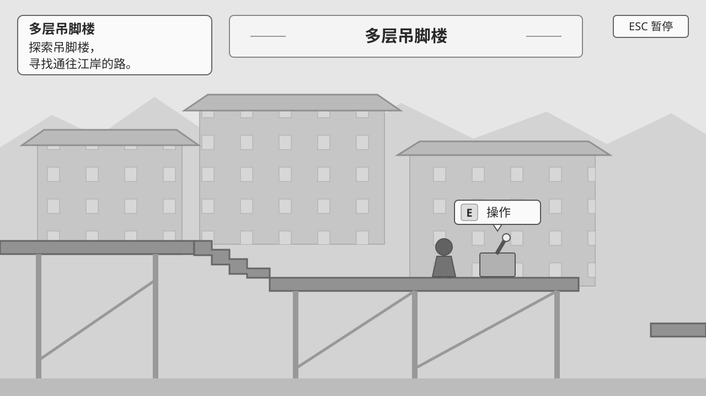
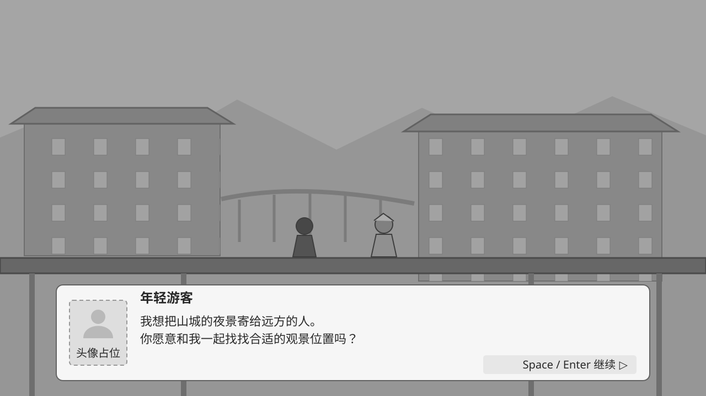
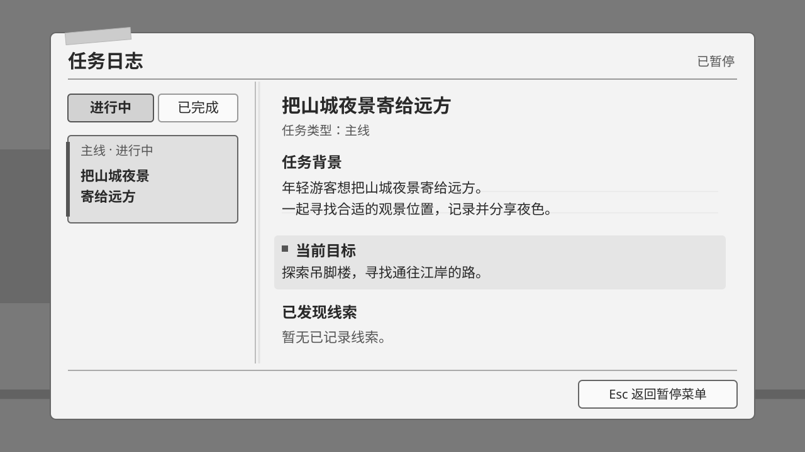

# 首关 UI 低保真线框设计方案 V0.1

| 项目 | 内容 |
| --- | --- |
| 当前项目名称 | 《坡坎之间》（中文当前使用名称 CONFIRMED；英文名称未确定，正式发行名称未冻结） |
| 文档状态 | PROPOSED，待负责人审查；本轮不新增 CONFIRMED 决策 |
| 日期 | 2026-11-15 |
| 适用范围 | 首关 MVP 的产品 UI 设计提案，不是开发任务卡或已实现功能清单 |
| 平台与画幅 | Web 浏览器、Windows；16:9，以 1280×720 为设计坐标，1920×1080 等比参考 |
| 交付 | 本文、正常游戏 HUD／NPC 对话／任务日志三张独立 SVG |

名称同步（2026-11-15）：当前项目名称为《坡坎之间》（CONFIRMED），英文名称未确定；旧工作名及历史记录按[当前名称决策](DECISIONS.md#project-name-pokan-20261115)追溯。本次仅同步项目归属名称，不改变本文设计状态、玩法或验收范围。 名称确认不改变本文 UI 方案的 PROPOSED 状态，三张 SVG 与现有方案内容不因改名重新制作。

本方案保留首关业务和控制规则，用轻量冒险 HUD 承载即时信息，用旅行手账承载任务记录与暂停导航。所有新增布局、文案、按键呈现、尺寸、配色、时长及菜单组织均为 PROPOSED；图稿是新建低保真设计文件，不是实际游戏截图、正式美术或游戏验收证据。

## 1. 依据与边界

### 1.1 已阅读与沿用的文档

| 来源 | 本方案采用的约束 |
| --- | --- |
| [AGENTS.md](../AGENTS.md) | 三窗口分工；单项审查；保留已有修改；本轮不启动开发、不 Commit／Push。 |
| [PROJECT_BRIEF.md](PROJECT_BRIEF.md) | 2D 横版探索冒险、虚构立体山城、Web／Windows 双平台；工作名未最终冻结。 |
| [DECISIONS.md](DECISIONS.md) | 视觉方向 B、首关空间方案 A、任务自动接取与追踪、PC-01／PC-02、暂停与恢复约束。 |
| [DEVELOPMENT_ROADMAP.md](DEVELOPMENT_ROADMAP.md) | 唯一开发任务入口。阅读时文首现行记录为 MLV-01A BLOCKED、MLV-01A-R1 READY、B PLANNED、D13 不启动；本文不领取、不更新任何任务状态。 |
| [HONGYADONG_LEVEL_DESIGN.md](HONGYADONG_LEVEL_DESIGN.md) | A 解放碑 → B 沧白路与洪崖洞入口 → C 多层吊脚楼下行 → D 下层嘉陵江岸；单线索、单机关、指定位置拍摄分享。 |
| [PLAYER_CONTROL_DESIGN.md](PLAYER_CONTROL_DESIGN.md) | 主动交互、单一主要提示、对话锁移动／跳跃、统一控制协调器、松键后重新跳跃、Owner／Token 暂停协议。 |
| [ART_DIRECTION_AND_SCENE_PROTOTYPE.md](ART_DIRECTION_AND_SCENE_PROTOTYPE.md) | 已确认的 2D 玩法＋2.5D 建筑表现＋手绘卡通；UI 材质、色板、字号等仍为提案。 |
| [QUEST_SYSTEM_DESIGN.md](QUEST_SYSTEM_DESIGN.md)（补充） | 了解委托并完成对话后自动接取；实时目标＋独立日志；不泄露答案；永久进度与幂等规则。 |
| [FIRST_LEVEL_GRAYBOX_SPATIAL_PROTOTYPE_V1.md](FIRST_LEVEL_GRAYBOX_SPATIAL_PROTOTYPE_V1.md)（补充） | 首关唯一综合空间提案入口；本文不另画地图、不冻结机关楼层或平台行程。 |

正式规则采用各文档最新有效条目，不以历史初始化段落覆盖后续记录。长期大型半开放方向不扩大本轮首关 MVP；文化收藏是长期方向，隐藏收藏、支线和旅行纪念册完整功能仍不属于当前必做范围。

### 1.2 冲突、实现差异与处理

| 核对项 | 差异或风险 | 本方案处理 |
| --- | --- | --- |
| 对话推进键 | 当前原型 `src/core/interaction.ts` 使用 Escape 关闭调查／对话；`src/platform/web/player-input.ts` 未接入 Enter。Phaser 文案仍显示“完成对话 · Escape”。 | 按本次要求绘制 Space／Enter 继续；标为待审输入呈现提案，不声称已实现。未来若获实施授权，必须把最后一页的正常完成接回原业务完成入口，不能在打开、翻页或压暗时接取。 |
| 暂停菜单与日志 | 当前读取的首关渲染与输入中未见本文所画的产品暂停菜单／独立任务日志；底层暂停协议已有正式约束。 | ESC 入口、菜单与日志返回链为本次 PROPOSED UI 组织；不是重新定义暂停协议，不把提示图当作现成功能。 |
| 原型答案直出 | 当前 `src/core/first-level.ts` 的线索／错误反馈含具体控制位指向；与本次“日志不直接泄露操作答案”的呈现要求有张力。 | 日志不直接复制这类原型字符串，只拟定已知信息的中性摘要，不改源业务／线索；实际摘要与原线索内容交负责人／Work 审查。 |
| HUD 色彩 | 美术文档给过浅色文字＋深色面板候选；本次希望清爽 HUD 和柔和浅色对话面板。两者都是未冻结细化方案。 | 本稿选择浅面板＋深文字作低保真比较，不修改美术主文或新增正式色板。 |
| 空间与真实地点 | 旧段落有上行 D／地点适用性待核对等历史说法；最新方案 A 已确认四区身份和总体下行。 | 使用现行四区名；不把平台具体方向、C3 机关摆位或现实精确路线画进 UI 规则。 |

未发现本次布局请求与已确认主线／通关规则必须互相替代的冲突。以上实现差异均只登记，不在本轮修改源码、测试、配置或正式决策。源码观察基于 HEAD `731ac55ccc1a58e659801fdb783127b56a4f09dc` 加本地已有改动的静态读取，不是运行验证。

## 2. 总体视觉与信息原则

### 2.1 两种协调风格（PROPOSED）

- 游戏内 HUD：普通卡通冒险风，轻量面板、清楚轮廓、少装饰。场景中的楼梯、木廊、机关、玩家与落点优先。
- 暂停菜单、任务日志、后续旅行纪念册：旅行手账风。用纸页、页签、少量胶带或邮戳表达旅行记录；装饰不承担唯一状态含义，不挤占阅读空间。
- NPC 对话：柔和浅面板连接两种语言，以说话者和正文为中心，头像只留灰块，不制作正式头像。
- 不采用科技面板、厚重 RPG 战斗 HUD、霓虹边框；不添加战斗数值或复杂物品系统。

候选色彩只供后续视觉比较；三张 SVG 全部用灰阶，优先审结构。

| 角色 | 候选值 | 用途 |
| --- | --- | --- |
| 暖米白／浅灰白 | `#F5F0E5`／`#F7F7F4` | 手账页／对话与 HUD 面板 |
| 深蓝灰／深棕 | `#293745`／`#483C32` | 正文与标题，优先清晰而非仿手写 |
| 橙黄色 | `#DDA441` | 当前目标或键帽的少量强调 |
| 青蓝色 | `#467D86` | 辅助分类／已知线索标记 |
| 暖红色 | `#A84E46` | 完成印章等特殊反馈，同时配“已完成”文字和勾形 |

字体建议：界面正文先用清晰中文无衬线（如系统 `Microsoft YaHei`／`PingFang SC`，通用 `sans-serif` 回退）；标题可用同族较粗字重。最终字体、授权与打包待确认，不要求新增字体依赖。手账感由纸页和结构表达，正文不使用难读手写体。

### 2.2 布局草案与取舍

```text
正常游戏：左上[区域／当前目标]    上中[短暂通知]    右上[ESC 暂停]
                     场景主体／关键平台／机关
                         [E 交互] 对象

NPC 对话：            可见但压暗的游戏场景
             下方[头像占位｜NPC 名称／正文／继续]

任务日志：        [进行中／已完成｜任务正文与已发现线索]
                           底部[返回暂停菜单]
```

比起给每类信息新增常驻框，本稿只保留一个目标区、一个短暂通知槽和一个交互提示。手账装饰集中到日志页，不给游戏 HUD 铺纸纹；日志不做未发现线索的问号格或收集百分比，避免暗示额外必做内容。

## 3. 图一：正常游戏 HUD



[独立 SVG](assets/ui-wireframes/first-level-hud-v0.1.svg)。1280×720，图中场景为布局示意，不是新地图或实际截图。示例状态为 C 区已接委托、尚未完成机关；上方“多层吊脚楼”表示刚进入该区的短暂标题。

### 3.1 元素与位置建议

下表全部是画面设计坐标，不是游戏世界／碰撞坐标；尺寸建议待实际画面验证。

| 元素 | 1280×720：x／y／w／h | 1920×1080 等比参考 | 显示与内容 |
| --- | --- | --- | --- |
| 左上任务区 | 32／28／352／108 | 48／42／528／162 | 区域名独立一行；当前目标最多两行，不长期堆任务背景。 |
| 右上暂停提示 | 1112／28／136／40 | 1668／42／204／60 | `ESC 暂停`；不放状态数值。 |
| 上中短暂通知槽 | 416／28／640／76 | 624／42／960／114 | 区域标题或事件反馈，单槽轮换，不叠成三层。 |
| 对象附近交互提示 | 随已选对象投影，建议约 156×44 | 约 234×66 | `E 交谈`／`E 调查`／`E 操作`，靠近才显示。 |

左上目标示例：“探索吊脚楼，寻找通往江岸的路。”目标随权威业务状态更新；开始提交请求不等于完成。未接取时显示当前引导，如“沿街巷前往沧白路”，不提前把游客委托登记为进行中。

交互提示只读现有系统选定的对象，不建立新的最近距离、轮盘、Tab 切换或多对象选择规则。离开有效范围即隐藏；对话、暂停、日志及既有控制限制不允许交互时不保留可操作提示。位置优先靠近对象上方，贴边时调整提示气泡自身、保持与对象的指向关系；不能移动对象、扩大交互范围或用提示遮住线索与落点。

### 3.2 临时反馈

| 情形 | 候选文案／形式 | 显示条件 |
| --- | --- | --- |
| 进入新区域 | `多层吊脚楼` 等简短区域名 | 现有区域进入结果；不是新增进度目标。 |
| 委托实际接取 | `新任务：把山城夜景寄给远方` | 对话正常完成且接取业务已确认成功。 |
| 机关成功与路线开放 | `机关已启动，通往江岸的路线开放。` | 两项结果均已实际成立时合并提示；仅一项成立时只写该项，不提前宣告。 |
| 错误可重试 | `装置暂未启动，可重新观察后再试。` | 已有失败结果；不显示正确控制位，不增加永久惩罚。 |
| 首关完成 | `夜景已分享 · 首关完成` | 全部前置与游戏内拍摄分享成功，不因仅抵达 D 而展示。 |
| 获得收藏品（后续） | `获得收藏：〈已获得物品名称〉` | 仅在未来批准且真实获得时复用通知槽；当前 MVP 不生成收藏品或收集目标。 |

短暂标题建议约 2 秒，普通结果约 3 秒，长任务名可延长至约 4 秒，均待验证。反馈按事件轮换，重复结果合并；重要结果优先于区域标题，区域标题不积压成迟到的跨区播报。对话／菜单覆盖时隐藏通知，恢复后只显示仍相关且未读的实际结果，不重播历史奖励或写入进度。计时按可见阅读时间处理是待审表现建议，不参与模拟时钟。

不加入血条、蓝条、武器栏、技能栏、常驻小地图、复杂背包、数值面板和常驻收藏品清单。

## 4. 图二：NPC 对话界面



[独立 SVG](assets/ui-wireframes/first-level-dialogue-v0.1.svg)。示例为 B 区年轻游客委托对话，正文是 UI 示例，不冻结完整对白或 NPC 姓名。

| 区块 | 1280×720 建议 | 1920×1080 等比参考 |
| --- | --- | --- |
| 对话面板 | x=102，y=518，w=1076，h=174；约 84.1% 宽、24.2% 高 | x=153，y=777，w=1614，h=261 |
| 头像占位 | x=126，y=546，w=104，h=118 | x=189，y=819，w=156，h=177 |
| 文本起点 | x=254；名称 y=550，正文首基线 y=592 | x=381；名称 y=825，正文首基线 y=888 |
| 继续提示 | 右下独立留白，正文下方 | 同比放大 |

面板用浅色底、深色字；背景建议叠约 25%—35% 灰黑遮罩，仍看见游客、玩家和建筑位置。压暗只是视觉处理，不自动申请模拟暂停。隐藏常驻任务区、交互气泡、ESC 暂停提示和临时通知，避免“对话内还能暂停／再次交互”的错误暗示。

名称使用“年轻游客”，不将旧候选人名确认为正式设定。正文建议每页 2—3 行、行距约 30 px；超出安全正文区就人工分页或换页，不缩小字号。首版可静态整页呈现，不要求打字机效果。头像只有灰框标“头像占位”，不承担人物身份的唯一识别。

### 4.1 输入与业务时序

1. 探索时由原交互系统选中游客，玩家按 E 主动开始；靠近只显示提示，不开启对话或接取。
2. 对话期间移动和跳跃锁定，遵守 PC-01；Space／Enter 只推进当前对话，不传给跳跃。一次有效按下推进一页，长按／键盘重复不跳过多页（呈现提案）。
3. 非最后一页显示 `Space / Enter 继续`；最后一页显示 `Space / Enter 完成对话`。不增加接受／拒绝或复杂分支选项。
4. 最后一页正常完成后才走现有对话完成／关闭的业务入口。任务仍由既有业务链自动接取；翻到末页、UI 按钮点击动画结束或面板出现本身均不是接取依据。
5. 对话中的 Esc 不触发暂停菜单。本稿建议对话内 Esc 不推进也不取消；这与现有原型 Escape 完成存在差异，需审查后独立安排实现，本轮不替换输入行为。
6. 对话完成不直接解除其他系统控制锁；由协调器判断是否恢复。沿用 PC-02：先松开跳跃键，再次按下才可起跳，最后一次 Space 不得落入探索跳跃。
7. 失焦、恢复清理、场景销毁等异常结束不当作“了解委托并正常完成”，不得补发接取；回到可用状态后按原会话规则处理，不用 UI 擅自续接旧输入。生命周期暂停与控制锁仍分别管理。

## 5. 图三：任务日志



[独立 SVG](assets/ui-wireframes/first-level-quest-log-v0.1.svg)。示例快照：已完成游客委托对话，正在 C 区探索，尚未实际观察 B 区线索；所以“已发现线索”为空，不渲染答案或未来线索槽位。

### 5.1 布局与导航（PROPOSED）

日志主纸页建议 x=80、y=52、w=1120、h=616；内部内容 x=108—1172，总宽 1064。左栏约 28%（298 px）、右栏约 72%（766 px，含页缝／内边距），以页缝分开。1920×1080 时全部乘 1.5。背景保留压暗的场景；底部明确 `返回暂停菜单`。

左栏为“进行中”“已完成”分类及所选分类的任务列表。首关仅放实际已接取主线；未接取时显示“尚无进行中的任务”，右栏显示“与旅途中遇见的人交谈，了解他们的委托。”这类通用空态，不预告未接取任务名称。已完成分类为空时显示“尚无已完成任务”。完成后按真实结果移入已完成，不是点日志即完成。

右栏依次显示任务名称、任务类型、背景说明、当前目标、已发现线索。正文左对齐，不将整篇居中；任务名称允许自然换行。任务类型示例为“主线”；不新增分类玩法。当前只读浏览，不设置“追踪／取消追踪”“放弃任务”、奖励领取或地图传送按钮。

鼠标用于菜单／分类／任务点击，符合既有设备分工；选择项使用边框、底色和文字状态共同标识。建议保留清楚焦点框、用 Esc 返回父菜单；键盘菜单导航的具体键位与焦点流待审，不新增 J 快捷键。

### 5.2 示例内容

| 字段 | 线框示例 |
| --- | --- |
| 任务名称 | 把山城夜景寄给远方 |
| 任务类型 | 主线 · 进行中 |
| 背景说明 | 年轻游客想把山城夜景寄给远方。一起寻找合适的观景位置，记录并分享夜色。 |
| 当前目标 | 探索吊脚楼，寻找通往江岸的路。 |
| 已发现线索 | 暂无已记录线索。 |

示例文本只用于布局与信息量检查，需与最终实际对白／目标逐项校对，不新增任务阶段或业务字段。

### 5.3 信息揭示与只读边界

| 玩家实际知道的内容 | 日志可显示 | 不可显示 |
| --- | --- | --- |
| 未完成委托对话 | 空任务列表 | 提前出现的主线详情、委托接取成功 |
| 已完成对话并实际接取 | 已知委托背景、当前业务目标 | 完整未来步骤、机关位置答案、未发现收藏总数 |
| 已在场景实际调查唯一线索 | 如“洪崖洞入口的图案似乎与装置有关”的中性摘要（示例待审） | “选择左／右控制位”、操作顺序、完整密码，或未来线索预览 |
| 尚未调查线索 | “暂无已记录线索” | 问号槽、暗示线索数量与位置的待发现清单 |
| 机关／路线结果已确认 | 已完成结果和当前可执行目标 | UI 推测的已成功或新增“必须先读日志”门槛 |
| 主线完成 | 已完成状态和已发生的旅行记录 | 点开即补发奖励、重放分享、清除永久记录 |

展示“已发现线索”必须有现有状态或可靠实际发现记录作为依据，不能从“已进入 B／C”“已接任务”推断。若当前没有可查询的发现依据，首版保持中性空态，列为后续实施前待核对项；本轮不为 UI 新增持久化字段、快照项或存档协议。记录缺失不反向阻止机关尝试，不新增“必须先调查”的硬门槛。

打开、翻页、选分类、滚动、关闭均只读，不产生任务／奖励／收藏／机关事件。任务目标与永久进度仍由原系统决定；恢复后重新读取有效结果，不把 UI 缓存当作权威进度。日志不要求玩家查看才能继续主线。

## 6. 界面状态、层级与暂停

以下是产品界面关系，不定义新的工程状态枚举、控制优先级或暂停架构。

### 6.1 可见性矩阵

| 界面情境 | 任务 HUD／ESC | E 提示 | 区域标题／临时反馈 | 对话框 | 暂停菜单 | 任务日志 | 模拟与玩家控制 |
| --- | --- | --- | --- | --- | --- | --- | --- |
| 正常探索 | 显示 | 隐藏 | 有事件时短暂显示 | 隐藏 | 隐藏 | 隐藏 | 正常模拟；控制按既有规则。 |
| 靠近可交互对象 | 显示 | 只显示现有已选对象 | 有事件时可同时显示 | 隐藏 | 隐藏 | 隐藏 | 靠近不锁定、不自动触发业务。 |
| NPC 对话 | 隐藏 | 隐藏 | 隐藏 | 显示 | 隐藏 | 隐藏 | 锁移动和跳跃；对话本身不新增全局模拟暂停。 |
| 暂停菜单 | 隐藏 | 隐藏 | 隐藏 | 隐藏 | 显示 | 隐藏 | 通过既有暂停协议停止模拟。 |
| 任务日志 | 隐藏 | 隐藏 | 隐藏 | 隐藏 | 内容隐藏，保留父级关系 | 显示 | 持续暂停，不因进入子页短暂恢复模拟。 |

背景压暗层在场景之上、当前模态面板之下；对话、暂停菜单、日志互斥。HUD 与对象提示可以同时存在；上中区域名与事件通知共用槽位，避免相互叠加。既有失败恢复／错误界面和生命周期暂停优先受原系统约束，不能用关闭 UI 绕过，也不在本稿重设计其界面。

### 6.2 状态切换

```text
正常探索 ──进入／离开有效交互范围──> HUD＋单一 E 提示／恢复普通 HUD
HUD＋E 提示 ──E 主动与游客交互──> NPC 对话
NPC 对话 ──Space／Enter 翻页──> NPC 对话（任务状态不变）
NPC 对话 ──最后一页正常完成──> 原业务完成入口 → 探索 HUD
探索 HUD ──Esc──> 暂停菜单
暂停菜单 ──点击“任务日志”──> 任务日志（持续暂停）
任务日志 ──返回按钮或 Esc──> 暂停菜单（仍暂停）
暂停菜单 ──“继续游戏”或 Esc──> 请求解除本菜单的暂停 → 允许时回探索
```

暂停菜单本轮不另交第四张图，建议用小型纸页中央显示“已暂停”“继续游戏”“任务日志”。不增加存档、重开、返回标题或退出等未在本轮设计的操作；既有异常界面／系统操作保持原规则。弹层的纸页语言与日志一致，不再铺满游戏 HUD。

### 6.3 不改变已有暂停与输入语义

- 暂停菜单／日志打开时，玩家、物理、平台运动、玩法计时与 SimulationTick 停止；菜单交互可用。不用 UI 自己的计时器推进游戏或补算后台时间。
- 仍经 Runtime Lifecycle Controller 的 Pause Reason Set 与 Owner-scoped Token、准确 Acquire／Release 协议请求暂停；不直接控制物理，不通过 CheckpointCoordinator 暂停。
- 日志是暂停菜单子页，转入／返回都保持暂停。关闭日志不能直接回游戏；菜单最终关闭只释放自己的暂停请求。仍有失焦、隐藏、最小化、恢复或其他有效 Owner 时继续暂停／锁定，不清空原因集合。
- 对话只采用既有玩家控制锁，不因视觉遮罩暂停全世界，也不以解除对话锁取代暂停令牌释放；若外部暂停发生，模拟按原协议停止，不推进对话或补发输入。
- 对话期间 Esc 不转入暂停菜单；任务日志 Esc 只返回暂停菜单，同一次按键不继续穿透到“继续游戏”。输入隔离和松键门槛须在后续实际实现中验证。
- Web 与 Windows 共用以上产品规则。浏览器原生 Esc（如退出全屏）与游戏按键的共存需实际验证，不承诺阻止浏览器原生行为，不将浏览器失焦误当对话正常完成。

## 7. 16:9 尺寸、可读性与避让

建议将上述画幅视为设计空间，按 `s = min(可用客户区宽 / 1280, 可用客户区高 / 720)` 等比适配，居中留边，不拉伸字形；客户区不含浏览器／Windows 标题栏。1920×1080 时 s=1.5；不是修改现有工程画布的授权。

| 内容 | 1280×720 建议字号 | 1920×1080 参考字号 |
| --- | --- | --- |
| 任务／日志正文 | 22 px | 33 px |
| 区域名／NPC 名称 | 24 px | 36 px |
| 日志主标题 | 30 px | 45 px |
| 键位／辅助操作文字 | 20 px | 30 px |
| 正文行距 | 约 30—34 px | 约 45—51 px |

建议左右边界至少 32 px、上下约 28 px；可点击菜单控件建议不少于约 44 px 高。任务名、正文不使用省略号隐藏关键信息；两行 HUD 放不下时先精简目标文案，详情留日志。日志长内容在右栏内部滚动或分页，返回按钮固定可见，不缩小正文，也不扩大窗口挤出屏幕。

不同客户区仍先保持整体比例；低于 1280×720 时等比缩小可能导致中文过小，需另验字体下限、正文分页与可用区域布局，不能声称所有小窗口自动可读。非 16:9 建议留边；手机触屏和任意超宽布局不在本轮交付承诺中。DPI 缩放需使用清晰文本渲染，SVG 可缩放不代表游戏文字已经通过高 DPI 验收。

避让优先级建议：玩家／落点／关键平台／机关与环境线索 > 可操作提示 > 常驻任务区／临时通知 > 装饰。对话时下方场景被遮挡属于模态阅读取舍；背景仍保持空间辨认。本稿不移动玩家、镜头、平台或机关来适应 UI。未来在 A—D 实际构图中检查；若左上任务面板遮住关键线索，优先缩短／收紧面板或提出局部位置调整，不掩盖问题或悄悄改地图。

状态采用文字、勾形、页签／边框共同区分；不能只靠红绿／橙蓝。灰阶稿采用深色字与浅实底，避免浅字落在高亮窗灯上；最终透明度与彩色对比需实机验证。动画只用于反馈，可考虑淡入淡出与减少动态表现，具体时长不冻结。

## 8. 首关实际使用场景示例

以下为依据真实首关流程编排的产品使用情境，不是本轮实际游玩报告；文案均为提案。

| 场景 | 可见 UI／操作 | 保留的业务边界 |
| --- | --- | --- |
| A 解放碑出生教学 | 区域“解放碑”；目标“沿街巷前往沧白路”；原教学对象附近显示 E 调查。 | 不提前接取游客任务；不新增历史卡或教学交互规则。 |
| B 入口全景展示 | 场景与建筑为主，区域标题短暂出现；镜头演出期间不额外引导玩家交互。 | 控制是否开放仍由既有镜头／控制协调决定，不用 UI 改演出触发。 |
| B 靠近年轻游客 | HUD＋E 交谈；按 E 开对话，底部面板／压暗背景。 | 靠近与打开对话都不接取。 |
| B 正常完成委托对话 | 最后一页 Space／Enter 完成后回 HUD；业务成功后显示“新任务”。 | 无接取／拒绝弹窗；UI 消失不等于业务成功。 |
| B 调查唯一线索后 | 在可靠实际发现依据存在时，日志增加中性摘要；HUD 不直接给机关答案。 | 不新增第二条线索，不把查看日志或调查记录变成解谜硬前置。 |
| C 单机关尝试 | E 操作；失败短反馈“可重新观察后再试”；成功后短反馈开路。 | 不透露正确项、不加惩罚；不更改唯一机关的判定与永久结果。 |
| C—D 平台乘坐 | 常驻任务仍简短，临时通知不遮住平台边缘。 | UI 不新增上／下车键；运行禁跳、站点对齐等按既有乘坐方案 A；具体安全范围仍待验证。 |
| C 探索时查看日志 | Esc → 暂停菜单 → 任务日志；返回后仍是暂停菜单。 | 世界与平台不在菜单期间推进，日志只读，未发现线索保持空态。 |
| D 下层嘉陵江岸 | 提示指定拍摄点的既有交互；仅在已知前置满足时显示拍摄相关当前目标。 | 到达不通关，主线已接取／机关成功／路线开放／指定位置／拍摄分享成功缺一不可。 |
| 坠落恢复后再看日志 | 从既有恢复完成结果重读已接任务、已完成目标与开放路线。 | 不要求重解已完成机关，不重发奖励，不重放临时对话；不承诺跨会话存档。 |

## 9. MVP UI 范围建议与后续扩展

“必须”在下表中表示本方案获批后的建议最小交付范围，不构成本轮开发授权，也不改写现有 MVP 验收或路线图。

| MVP 必须实现的 UI（提案） | 最小边界 |
| --- | --- |
| 当前区域＋简短目标 HUD | 一项当前目标、业务结果后更新、不泄露答案。 |
| 单一对象交互提示 | 只呈现现有选中对象；进入／离开范围显示／隐藏。 |
| 区域标题与短暂结果反馈 | 任务接取、机关／路线、可重试失败、首关完成；共用槽位、不长期挡景。 |
| NPC 对话面板与输入隔离 | 名称、头像占位、正文、继续／完成提示；原对话完成接取时机；锁移动／跳跃。 |
| 暂停菜单及日志入口 | 继续游戏／任务日志；接入既有暂停协议，保留其他 Owner。 |
| 只读任务日志 | 进行中／已完成、单主线详情、可靠已知线索或中性空态、返回暂停菜单。 |
| 双平台适配与可读性 | 720p／1080p、实际客户区／DPI、长中文、焦点与输入不穿透、关键场景避让。 |

| 后续扩展 UI（不进入本轮首关 MVP） | 限制 |
| --- | --- |
| 旅行纪念册完整页面、收藏卡插画与邮戳 | 延续手账语言；内容、名称、奖励与解锁另审。 |
| 收藏获得通知 | 复用反馈槽；先批准真实收藏内容，不凭 UI 增加必收数量。 |
| 正式 NPC 头像、打字效果、对话历史 | 不新增分支或改写任务接取时机。 |
| 多任务浏览／手动追踪 | 等任务规模与追踪规则确认；当前日志不加切换追踪按钮。 |
| 字号选项、更多窗口比例、键位重设、手柄提示 | 独立验证／安排，不把候选按键冻结为最终全平台映射。 |
| 城市地图／后续章节 UI | 不作为当前常驻小地图，不依据章节提案提前制作关卡选择。 |

血条、蓝条、武器／技能栏、复杂背包／数值与常驻收藏清单不属于本方案；后续扩展表也不暗示会加入这些系统。

## 10. 审查事项与验证记录

### 10.1 请负责人审查

1. 是否采用“轻量卡通 HUD＋旅行手账菜单／日志”的搭配，浅色对话面板是否合适；颜色、纸张／印章密度和最终字体继续待确认。
2. 是否认可三张布局、目标最多两行、日志约 28%／72% 双栏、底部对话约 84%／24% 的比例，以及 720p 字号建议。
3. 是否采纳 Space／Enter 继续和最后一页完成、对话内 Esc 不推进／不暂停的提案；其与当前 Escape 完成原型的差异须后续独立处理。
4. 是否采纳 Esc → 暂停菜单 → 日志 → 返回暂停菜单的入口链、不加 J、不提供任务追踪切换。
5. 日志示例文案是否与实际委托一致；已发现线索是否有可靠只读依据、哪些中性摘要可展示；不要复制答案型原型文本。
6. 当前稿是否足以进入下一轮 UI 原型；若批准，由 Work 在唯一路线图另行安排单项，本稿不下发开发提示词。

### 10.2 本轮验证边界

| 检查 | 状态 | 证据与范围 |
| --- | --- | --- |
| 正式文档／业务时序静态核对 | PASS | 阅读第 1 节来源；对照原型对话正常关闭入口与输入映射，差异已列出。不是运行测试。 |
| Markdown 引用与三张 SVG 文件结构 | PASS | Python 检查本文本地文件引用均存在、4 个代码围栏标记成对；XML 解析三张 SVG 成功，均为 1280×720／16:9，并包含标题与说明。 |
| 三张线框的 720p／1080p 静态渲染与目视检查 | PASS | Playwright 驱动本机 Edge 无头渲染，分别以 1280×720、1920×1080 等比显示三张 SVG，共 6 张截图；文本边界未越出画幅，目视未见当前示例文字裁切／面板相互覆盖。仅覆盖静态布局，不代表游戏集成；截图与 static-review.json 留在仓库外审查缓存。 |
| Web／Windows 游戏内 UI、输入、暂停和业务回归 | NOT RUN | 本轮未修改源码、启动游戏或运行游戏测试。 |
| 真实场景遮挡、动态镜头、长文本、多 DPI／小窗口 | NOT RUN | 待后续获批原型阶段验证。 |
| 负责人产品审查／Work 验收 | NOT RUN | 等待审查，方案保持 PROPOSED。 |

本轮只新增本文件及三张 SVG，不修改其他正式文档、源码、测试、配置或现有工程改动；不启动 D13、MLV-01 或任何开发任务，不 Commit／Push。交付后等待负责人审查。
