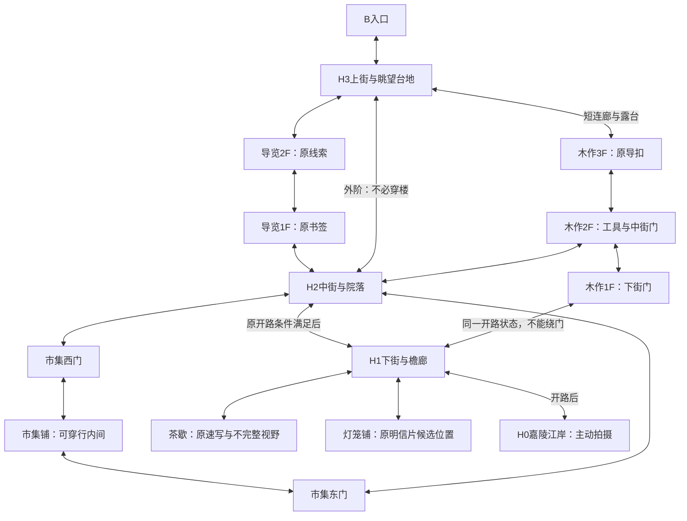
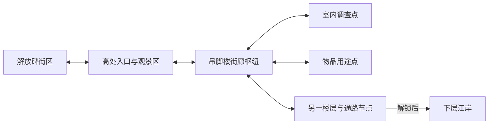
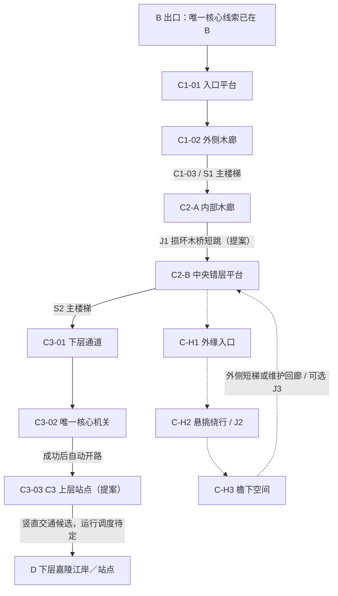

# Hongyadong Level Design

## 现行首章：2D 斜俯视山城探索（2026-11-19 后续重构）

本节为新首章唯一详细空间／节点设计。产品方向与主线叙事已 [CONFIRMED](DECISIONS.md#topdown-exploration-reboot-20261119)，两栋楼层数及本轮C区组合的明确确认范围另见对应记录；其余具体内部几何、房间／NPC／道具细节、未确认数量与时长分配仍 **PROPOSED／TO_VALIDATE**。文档设计不是已完成地图。下方横版 A—D、C 区 V2 和旧升降规则保留为 HISTORICAL；旧横版空间原型不再是新地图坐标依据。

现行设计工作入口（2026-11-21）：负责人认为当前街区缺乏重庆山城风味、探索欲望和可进入建筑，并要求继续纠偏。下方[整个C核心街区的空间与探索重设计](#c-exploration-rework-20261121)的组合范围已[正式确认](DECISIONS.md#c-exploration-rework-confirmed-20261121)：上中街提前自由探索、多门错层穿楼、C五栋可入建筑、下街与D仍按原条件开路。EXP-05A／B是已实现的技术原型事实，不代表产品空间获认可；具体几何、美术、道具摆位继续PROPOSED／TO_VALIDATE，不再把旧C几何全部保持复制为未来限制。当前只准备开发交接，未实施新地图。

### C核心街区：错层穿楼与探索闭环重设计

状态：组合范围CONFIRMED，具体通路几何／物件摆位／美术PROPOSED／TO_VALIDATE。负责人先要求继续设计，随后明确选择“采用整套方案，下一步准备开发任务”；确认依据与边界见[正式记录](DECISIONS.md#c-exploration-rework-confirmed-20261121)。设计记录见[EXP-06-PRE](DEVELOPMENT_ROADMAP.md#exp-06-pre-c-exploration-20261121)，首项交接仅见[EXP-06A](DEVELOPMENT_ROADMAP.md#exp-06a-c-district-rework-20261121)。本节是新C区详细方案主文，不另建平行地图；文档准备不等于启动代码实施。

#### 1. 真实问题与目标

核对基线main／HEAD `39245692e3e755d9ee192c51f57debd9e92afadf`：当前有13张地图，6室外／7室内；室外共35处建筑体块，仅导览、木作、茶歇、游客服务4栋设室内入口。新增3张楼层图仍属于原两栋楼。室外建筑中有摊位／亭廊等体块，35不是现实独立建筑统计，也不以全部可入为目标。当前上中下街区主要是分开的平面图，楼内大多原路进出；增加楼层后仍缺乏跨街连接、可预测的空间关系和调查后的世界变化。

纠偏目标不是再增加地图计数，而是让玩家能经历：在上街看到下方目标→判断入口所在楼层→穿楼到另一条街→调查物件并理解用途→开放下行路线／更短回程→从不同高度重新认识同一片建筑。重庆特色先落实在依坡建屋、层叠街道、屋顶邻街、穿楼出街、檐廊与江景高差上，再进行正式手绘美化。所有建筑与道路均为游戏化改编，不声称复刻现实洪崖洞楼层或真实通行设施。

保留斜俯视八向操作、A解放碑→B入口→C→D江岸与夜景委托、非战斗、原两栋3层／2层和选做收藏方向。玩家不需要跳跃、背诵重庆地理或靠反复跑腿完成主线；不减移动速度、不缩人物、不靠空路和强制等待凑30—45分钟。

#### 2. 地形与建筑必须属于同一张空间关系图

以下H3／H2／H1只表达相对地理高度，不是坐标、世界z轴或最终引擎层级；同一层室内外用相同高度记号。现有map ID可在后续复用，但不得把旧长方形街道仅改名字当完成重排。

| 高度与街区 | 地形组织 | 与建筑的候选连接 | 玩家获得的空间认识 |
| --- | --- | --- | --- |
| H3 上街／入口台地 | B出口后有前后街面、眺望缺口、沿坡转角和屋顶连廊；视野能看见H2院落及更低江景。 | 导览2F临上街；木作3F可经上部露台／短连廊回到上街。 | 在坡上，另一栋的三楼也可能与当前街面齐平；不是每栋楼都从1F进入。 |
| H2 中街／内院 | 依挡土墙形成窄巷、开敞院落与檐下街面；存在绕建筑的地面路线。 | 导览1F后门、木作2F街门、市集铺的两侧门面连接本层。 | 下楼后不是回到相同门口，而是走到此前看见的另一条街。 |
| H1 下街／生活檐廊 | 开路后可达，围绕真实建筑形成内外两条回访路线，能看清吊脚支撑与上方连廊。 | 木作1F下街门、茶歇、灯笼铺位于本层；外阶连接D。 | 上部走过的楼下有生活街面，回望能辨认自己的来路。 |
| H0 D江岸 | 沿用独立江岸主题及取景收尾，具体入口随C重排核对。 | 保留安全回程与原拍摄要求。 | 从高处远望逐步走到江边，而不是靠地名宣告到达。 |

以下拓扑落实已确认的组合范围，具体门面位置／连廊几何为试制。实线为双向通行；标注“开路后”的边受原unlocked控制。代码尚未同步，旧存档的历史准入仍须封闭校验，不能直接放宽旧格式。

市集两条边指同一H2地图上的不同门口，形成绕过一个街角的实用通路，不是进门立即回同一点。上街／木作3F连廊可早期自由回访，不作为新谜题；允许先找到导扣再查导览。临江边界与高差依栏杆、台阶、建筑基部和视野组织表达，不添加无解释空气墙。

技术边界：每个活动地图仍只有一个二维足部通行平面。高低交叠处以可辨的分区连接表示；画面里看见的下层道路在当前层只是远／中景，不能同时当另一层碰撞路面。若设计需要同一坐标上下两条独立可行走道路，须先拆分地图或重新评估，不偷偷引入z轴、三维物理或重写移动系统。

#### 3. 可进入建筑与门面合同

C区开放5栋有用途建筑的范围已确认：原导览2层、木作3层、茶歇，另将现有市集／灯笼铺体块各落实一处可走室内；具体内部陈设仍试制，不承诺整片所有门都可进。A游客服务小店继续保留，不拿它补C建筑数量。新增建筑不额外扩楼层，不新增强制支线、商业系统或NPC委托。

| 建筑 | 可进入空间及可操作用途 | 进出与发现回报 | 不应这样实现 |
| --- | --- | --- | --- |
| 导览楼2层 | 2F在窗边查看原楼层／江纹信息；1F实际走到阅览接待区及原书签。 | 上街2F进、中街1F出；两面入口能相互回到对应门口。先看到院落，再从楼内到达它。 | 只把note从一层挪二层，仍唯一入口原路上下。 |
| 木作楼3层 | 2F中街进楼，在工具／楼梯关系中定位3F门扣柜，绕屏风取得原导扣；1F通往下街。 | 3F露台回上街；开路后1F出口到下街，成为穿楼回访路线。 | 上楼提示直接写出物品答案，或从1F偷绕未开的下街门。 |
| 市集铺1层 | 从街角看到对侧出口或院落，穿过真实内间、货架与廊门，学会另一条横穿路径。 | 两个同层出口缩短绕街；回报是空间发现，不要求额外点击或记录永久“检查柜子”。 | 新建空矩形，仅一个“看看市集”对白。 |
| 茶歇1层 | 保留原速写选做收集、窗边驻足与不完整取景比较。 | 在房间中看见缺少的景物，帮助判断需要去更开阔的江岸；可回访。 | 只用文字宣布错误答案，或让收集速写成为通关前置。 |
| 灯笼铺1层 | 陈列台、檐下后窗与真实可拿的原明信片；原纸质纪念物可候选迁到这里。 | 沿下街发现门面，入屋找纪念物后在手账重看；不新增第4件收集硬指标。 | 宣称已经新增传统工艺知识／奖品，或无资料编造历史。 |

所有门面只用一致的三类表达：可入＝明确门洞／通路与靠近提示；暂闭＝能观察到理由，提示对应原开路关系；背景＝窗墙、封闭卷帘等，不画成与可入门完全相同的可疑门洞。确认范围与可入数量不能只存在于开发说明，玩家在画面中应能判断。门口提示不提前暴露房内物品答案。

**R05本轮确认补充**：每个门独立成对匹配，同一栋楼可有不同高度的多个门；从甲门进、乙门出时到乙门对应街面，再进乙门也回乙门室内落点。负责人已确认这项多出口解释／拓展；不能将“穿楼”解释为任意选地图传送，也不要求无缝室内外。R05历史原文与05B单出口实现保留，代码只在06A中受限同步。

#### 4. 三个调查动作如何形成探索欲望

仍沿用游客委托→调查／找物→用途开路→江岸取景的既有身份与3—4节点框架。本次先不增加钥匙链、多个维修任务、随机密码或新主线目标。

| 玩家时刻 | 可看见的信息与选择 | 实际行为 | 世界／信息回报 |
| --- | --- | --- | --- |
| 刚进入C | 上街缺口能看见下方院落、门面或连廊另一端，能辨认“可见但还没到达”。 | 选择外阶或导览楼进入中街，比较两条路径。 | 从另一高度抵达之前看见的位置，并能回望；不是做一次无反馈的绕行。 |
| 需要理解路线 | 导览实体图示把水波、楼层和下街门联系起来；未读前目标只提示可调查范围。 | 走到2F读原note，记录已知关系；可先去木作楼但仍需理解开路用途。 | 手账新增实际获得的信息；灯光／构图引导观察，不把完整答案写在未发现目标上。 |
| 在木作楼找物 | 从工具用途、柜台陈设和水波／山纹差异判断哪件物品相关。 | 从不同入口上3F，绕柜／屏风观察并主动收取原导扣；错误工具箱不扣物。 | 可持有、可理解的道具用途；不靠全屋无差别点击或“3F有答案”导航。 |
| 下街暂闭 | 现场江纹门／栏杆的实际样式与已知物件对应，隔着边界可看见后续街面。 | 满足原accepted／clue／item并在正确用途点主动完成操作。 | 原unlocked生效，外阶和木作1F同一封道开放；玩家能马上走过、回头并走更短路线，不能只显示成功文本。 |
| 自愿偏离主线 | 茶歇窗景、灯笼铺门面、导览1F书签有可见吸引物。 | 进入、调查或自愿拿原3件纪念物。 | 沿用原收藏图案／称号；零收藏仍可完成夜景委托，不承诺文化资料已核验。 |

C区每一段较长步行都应通向新视点、入口、路线选择、信息或物品用途；没有这些用途就缩短路径，不追加空铺面。候选内容仍不足以证明30—45分钟，后续必须邀请未参与开发的新玩家记录真实行为与时长。

#### 5. 门槛、回访与失败保护

已确认**H3上街与H2中街早期可探索，H1下街和D仍需原开路条件**。这是对05A／B“middle也需unlocked”的明确产品变更，不能据此放宽旧档的历史校验。导览两层、木作三层可早期调查，但所有通向H1的外阶、1F门口、外缘通道共享同一原unlocked条件；不能从屋顶／另一室内提前穿入下街。

实施用途点设在H2中街通往下街的封道前，沿用唯一 `gate` 调查／用物身份；未接任务、未读线索或未持导扣时均可走到该点，得到原对应反馈，满足原accepted／clue／item后正常完成操作才提交unlocked。木作1F下街门只读取同一unlocked，不复制第二个开路操作／奖励；未开时可从楼内观察封道理由、原路返回，不把用途点放在门后造成死锁。坐标留06A试制表验证。

不新增永久“捷径已开”字段：本轮先以现有开路状态同步开放需要门槛的出口；市集同层穿行与上／中层两条路线从一开始开放。不会因错误用物、未收纪念、取消调查或离开建筑失去唯一必需物；菜单、后台与触控清理继续沿用现有协议。

旧进度／照片／三纪念物与奖励身份保留；不要求已完成玩家重解或重领奖。未来地图重排允许改变试制几何，不能同名safe换到墙内／未开放区域，也不能为保坐标破坏整体设计。实现前必须列旧31安全点→新版安全点的语义／门面／准入映射，旧版本白名单保持封闭、旧键原文不动、坏较新档不静默降级；新地图与中层准入变化须用新版档案校验，不放宽旧05B格式。具体版本名、坐标与技术改动由受限实施卡确定，本轮不创建新档或修改源码。

#### 6. 验收先看玩家行为，不以图数代替产品结果

1. 不读开发说明也能辨认上街／中街／下街关系；至少两处画面能同时读到相邻高度与连接去向。试玩中问玩家“刚才那栋楼与这里什么关系”，记录真实回答，不预先教答案。
2. 玩家实际完成导览2F→1F→中街，以及中街→木作2F→3F→上街／开路后1F→下街两种跨层穿楼体验，每门成对回程，无错误传送或未解锁绕行。
3. C区已确认的5栋均有真实室内与上述用途，前场可见门面和游戏实际入口一致。所有背景建筑不要求可入，但不能与可入门同样误导。
4. 至少有一次玩家从远处看见可达目标、主动尝试另一入口并发现新视点；至少一次调查／取物导致可以实际通过的路线变化。自动化只证明操作与状态，探索欲望须独立试玩评审。
5. 保留零收藏通关、取消不提交、奖励幂等、原存档保护；键盘与触屏模拟分开记录，真实手机缺失继续NOT RUN。
6. 程序化灰阶／基础材质阶段也必须看出依坡、错层门面、吊脚支撑、石坎与木廊关系。若仍只是同高矩形房屋排成一行，空间评审FAIL；不靠换一张精美背景或地名标签补PASS。

#### 7. 分阶段实施建议与确认范围

EXP-06-PRE设计整理完成，组合范围已确认；06A首项任务卡准备完成但未启动，先交“整体C空间／五建筑／穿楼与回程”，再单独深化环境线索／找物用途／探索反馈，最后才推广正式美术。06A复用现有调查、物品、收藏和开路业务，五建筑必须已经能走／调查／取原物并完成原主线，不能交空屋留给06B填；06B提升可见线索与判断表现，不接管06A的必要业务接线。两阶段都在同一普通H5入口中可操作，不另做与主线脱节的展示庭院。

负责人已一次确认组合方案，无需重复确认相同范围。详细坐标、连廊尺寸、门面绘制与原明信片迁位由06A按预算试制、交Work与负责人评审，不变成最终美术／文化内容冻结。未来若需新永久进度、额外谜题、第三个重点楼宇或三维物理，仍须另报；不因当前READY自动扩到下一任务。

### 1. 空间必须支持的体验

玩家可以沿地面八向行走，穿过街巷、进入门后室内、返回对应门口、在已开放楼层自由调查，再根据线索使用道具开通去向。场景中的墙、门、桌柜、台阶与楼层通路对应真实通行／阻挡，不是只放文字标签或背景立面。

一个“完整探索场景”指本首章关卡体验，可由多个室外分区与室内小地图共同构成；不等于一个渲染 Scene。主线 30—45 分钟为完整内容目标，技术小样和比赛短版分别记实际长度，不能通过走慢、反复跑腿或等待补齐。

### 2. 四区与室内组织候选

| 区域 | 室外可玩空间与地点身份 | 可进入空间候选 | 功能与目标时间（非强制计时） |
| --- | --- | --- | --- |
| A 解放碑城市序章 | 明确纪念碑轮廓、广场、商业街、连接街巷；玩家能围绕街面活动，沿街有可接近的入口，不把一个小碑与地名当整个区域。 | 一处街边游客服务／明信片小店，作为交互教学候选；不虚构纪念碑本体内部可入。 | 认识八向移动／交互、观察环境、建立旅行目标；约 5—8 分钟。 |
| B 沧白路／洪崖洞高处入口 | 路口、观景平台、入口街廊，能读到楼群、落差、桥水方向；不是紧贴出生点的一个 NPC 台子。 | 入口服务小屋或沿街商铺可作为资料点候选，数量不冻结。 | 与年轻游客建立主线、获取第一组路线信息；约 5—8 分钟。 |
| C 吊脚楼核心街区 | 开放街廊与楼层枢纽，包含至少两处可先后调查的入口；用场景切换／楼层通路表达山城高差，不以横版跳台串联。 | 商铺内间、木作／维护工作间、檐下休息室等 3—4 处候选；每处有真实行走、调查或用途，避免重复空房。 | 调查、找物、推理用途、解锁楼层／江岸路线；约 15—20 分钟。 |
| D 下层嘉陵江岸 | 升降／楼梯通路出口、沿江步道、桥景取景面、对岸／建筑倒影；与高处街区有清楚地理关系。 | 江岸小亭／服务间只在确有用途时加入，不为数量造房间。 | 根据已有信息找到取景／会合位置，完成故事与奖励反馈；约 5—9 分钟。 |

时间合计约 30—45 分钟是设计预算，不是实测。完整首章可先按 4 个室外主题区域、约 4—6 个有用途的室内／局部地图、少量 NPC 与收藏分布估算；数量全部待内容原型验证。工期缩减优先减少无用室内、重复委托和装饰，不把所有建筑退回背景板。

#### EXP-01 试玩后：核心街区扩建预算（2026-11-19）

负责人已明确选择“认可视角和操作，重点扩大街区与探索内容”。这确认斜俯视八向／门口进屋可以继续，不代表认可现有小地图规模、画面或完整首章。源码中 EXP-01 室外可活动范围为 1000×355、室内 670×340，逻辑画布 1100×650、固定镜头；它是单庭院技术样本，不是完整洪崖洞片区。

下一项 [EXP-02A](DEVELOPMENT_ROADMAP.md#exp-02a-core-district-20261119) 将先制作 C 核心街区；完整 A 解放碑→B 高处入口→C 楼层探索→D 江岸顺序保留，不把 C 开发入口说成首章出生点已经迁移。以下是 Work 的 **PROPOSED／TO_VALIDATE 工程预算**，不是新增正式决策：

- 上层街廊与下层街廊两张相连室外图，每张按约 3 个当前视口宽、2 个视口深起步（当前画布下约 3300×1300），采用跟随镜头、边界约束与固定屏幕 HUD。场景转换表达地理楼层连接，不增加重力平台跳跃或任意楼层穿行。
- 三间独立可走室内：导览／线索点、木作／关键物件用途点、可驻足的茶歇观察点；前两处参与主线，第三处选做，不加收藏／成就的强制通关条件。具体名字、谜题、几何和陈设属于试制。
- 室外有沿街门面、可辨认路口、前后街廊连接、能回访的观景位置和解锁后的短连接；可开放空间允许玩家先调查不同入口，不以一条窄长走廊或自动导航线替代自由探索。大量不可进入背景建筑不计入可玩地图规模。
- 保持人物尺寸、逻辑画布和基准 zoom，不通过缩小人物、拉远镜头、减慢步行或增加空路伪造规模／时长。每处室内、转角与开放路线都应有可观察／可决策的用途，暂不精修所有资产。
- 本段试制可按首次体验约 10—15 分钟安排内容预算，但必须记录真实新玩家时长，不能把预算当验收 PASS。完整首章 30—45 分钟仍由 A／B／C／D 内容共同支撑；不要求本卡独自补齐整章。

实现任务、白名单、存档版本与测试要求仅在路线图维护，本节为唯一空间预算来源，不再创建另一份首关地图文档。

#### 重点建筑内部多楼层（EXP-05B，2026-11-21）

负责人已[确认两栋建筑分别3层／2层](DECISIONS.md#building-interior-floors-20261121)。这是建筑内部楼层，不能拿C街区上中下层抵数。本轮推荐在已有木作间、导览店上增量制作，以下具体配置 PROPOSED／TO_VALIDATE，不新增一套首章地图方案。

| 试制建筑／楼层 | 实际可走空间与用途 | 主线关系 |
| --- | --- | --- |
| 导览楼1F（原guide） | 保留入口、阅览接待、原书签与门口，增去2F楼梯；通过环境和楼层牌识别去向。 | 不新增强制接待步骤。 |
| 导览楼2F（新增） | 两个可走功能空间：阅览区／楼层纹样导览区，桌柜或隔断形成实际行走／视线关系。 | 原note迁到本层，正常完成调查才取得原clue，取消不提交。 |
| 木作楼1F（原workshop） | 原工作台与入口保留，新增楼梯与可选楼层用途牌。 | 只介绍建筑组织，不新设接任务／开楼梯条件。 |
| 木作楼2F（新增） | 工具存放、整理台与纹样观察位；有不同的上下楼口和绕柜通道。 | 可观察山纹与水波对应物件，不成为新增必读标志或第二份通关答案。 |
| 木作楼3F（新增） | 储物与门扣柜两个区域，柜台／隔断真实阻挡；错误山纹工具箱可看但不扣物，水波导扣可按已有信息辨认。 | 原plaque及唯一item迁入此层，仍属原找导扣节点，不新增独立机关／永久ID。 |

每层为可实际八向行走的室内图，楼梯用现有主动交互成对切换，显示建筑名／楼层。先不做连续3D楼梯、剖面同时模拟、屋顶跳跃或建筑高层直通外街的新增捷径。角色／镜头／移动和碰撞算法不变；新3层地图先按约1100—1320×800—900试制，包含功能空间和家具阻挡，不复制三个空矩形。既有两栋1F尺寸、碰撞几何、外部门口与旧safe保持；只增加楼梯／位置标识，移除会假冒已迁主线对象的旧绘制。

原note／plaque各保留一个真实交互目标，移到导览2F／木作3F；已读线索／已拿导扣旧进度不取消、不要求重新完成，正常新局必须实际走到目标楼层。新楼层在接委托前也可探索，不把新楼梯错误套用街区unlocked；原江纹门与下层／江岸准入不变。书签等原3件选做纪念仍在原处，不借本轮扩收藏。

旧10图／25锚点身份保留；追加3个室内图、3对楼梯和6个对应楼梯安全落点，预期共13图／31锚点。每次上下返回对应楼梯口，进出整栋楼仍回原外部门口；刷新从已验证楼层安全点继续。新键与封闭旧格式迁入只在路线图说明，旧25／19／12白名单不因新楼层扩大。此为新玩法空间试制，不等于完整章时长或最终美术；[单项实施卡](DEVELOPMENT_ROADMAP.md#exp-05b-building-floors-20261121)是唯一开发入口。

实施核对（2026-11-21）：上述导览2层／木作3层已按有限预算实现，新增三图均1320×900，家具隔断可绕行、楼梯成对往返，未接委托可探索并刷新继续；原note／plaque仅迁层、未生成第二身份。木作3F玩家在屏风左侧距导扣约62px时被真实视线及足部阻挡，绕到南侧可正常拿取；错误箱／用途牌／纹样观察不加主线门槛或进度。Work功能技术复核PASS，证据见[审查](DEVELOPMENT_ROADMAP.md#exp-05b-work-review-20261121)。这是可玩楼层与用途验证，具体房间／美术仍PROPOSED／TO_VALIDATE，不将工程落地升级为最终设计或30—45分钟体验成立。

#### 地图与玩法优先：三层街区／独立江岸骨架预算（EXP-05A）

负责人2026-11-20明确要求继续开发整体地图骨架与玩法，界面美化后置。当前可玩首章已有A／B、C上下两层、四间实际室内与拍摄闭环，但D取景仍混在下层街巷。下一项先验证完整空间连接，随后再深化已有调查／用途节点；不把增加地图张数、空路或自动化通关时间当30—45分钟内容成立。

以下为Work受限工程试制预算，均 PROPOSED／TO_VALIDATE，不批量确认新剧情、最终坐标／美术或新增主线门槛：

- 保留既有A、B、上层、下层与四室内的尺寸、建筑阻挡、门口和主线对象；新增约3300×1500的中层与约2600×1500的独立江岸，实际预算可在相同量级内按可玩路径调整并报告。保持1100×650、zoom=1、角色尺寸／移动速度／碰撞算法，不靠镜头或慢走造规模。
- 中层不是一条过场走廊：围绕真实阻挡的建筑内院形成内侧廊／外缘廊两条可走路线，至少三个可辨路口、一处可驻足的观察空间，两端上行口与下行口区分，允许绕行、回望、误入后返回。两个可选调查对象只说明当前位置／建筑关系与去向，不追加开门答案、永久进度、主线条件或文化历史断言；不能以调查对话替代实际通行空间。既有四室内仍可正常进出，不为数量造空房。
- 原上层东西下楼目标改为抵达中层；下层东西上楼目标改为回中层，新增成对连接补齐三层，两条旧直达连接不留成绕过中层的隐藏传送。全部下行仍服从原开路状态，无新机关；原主线调查、导扣、开路与选做收藏身份保持。
- D独立江岸包含到达平台、沿江步道、桥景开阔面与安全回程；河面真实不可行走，栏杆／挡墙和入口对应实际几何。正确 `view` 取景目标迁到D，原下层 `window`／`photo-eaves` 保留比较作用。旧下层取景附近变成明确的江岸通路入口，不让两个地图同时保留可完成同一拍摄的目标。这里只用必要样块／地标轮廓表达路线，不开展菜单、角色或最终美术精修。
- 原19个安全锚点保持原含义和坐标；增加中层四个成对落点与D到达／取景安全点，均要可返回且不贴墙、落水或立即触发反向切图。旧完成档不取消照片／奖励，也不强迫重做；旧下层 `overlook` 仍是旧位置，新增D取景另用新ID。内容版本／键隔离与封闭旧档校验由路线图规定，不通过扩大旧白名单实现迁入。

本项只验证骨架与路线选择。后续候选是深化现有室内调查／物品用途与开路推理，仍以既定3—4个节点和选做收藏为边界；具体谜面、房间和文化内容须另设计，不自动授权下一任务。唯一任务入口见[EXP-05A](DEVELOPMENT_ROADMAP.md#exp-05a-spatial-backbone-20261120)。

实施补记（2026-11-20）：EXP-05A已按上述试制预算实现10图／25点／41目标、三层连接、两条中层可走路线与独立D拍摄；原8图几何、19旧锚点和四室内保持。Work功能技术复核PASS，详见[审查](DEVELOPMENT_ROADMAP.md#exp-05a-work-review-20261120)。本次实现不把预算升级为最终空间／美术决策；未确认负责人地图满意度、真机和完整章时长。

#### A／B 前段接续预算（EXP-02C，2026-11-19）

负责人要求按上一轮单项实施／跟踪／审查继续。Work 将下一项落到现有 N1：真正从解放碑出生，经商业街／过渡街巷进入沧白路与洪崖洞入口，在 B 与同一年轻游客正常完成对话后接取委托，再进入已有 C 街区。此为既定地点与叙事的工程试制，不批量确认新谜题、最终资产或物理参数。

| 试制空间 | 可操作内容与地点身份 | 初始工程预算（PROPOSED／TO_VALIDATE） |
| --- | --- | --- |
| A 解放碑城市序章 | 围绕浅色纪念碑基座活动的城市广场、连续商业步行街、连接山城街巷的出口；有地灯／花坛／座椅／现代立面与自然可读的去向。地标轮廓参考人民解放纪念碑的柱体／钟面／收束顶部，不能画成教堂尖塔，也不能只摆一块写地名的小牌。 | 室外约 3300×1500，保持当前 1100×650 逻辑画布／zoom／角色比例；广场、商业街与过渡段均有实际地面延伸，不靠放大空地凑面积。 |
| A 游客服务小店 | 门口主动进入的一间独立室内，可走到柜台／导览板学习调查与方向信息，返回对应门口。不是纪念碑内部，不增加购买、货币、必须接取的支线或强制教程计数。 | 一间约 1100×650 室内；功能为可选调查／操作教学，绕过它仍能走主线。 |
| B 沧白路／洪崖洞入口 | 有可驻足高处观景平台、栏杆、江桥方向与下方吊脚楼群；街面与通往 C 的实际入口连续可辨，游客位于这里。不是再复制一张普通木廊图加地名。 | 室外约 2200×1300；A↔B↔C 上层为成对、可回访连接，地理比例游戏化，不冒充现实精确步行路线。 |

游客沿用同一内容身份与原取景目标，只移动到既定 B 区，不复制第二份委托／奖励。A 教学不恢复横版跳跃考核；八向走动与主动交互即可。原 C 两层／三室内、取物／开路、取景与纪念卡不改谜题／几何。

新局使用新增的解放碑安全点；旧 C `arrival` 等锚点含义保持，不能改写同名锚点让旧档无提示换地点。合法旧 02B 档保留已获卡片／开路／位置，可自愿回访 A、B；旧未接委托而停留 C 的档案须有清晰、可通行的回 B 路径，不因游客移位变成死局。具体版本保护／测试只见路线图 EXP-02C。

既有 A-01 候选 PNG 仅参考地标形态／暖夜街区语言，不直接作为斜俯视地图、不整图贴底替代可走场景、不改写该原图状态。本卡补足前段可玩骨架；D 正式江岸、最终美术、文化收藏／全成就和完整首章时长仍不由此自动验收。

2026-11-20 实现核对：以上三个受限空间已由 EXP-02C 接入，同一游客在 B，原 C 五图／12 安全点／19 个其他旧目标保持；新局 A、旧档原安全地点分开处理。Work 功能技术复核 PASS，证据与未覆盖范围统一见[路线图审查](DEVELOPMENT_ROADMAP.md#exp-02c-work-review-20261120)。地图像素、样块美术与首章时长仍不是正式设计冻结，不能据本次功能通过认定地点观感／完整章验收完成。

### 3. 主路线与自由探索如何兼容

图仅表示候选连接关系，不是最终地图或必须新增的对象清单。A—D 是旅行主题顺序，节点局部允许回访、先观察后领取任务或先进入已开放房间；不能把“自由探索”实现成只有一条路、一扇当前可点的门。入口信息和进度反馈应让玩家知道哪里已调查、哪里还缺什么，而不是把答案一直用导航箭头指到脚下。

锁定通路由真实门／楼层连接权限表达，不靠不可解释的空气墙。通行前置必须能被发现，错误操作可恢复，不消耗唯一关键物品造成死局。D 与 C 的高差用楼层和地理关系表达，不能简单把屏幕 y 值更大称作“下层江岸”。

### 4. 3—4 个主线节点草案

负责人已确认沿用《把山城夜景寄给远方》：帮助年轻游客找到取景点，通过室内调查、找物与开路推进。下面给出可进一步细化的具体玩法候选；“手绘导览／缺页／通行牌”等是游戏原创道具，不当作现实景区设施或真实文物，仍需内容评审。对话不是唯一内容，每节点都必须有可操作的空间与对象。

| 节点 | 玩家做出的判断／行动 | 信息与用途 | 完成后的变化 |
| --- | --- | --- | --- |
| N1 街区识路与委托 | 在 A 的广场／商业街认识路标与交互，到 B 和游客正常完成对话，接受寻找包含桥、江水和吊脚楼夜景的取景位置这一目标。 | 候选：游客便笺的店招图案与现场路标相符，帮助辨认进入核心街廊的方向；不需要玩家预先熟悉重庆现实道路。 | 记录已知取景要求与可调查地点，不直接用箭头指完所有步骤，也不靠近即自动接取。 |
| N2 室内调查与找物 | 进入一间真实商铺／工作间，依据室内标记与对话找到手绘导览缺页或楼层通行信息，再带回街廊核对。 | 候选：窗边示意／木柱符号提示查看哪处柜台；物件有“为何需要、可能用于哪里”的说明，避免满屋无差别翻找。任务道具与可选文化收藏分开。 | 新线索与关键物品可读，允许玩家先调查另一处开放入口再回来，不把离开房间当任务失败。 |
| N3 用途推理与通路 | 将导览信息与街廊楼层／入口标记对应，在正确位置使用通行牌或完成有依据的维护互动，开通下层路线。 | 候选有两处可调查入口，其中正确用途能由已发现信息判断；错误只反馈缺少何种信息／用途不符，不消耗唯一道具或让玩家穷举密码。 | 解锁对应楼层／江岸通路，永久状态保存；具体是门、楼梯连接还是交通设施待构图验证，不强搬旧双吊臂谜底。 |
| N4 江岸定位与收尾 | 到达 D 后对照游客要求观察几个取景面，找到同时能读出桥、水和吊脚楼夜景的位置，主动拍摄／分享。 | 拍摄判定由实际位置与主线阶段决定，不靠多拍次数或固定等待；分享仅游戏内表现，不对接外部社交网站。 | 完成主线、生成旅程纪念反馈并领取一次成就；仍可回访已开放地点，不要求先全收集。 |

上述节点内容和名称是候选，不把四行表格当已经提供 30 分钟玩法。后续每节点必须补“可见线索、可调查对象、物品用途、错误反馈、状态变化、提示分级、预估体验”并以真实新玩家试玩验证；只写对白或把物品分散很远不算充实内容。

#### N4 的下一段试制：取景调查与游戏内纪念卡（EXP-02B）

负责人已要求按上一轮单项开发／跟踪／审查流程继续；Work 将本项作为 N4 的受限内容实施，不将下列工程试制升级为全部正式章内容或美术验收。复用 EXP-02A 两层街区／三室内和已开通路线，不另扩地图；A 解放碑出生与 B 委托入口尚须后续独立接入，不把当前 C 专用入口称作首章出生点。

- 已知要求仍是游客提出的“桥、江水与吊脚木楼同框”。下层布置三处可接近、可调查的候选视野，分别通过屋檐遮挡、窗廊与江岸开阔程度体现取景差异；至少一处满足要求。具体地点名、相机构图和物件外观为 PROPOSED／TO_VALIDATE，游戏化改编不冒称现实景区最佳拍摄点。
- 每处候选应在实际场景或取景预览中明确看见建筑／水面／桥的构成与遮挡，不用“此处错误／正确”的标签替代画面。观察后可记入简单线索记录，但不在未调查前展示各处答案；可以从不同顺序接近，不强制看完三处才允许成功拍摄。
- 玩家主动调查、对照要求，再明确点击／触屏拍摄；靠近、打开／收起预览、已找到取景面和暂停恢复都不自动完成拍摄。错误拍摄说明当前缺少的画面要素，不扣次数／消耗唯一物件／强制等待；线索与场景支持判断，不靠穷举密码或拍照次数。
- 正确拍摄后给一次游戏内“夜景寄给远方”纪念卡／故事反馈，可重新查看、收起后继续走动；不调用真实相机、不接外部分享／上传、不加货币或复杂成就系统。纪念卡只代表本段街区委托结果，不是整章 A—D 已完整实现。
- 记录已发现的取景信息、已完成拍摄及已领取的单次纪念反馈；刷新后可以重看，不重复发放。保留旧开路／调查进度，旧版找到观景点不等于新拍摄成功。具体存档版本保护和实施边界见路线图，不因本段规划宣称新功能已有代码。

本项不以新增三处驻足点承诺 10—15 分钟，更不以此声称完整章 30—45 分钟；下一次内容判断依据真实观察与操作体验，避免继续靠地图面积或作者通关时间估计。

实施补记（2026-11-19）：EXP-02B 已交付檐下遮桥／花窗缺木楼／江边同框三处取景、主动拍摄、已知记录和一张可重看的游戏内纪念卡，Work 本任务功能技术复核 PASS，详见[审查记录](DEVELOPMENT_ROADMAP.md#exp-02b-work-review-20261119)。原街区几何／连接／安全点和移动函数保持，实际构图仍为工程试制；负责人体验／最终美术、真机及整章时长未验收，不将本段限定结果扩称为整关完成。

### 5. 室内／楼层切换合同（产品层）

- 门口主动交互进入；进入后是可控制人物和可调查物件的小地图。离开时回到原门的安全落脚点，不回到整个章节出生点。
- 出入口成对，记录入口／目标／返回点，不用玩家瞬时速度冲出边界后再猜返回位置。切换只由一个权威协调过程推进，未装配完成时不接受世界交互，结束后清理旧地图自有监听／碰撞并安全恢复操作。
- 主线、已得道具、收藏、奖励与永久开门状态跨室内／楼层保留；不是每次进门新开一局。可以先调查可用对象，进度准入由主线条件决定，不把所有内容锁在一次 NPC 对话后。
- 角色不是穿越真实三维空间；新地面坐标与旧重力 y 不混用。所有门口、任务物件与保存安全点都要在实际地图可通行范围内验证。
- 不先做全城无缝、自动寻路、任意楼层同时物理模拟或通用插件加载器。

### 6. 收藏、成就与文化表达

候选收藏放在有观察意义的房间角落、展台或街区视线外缘，不靠像素碰撞或反复刷图。可先考虑山城风景明信片、建筑纹样拓印、地方饮食手记、桥景照片等游戏内容；真实文化名称、图案与说明必须另查资料，不虚构文物／历史年代或将原创维护机关说成现实设施。具体 6—8 件收藏／3—4 项成就只是预算建议，不是负责人冻结数量。

纪念册／图鉴点亮、称号、故事或装饰性反馈提供发现价值；没有货币、交易、武器和属性成长。收藏选做，主线道具可被任务读取；不能为文化收藏设置第二套强制通关条件。详细身份／幂等见任务文档，存档不把已领取奖励重发。

候选物件举例（仅内容设计标签，不是已建业务 ID／已制作资产）：

| 候选收藏 | 地域表达／发现动机 | 边界 |
| --- | --- | --- |
| 解放碑夜景明信片 | 序章街区的旅行纪念，记录地标与城市生活。 | 用原创游戏画面，不复制在售明信片或名家作品。 |
| 吊脚楼构件纹样记录 | 在可进入工作间观察木构细节，形成图鉴页。 | 是游戏里的观察记录，不引导对现实保护建筑拓印／拆取。 |
| 小面风味手记 | 商铺中的地方饮食内容与居民生活。 | 不增加烹饪玩法；真实介绍与配图需另核资料。 |
| 江岸桥景照片 | 取景和回访时发现不同观察位置。 | 是游戏内纪念，不保存或上传玩家现实照片。 |
| 石阶巷口速写／原创店招印记 | 鼓励进入旁侧安全视野或细看街面，不强制遍历每个角落。 | 不复制商标，不把原创店招写成真实历史招牌。 |

成就可先按“完成首段室内调查”“首次开启新通路”“完成夜景委托”组织反馈，另有收藏阶段成就候选；名称、数量、图标和阈值全部 PROPOSED。不能用高额奖励或强制全收集补主线内容不足。

### 7. 设计验收

先看新方案能否让玩家自由行走、进入实际房间、根据线索找到并使用物品、回街廊后看到路线真的变化、退出重开后从安全点保留进度，再评美术细节。应记录不同玩家的首次主线时长、提示使用、迷路／卡关点与选做发现，不靠单次作者通关宣称有 30—45 分钟内容。

下方旧横版文档不再限制当前主线只可有一个机关或不允许收藏，但仍保留旧时点事实、原图及测试；旧坐标、机关位置与平台周期不是新地图默认值。设计重构当时尚无斜俯视代码；后续 EXP-01 已实现受限小样，当前由上方扩建预算与路线图 EXP-02A 接续，不将历史“未实现”当作当前状态。

---

## HISTORICAL：横版首关空间／C 区 V2／旧 Demo 文档

以下是确认新方向前的原设计与实施说明，不能据其中旧 READY、单机关、屏数、无存档等限制继续推进新产品。

2026-11-19 制作顺序补充：负责人要求先做好 H5 整关 Demo、功能与界面，再提高美术完成度；不是改视角、谜题或通关条件。现行产品方案见 [H5 计划 V2](COMPETITION_H5_MVP_SCOPE_AND_DELIVERY_PLAN.md#demo-first-v2-20261119)，空间修订统一放在 [综合空间主文](FIRST_LEVEL_GRAYBOX_SPATIAL_PROTOTYPE_V1.md#competition-demo-space-20261119)，不在本页另建地图。当前 `92ea489` 已有真实 C 楼梯与下行平台，旧章节中的“未同步上行差异”只保留历史；扩图、地标样块和最终美术均未在本轮实现。负责人后续已确认 7—9 屏宽／约三层、主线观景驻足而不加支路、沿用初始恢复，具体几何仍待验证；仅路线图 DEMO-01 READY，其余任务不自动进入。

洪崖洞第一关设计文档

项目：《坡坎之间》（当前中文项目名称；英文名称未确定）

名称同步（2026-11-15）：当前项目名称为《坡坎之间》（CONFIRMED），英文名称未确定；旧工作名及历史记录按[当前名称决策](DECISIONS.md#project-name-pokan-20261115)追溯。本次仅同步项目归属名称，不改变本文设计状态、玩法或验收范围。

更新日期：2026-11-09。本文区分 CONFIRMED 正式方向与 PROPOSED / TO_VALIDATE 待验证提案；各项决策的确认日期单独记录。

2026-11-12 名称与定位同步说明：本文保留旧名 Mountain City: Last Delivery／山城有路：最后一单时期的真实地标首关方案及建筑资料；当前项目舞台是具有山城特色的虚构立体城市。原更新日期、结构、谜题、任务、通关条件、历史来源及确认状态均保留，不代表已完成虚构世界适配，也不因更名自动全部废止。

历史适用性核对记录涉及首关真实地点与虚构世界映射。本次负责人已明确 A 解放碑、B 沧白路与洪崖洞入口、C 多层吊脚楼、D 下层嘉陵江岸的现行首关定位，这部分不再待确认；未涉及的世界观／文化对白仍保持原状态。路线为游戏化压缩，不冒充精确现实游览路线或虚构城市最终定名，不改变单线索单装置和拍摄分享通关条件。

## 2026-11-14：首关现行空间布局——方案 A

状态：CONFIRMED。依据：[首关空间布局与 C→D 方案 A](DECISIONS.md#2026-11-14首关空间布局与-cd-方案-a)。本节为后续原型和实施的当前设计依据，优先于下文确认前的候选描述，不授权本次修改游戏地图。

路线：**解放碑出生与教学 → 沧白路与洪崖洞入口 → 多层吊脚楼向下探索 → 下层嘉陵江岸 → 拍摄／分享 → 完成首关**。

- A：玩家必须在解放碑周边出生，完成左右移动、跳跃及主动交互教学；用街巷／台阶体现山城，再进入 B。不能在洪崖洞或泛化普通街道出生，不新增历史卡、隐藏收藏或额外支线。
- B：沧白路与洪崖洞入口，展示整体建筑和江景；与年轻游客主动完成对话后自动接原委托，无接取／拒绝弹窗，观察唯一核心线索。
- C：多层吊脚楼剖面、楼梯、木走廊、悬挑平台，自上而下推进；单一核心机关正确操作开放升降平台辅助路线，错误可重试且无永久惩罚。
- D：位于 C 主线下层的嘉陵江岸，桥梁、江面与夜景收尾；抵达指定位置且满足全部前置后拍摄／分享，不能仅到达就通关。

升降平台具体运行方向、停靠点、行程／往返及碰撞坐标仍 PROPOSED。总体下行路线不等于规定平台单向下降，概念图不能代替物理与安全锚点验证。

图片 A「首关核心视觉原型图 V1」只作风格参考；图片 B「首关 V1.1 黑白空间布局原型图（修正版）」为负责人指定的当前空间概念参考。旧版未明确解放碑出生点的初稿只留历史，不再使用。两图不是精确地图／坐标／碰撞设计，统一归档登记见[美术文档](ART_DIRECTION_AND_SCENE_PROTOTYPE.md#图片归档与采用状态)。2026-11-14 本轮已取得并原样归档两张 PNG，格式／尺寸／源目标哈希核对 PASS，详见美术登记；此前缺附件 BLOCKED 为历史，图稿匹配／空间实施和游戏验收仍未执行，不影响文字规则效力。

## 现行规模补充：大型半开放方向（CONFIRMED）

2026-11-14，负责人将旧 Small／Compact 规模目标正式调整为 [Large Semi-Open Levels](DECISIONS.md#2026-11-14large-semi-open-levels大型半开放关卡)。较大型指有界、探索丰富的城市街道与多层建筑，不是开放世界；原“小型／紧凑”规模记录保留 HISTORICAL，不能再当完整关卡上限。

首关仍以 A—D 单主线、B 唯一线索／C 唯一机关／D 下层拍摄、原任务与恢复为 MVP 验收；不因长期规模变更开放额外分支／收藏／支线。详细空间仍只见 [首关空间原型 V1](FIRST_LEVEL_GRAYBOX_SPATIAL_PROTOTYPE_V1.md) 与本文 C 区 V2，新增 [完整版内容与扩展架构方案](FULL_GAME_CONTENT_AND_LEVEL_EXPANSION_ARCHITECTURE.md) 只规划章节和复用方向，四章六关及接口未确认。本轮不改地图或启动开发。

## 首关完整空间灰盒原型 V1 入口（PROPOSED）

[首关完整空间灰盒原型设计方案 V1](FIRST_LEVEL_GRAYBOX_SPATIAL_PROTOTYPE_V1.md) 汇总 A—D 建筑空间、候选制作拆分与 GBX-01—10，基于 main `68ad83d`、实际源码静态读取和本轮所附草案整理；它不是 C 区 V3，不取代本主文或正式决策，也不新增开发入口／授权。

A 解放碑出生、B 全景／年轻游客／唯一线索、C 单机关与总体下行、D 低于 C3 的下层江岸及乘坐操作方案 A 均沿用 CONFIRMED。C 区子区摆位、J1 必经、C3↔D 自动往返与两端短停仍 PROPOSED；空载／持续循环、具体参数和恢复停靠不因此确认。完整确认依据核对见新文档第 7.3 节，未核得自动往返／短停原始确认，本轮不增加 DECISIONS 条目。

旧 A1—A4 保留历史，本轮统一候选改用 A-GB-01 解放碑出生广场 → A-GB-02 步行街 → A-GB-03 过渡街巷 → B；详细映射见新文档第 4.1.1 节，不把旧 A1 抵达街口继续当出生点。B 的候选子区重排见其第 5.3 节，文化对象不加入 MVP。C 专项细节仍以本文 V2 为主，不能把全关 V1 与 C 区 V2 当成两套并行现行地图。

待设计同步：当前两个机关控制位位于 `(1135,333)`／`(1235,333)`、C 上层支撑附近；V2 候选为 C3-02 下层机关。D12-A3 已有下行空间交付记录，不等于这项下层摆位已实现。本轮只标出差异；若采纳需在后续单项中协调线索指向、通行面、站点／门、快照与安全锚点，不改代码或业务身份，也不宣告原验收失败。

两张参考图已归档，但图 A 只管风格、图 B 只管概念空间，图上机关层位不批准 C3 摆位，箭头不决定运行。C-H／J2／J3／收藏／支线／观察／老店主均仍为完整版候选，不得绕过 C3、直接进入 D、提前开平台或追加核心线索。GBX-01—10 与完整空间的真实可玩／视觉验收均 NOT RUN；D12-A3 状态不变，不启动 D13。

## 2026-11-14：视觉方向与场景原型维护

视觉方向 B 已按负责人本次明确指示记录为 CONFIRMED：二维横版玩法、2.5D 山城立体建筑表现、手绘卡通风格，首关以轻松、活泼、温暖的山城夜景为主题。正式记录见 [DECISIONS](DECISIONS.md#2026-11-14视觉方向-b二维玩法与-25d-山城手绘卡通表现)，四层画面、候选色板、模块资产、角色／UI、A–D 原型和制作计划集中见 [ART_DIRECTION_AND_SCENE_PROTOTYPE.md](ART_DIRECTION_AND_SCENE_PROTOTYPE.md)。2.5D 不改变二维操作、碰撞、任务或恢复规则，具体 HEX／资产尺寸／镜头参数仍为 PROPOSED。

现行原型定位：A 解放碑城市街区出生／教学；B 沧白路与洪崖洞入口、游客、全景与唯一线索；C 多层吊脚楼剖面、楼梯／木走廊／悬挑平台、单装置和升降辅助路线；D 下层嘉陵江岸、桥梁倒影与拍摄分享。地点与总体下行已确认，具体构图仍待验证，不新增虚构地名或改写冻结任务。V1.1 修正版图片 B 已采用并完成本轮原样归档／完整性核对；V1.2 灰阶、V1.3 彩色和游戏内 C 优先切片仍待后续制作／验证。

### HISTORICAL：ART-ROUTE-01 确认前的冲突与建议

以下为确认前的历史分析；方案 A 现已由负责人确认，本节原“推荐待确认”不再是现行状态。代码上行／上层 D 尚未同步是实施缺口，不是待重选的设计路线。

下文已确认 C 主线自上而下并最终连接江岸 D。本次美术方案按 D 为下层江岸的原设计意图核查；最终高差／平台处置仍须负责人确认。当前 `858f7fb` 首关源码中 `c-ground` 上缘约 y=540，而 `d-upper-ground` 上缘约 y=280，平台 `fromY=549 → toY=309` 向上运送；因此不能把当前上行终点直接视为下层江岸已实现。

推荐优先保持既有 C 向下探索、D 下层江岸方向，协调修改地图与后续美术；**推荐处置为 PROPOSED，等待负责人确认，不授权本次改代码**。改图将影响平台端点／门／地面衔接、吊脚楼剖面与柱脚、江面与桥梁取景、镜头、锚点／快照和永久开放路线。两种路线不能只换背景解决，完整对照见[美术文档第 7 节](ART_DIRECTION_AND_SCENE_PROTOTYPE.md#7-cd-路线冲突与处置建议)。

旧地图 V1、旧上行平台提案、原确认条目和当前实现事实均保留；不把上行代码追认为正式设计，也不将冲突扩展成重做任务／新增谜题。确认前可研究材质、模块和标注方案，不能锁定依赖 C/D 高差的成品布局或启动视觉切片接入。

## 已确认的关卡基础

状态：CONFIRMED，沿用现有决策。

- 第一关以重庆洪崖洞为主题，采用现行已确认的大型半开放方向（原小型规模保留历史），首关 MVP 范围不扩大。
- 主线为《把山城夜景寄给远方》：主角帮助年轻游客寻找能够欣赏洪崖洞夜景的观景位置。
- 氛围为温暖、轻松的旅行冒险，通过主线自然引出场景探索、环境解谜和重庆文化收藏。

主线及任务系统见 [QUEST_SYSTEM_DESIGN.md](QUEST_SYSTEM_DESIGN.md)，正式决策见 [DECISIONS.md](DECISIONS.md)。

## 首关 MVP 设计冻结

状态：CONFIRMED。确认日期：2026-11-09。依据：[Hongyadong First-Level MVP Design Freeze](DECISIONS.md)。

首关只验收 A → B → C → D 的单一主线，保留 2D 横版、山城建筑探索及环境解谜，不引入传统战斗。支线、隐藏收藏品、额外探索路线、复杂分支和非必要机关暂缓；此前小型半开放规模保留 HISTORICAL，可选内容提案仍待确认，不因新规模加入 MVP。

| 区域 | 主线必做内容 |
| --- | --- |
| A：解放碑周边城市街区 | 玩家在此出生，关卡提供基础移动、跳跃、交互教学和前往洪崖洞的主线通道。解放碑历史卡等可选内容不作为 MVP 必做或通关条件。 |
| B：沧白路与洪崖洞入口 | 以上层城市阳台揭示洪崖洞全景。主动与年轻游客对话并了解委托后，自动接取《把山城夜景寄给远方》，无接取或拒绝弹窗。观察本区与 C 区装置关联的唯一核心环境线索。 |
| C：洪崖洞多层吊脚楼探索区 | 主要沿楼梯、木走廊逐层向下。用 B 区那一条核心线索判断一个控制装置的正确操作，启动原创升降平台，开放通往 D 区的路线。错误不造成永久惩罚，可重新观察线索并重试；不设第二条核心线索、多机关组合、复杂密码或多阶段机关链。 |
| D：下层嘉陵江岸终点区域 | 位于 C 主线下层，经已开放路线抵达指定夜景观赏位置，完成拍摄与分享互动后永久记录主线完成，并展示首关完成反馈。不要求额外收藏、支线或隐藏挑战。 |

通关同时要求主线已接取、C 区机关成功操作、升降平台路线已开放、到达 D 区指定位置、拍摄与分享成功。仅抵达 D 区不算通关。

**机关与恢复**：C 区机关及平台开路机制属于 MVP 必做；C3 具体摆位、平台尺寸、运动及乘坐表现可在灰盒中确定。已完成机关目标和路线解锁是永久进度，未完成的操作和平台瞬时运动位置／阶段是临时状态。失败后使用既有检查点流程，先恢复临时逻辑，再应用永久效果并重建、验证世界；已开放路线必须仍可通行，不要求重新解谜。可使用初始出生备用检查点，额外正式检查点位置不阻塞灰盒。

NPC 完整对白、线索内容、装置外观、地图坐标、平台尺寸、奖励内容、额外检查点位置、摄像机与动画仍为 PROPOSED。验收用例 MVP-G01 至 MVP-G06 见 [DECISIONS.md](DECISIONS.md)，均为 NOT RUN。

## 紧凑型半开放地图（Compact Semi-Open Level）

状态：HISTORICAL（原 CONFIRMED，保留以下原记录）。2026-11-14 Large Semi-Open Levels 取代紧凑规模限制；A—D 功能、主线、质量和后续 MVP 冻结仍有效，不因本历史标签废止。

确认日期：2026-11-06；记录更新日期：2026-11-07。

依据：项目负责人本次明确指示。

1. 地图规模保持紧凑。
2. 设置四个主要功能区域作为当前规划基线。
3. 具有明确的主线探索路线。
4. 保留少量可选探索支线和隐藏区域。
5. 采用多层建筑空间表现重庆山城特色。
6. 优先保证探索质量和文化体验，不追求地图面积和内容数量。

本条细化既有小型半开放关卡方向。四个主要功能区域是已确认的当前规划基线，不等于最终地图定稿；功能定位与主线旅行顺序现以下节 2026-11-07 最新决策为准，具体空间连接与内部路线仍待设计。明确主线方向与保留可选探索、返回已探索区域的原则兼容，不把所有探索强制限定为单一路线。

上述可选支线、隐藏区域和额外探索属于长期设计，首关 MVP 的必做内容及验收以本文件「首关 MVP 设计冻结」为准。

## 四区功能定位与主线旅行顺序

状态：CONFIRMED。

确认日期：2026-11-07。依据：项目负责人本次明确指示。

| 区域 | 已确认定位 | 功能 |
| --- | --- | --- |
| A 区 | 解放碑周边城市街区 | 玩家起点、重庆城市序章和新手教学区域 |
| B 区 | 沧白路与洪崖洞入口 | 进入洪崖洞、NPC 互动和文化探索 |
| C 区 | 洪崖洞多层吊脚楼探索区 | 建筑探索、平台跳跃和核心机关谜题 |
| D 区 | 嘉陵江岸与千厮门大桥观景段 | 主线收尾和洪崖洞夜景展示 |

当前游戏主线旅行顺序：A → B → C → D（CONFIRMED）。该顺序表示剧情旅行推进顺序，不确定具体空间尺寸、真实步行路线、地图坐标或各区域内部路线，不取消既有半开放可选探索与返回区域原则。

开局不采用直接选择景点的菜单（CONFIRMED）。后续考虑通过城市地图和旅行手账，随剧情逐步开放其他重庆地标（PROPOSED / TO_VALIDATE）；具体开放规则、UI 和操作方式尚未确定。

本次确认四区的功能定位及调整方向，不据此把各区拆为独立关卡；首关仍以洪崖洞主线为核心，加入城市序章与江岸收尾。游戏空间可合理压缩与改编，但不得将压缩后的路线描述为真实路线，亦不据此新增景点、任务或交通玩法。

## B 区视觉呈现与子区域提案

### A+B 结合的视觉呈现

状态：CONFIRMED。

确认依据：项目负责人本次明确指示。

1. 玩家进入 B2 上层城市阳台时，先通过短暂镜头演出展示洪崖洞整体建筑和江景。
2. 全景演出结束后恢复玩家正常控制。
3. 随后玩家进入 B3、B4，逐步探索建筑局部、木质走廊和内部空间。
4. 保留整体视觉展示到局部探索的递进关系。
5. 保持 2D 横版形式，不要求制作 3D 场景。

MVP 保留上层城市阳台的全景揭示与后续局部探索方向；B2–B4 的具体子区布局和镜头参数仍待灰盒，不作为额外通关条件。

### 子区域及路线提案

状态：PROPOSED / TO_VALIDATE，不是最终地图。

| 区域 | 当前提案 |
| --- | --- |
| B1 | 沧白路过渡街区 |
| B2 | 洪崖洞上层入口与城市阳台 |
| B3 | 巴渝建筑文化街廊 |
| B4 | 吊脚楼内部过渡通道 |

初步路线：A 区 → B1 → B2 → B3 → B4 → C 区。该顺序仅为当前设计提案，不代表真实步行路线或现实景区的空间连接。

HISTORICAL／候选对照：以下是旧 B 子区对象提案，不能作为现行 MVP 制作清单；全关 V1 对 NPC 与唯一线索的 B2／B3 重排仍 PROPOSED，不确认人名或加入额外文化任务。初步对象提案：B2 主线 NPC 小满；B3 明信片画师和建筑调查点；B4 游戏原创机关操作示意图。角色、调查对象和示意图的位置与具体内容均待设计。机关操作示意图及其对应设施属于游戏原创设计，不得描述为现实景区真实设施。

### 待详细设计（TO_VALIDATE）

- B 区地图实际尺寸及 B1—B4 的具体空间布局。
- NPC 最终位置和对话。
- 建筑调查对象及知识卡内容，须以可靠资料核验文化事实。
- 全景镜头演出的时长和构图。
- B4 与 C 区的路线连接。
- 碰撞体、检查点和摄像机参数。

真实性边界：真实洪崖洞建筑作为美术参考；游戏原创的维护设施、机关、内部路线及区域连接应明确标为游戏设计，不得描述为现实景区真实设施或路线。

## C 区完整空间布局 V2（PROPOSED）

记录日期：2026-11-14。依据：负责人本次提供的 V2 空间提案。C 区总体向下、方案 A 下层 D、唯一核心线索位于 B、唯一机关与错误可重试、楼梯／木廊／短跳分工及外部绕行方案 B 为已有 CONFIRMED 约束；本节新增分区、连接、跳跃位置和扩展内容全部先记 PROPOSED，不将它们自动加入当前 MVP 验收。

V2 是当前详细空间讨论稿，不是完成地图、工程坐标、碰撞配置或开发授权。空间／任务编号是策划标识，不定义正式 API，也不代替 Event／Command／Transaction 或收藏业务 ID。原地图 V1 保留在后文追溯，V2 不因版本号自动变成已批准布局。

本次在 V2 内继续完善，不创建 V3。新增正式例外仅为[乘坐操作方案 A：有限自由操作](DECISIONS.md#2026-11-14c3d-升降平台乘坐操作方案-a有限自由操作)的玩家控制规则；本节其余空间细分、J1、轨道与调度按原提案状态管理。不要把“路线方案 A”“乘坐操作方案 A”和“隐藏空间方案 B”混为同一选择。

### V2 范围与不变量

- 主线仍为 A 解放碑出生／教学 → B 年轻游客委托与观察 → C 单机关开路 → D 下层江岸拍摄／分享；不改正式任务名称或通关前置。
- B 提供唯一核心谜题线索；C2-A／C2-B、文化观察与隐藏路线均不新增机关答案、密码、必读条目或额外完成条件。C2 的建筑观察只作文化内容候选。
- 主连接以楼梯承担垂直、木廊承担横向，短跳服务合理间隙与探索；不设计像素级操作或无意义高难度连跳。
- 外部隐藏路线的方向采用方案 B；其具体 C-H1–H3 结构、J2／J3、收藏与支线仍为完整版扩展提案，当前 MVP 暂缓，不绕过 C3／机关直接进入 D。
- 当前里程碑和已有验收不因本节改变。J1 作为 MVP 必经短跳、平台沿井道向下运行均是本次建议，需负责人后续确认才能升级为正式验收条件；不将总体下行误写成已冻结具体平台行程。

### V2 分区与主路线

| 分区 | 建议空间组成 | 连接与用途 | 提案边界 |
| --- | --- | --- | --- |
| C1 上层入口 | C1-01 入口平台、C1-02 建筑外侧木廊、C1-03 主楼梯 S1。 | B 出口进入，经外侧走廊与建筑剖面首次看到吊脚楼群、远近景和部分下层，再经 S1 到 C2-A。 | 不新增必做任务或第二机关；平台位置、楼梯形状待验证。 |
| C2-A 中层内部木廊 | 内部木廊、半开放室内、两栋建筑之间短木桥、小型高差。 | 顺主线通过损坏木桥短跳 J1，进入 C2-B。 | J1 是本轮 MVP 候选必经段，不是已确认的新门槛；宽落点与安全承接待原型验证。 |
| C2-B 中央错层平台 | 上层木廊、中层开放平台、主楼梯 S2、C-H 分支口及另一侧回归口；C-OBS-01 候选阳台。 | 在此读出下层支撑、机关层方向与建筑外悬挑，主线经 S2 进入 C3。 | 不放第二条核心谜题线索；C-OBS-01 与 C-H 当前 MVP 不启用。 |
| C3 下层机关与开路 | C3-01 下层通道、C3-02 唯一机关操作区域、C3-03 升降平台 C3 上层站点，连接候选竖直井道。 | 依据 B 的唯一线索作一个正确操作，机关成功自动开放通路，再由 C3 站点连接 D 下层江岸。 | 子区是空间细分而非三个机关；双站几何／运行／调度仍提案，只有已确认乘坐控制必须遵守。 |
| C-H 建筑外部环路 | C-H1 外缘入口、C-H2 悬挑绕行、C-H3 檐下空间、外侧短梯／维护回廊。 | 从 C2-B 分出，只回到 C2-B 的另一侧，形成侧向探索闭环。 | 全部为完整版候选，当前 MVP 暂缓，不能在图上偷接 C3 出口或 D。 |

候选连接示意：以下连线和 J1／井道细节仍 PROPOSED，只表达空间关系；实线主线，虚线为完整版候选分支。不是实测可达性或实际地图坐标。

### J1／J2／J3 与安全性（PROPOSED）

| 跳跃 | 建议位置与设计意图 | 当前范围 |
| --- | --- | --- |
| J1 | C2-A 损坏木桥短跨越，起跳边缘清楚、落脚面宽，不要求像素级输入；下方可设安全承接，再回主路。 | 建议纳入 MVP 主路线，等待确认与实测；间距、高差、承接位置未定，不改现有玩家参数来迁就草图。 |
| J2 | C-H2 外墙悬挑段的可选短跳，面向主动探索者，避免直接跳到主线机关后方。 | 完整版候选，MVP 暂缓。 |
| J3 | C-H3 返回 C2-B 的外侧回廊中可选一处短跨越；也可采用连续短梯／维护木廊。 | 完整版候选，是否设置尚未确定，不能形成连续高难度跳跃链。 |

J1 的安全承接是减轻普通失误的方案，不是新增强制惩罚或新的检查点要求；具体是否需要重试平台、如何接回原起跳段，均待验证。所有跨越均按实际玩家碰撞体和已有走跳机制测试，不用图片尺度承诺可达。

### C-H 外部绕行闭环（完整版详细提案）

方案 B 的已确认方向是沿吊脚楼建筑外部绕行；以下落点、对象与路径细分仍 PROPOSED：

1. C-H1：从 C2-B 外侧阳台的小门／栏杆缺口进入，能看见沿外墙伸出的木廊；门洞只是候选通路入口，不是新增谜题门。
2. C-H2：木柱与外墙在一侧，山体、江景与悬挑空间在另一侧；设置候选 J2，可发现旧木招牌，保持可返回的探索节奏。
3. C-H3：檐下小型木平台，可观察下层江岸，拟放 C-COL-01 风铃纪念章；能看到 D 不等于可以从这里到达 D。
4. 返回：经外侧短楼梯或维护回廊回到 C2-B 另一侧平台；J3 可选，不要求玩家靠额外能力或高难度跳跃返回。

闭环必须满足 `C2-B → C-H1 → C-H2 → C-H3 → 外侧回廊 → C2-B`。返回后仍需经 S2 到 C3 操作唯一机关。不能绕过 C3、越过路线门、直接落入 D、提前启用平台，也不能用隐藏道具或观察记录提供第二套主线解谜条件。后续验证需覆盖分支所有可到达边缘与落点，不能只凭主线路径图宣称没有捷径；当前并未执行该验证。

### C3 唯一机关与双站空间（详细提案）

机关继续只有一个正确操作，使用 B 的唯一核心线索；错误反馈后可重试，无永久惩罚。C3-01 是下层通行／接近段，C3-02 是唯一机关操作区域，C3-03 建议细化为升降平台 C3 上层站点、邻接井道，它们不是三个独立谜题。

机关造型可尝试传统木结构配简化绞盘，但外观／动作仍 PROPOSED。成功后自动开放升降通路并提供开路反馈，不要求玩家再解第二个独立机关；“自动结果”不等于已经确认持续循环、空载运行或自动往返。本节原有沿竖直井道向下到 D 的建议，现按下列双站候选完善；相对总体下行仍按路线方案 A 执行，具体运行组织未因此获批。

| 站点／系统 | 空间与使用建议 | 状态边界 |
| --- | --- | --- |
| C3 站点 | 位于下层机关附近的 C3-03，提供等候空间；平台到站、完全停止并对齐后可自由上下。 | C3-03 命名／位置／等候区尺寸是 PROPOSED；停稳／对齐后上下的控制语义为 CONFIRMED。 |
| D 站点 | 位于下层嘉陵江岸，候选沿江木步道连接拍摄分享位置；乘客离开平台后进入原 D 区流程。 | 木步道／端点与碰撞布置 PROPOSED，不更改 D 的已确认位置层级／通关条件。 |
| 固定竖直轨道 | 候选 `C3 站点 ↔ D 站点`，两端停靠，支撑上下层垂直交通。 | 双站详细运行组织 PROPOSED；往返箭头不确认自动往返、空载、循环或发车方式。 |

平台始终是机关成功后的交通／开路结果，不是需要另一套答案的装置；站点自由上下不需要额外按键。何时启程、无人时如何运行／等候、停多久、速度、尺寸、具体物理端点和停止／对齐容差均为 PROPOSED / TO_VALIDATE，不设具体数值。

### CONFIRMED：乘坐操作方案 A——有限自由操作

负责人确认的八条完整规则见 [DECISIONS](DECISIONS.md#2026-11-14c3d-升降平台乘坐操作方案-a有限自由操作)。它只规定玩家乘坐控制，不批准上表全部系统细节，也不确认现有代码已符合。

| 乘坐条件 | 玩家允许／禁止的行为 | 安全要求 |
| --- | --- | --- |
| 平台运行中 | 可左右小范围调整，但禁止跳跃，不允许在井道中途上下平台。 | 调整受到安全承载范围限制，不能轻易走出平台；乘坐不成为高难度或像素级站位挑战。范围／限制实现待验证。 |
| 到达 C3 或 D | 平台必须完全停止并与站台对齐，才恢复完整移动／跳跃，在站点自由上下，无额外上下车交互键。 | 不能把仅接近端点、短暂无速度或中途暂停当成安全停站；停稳与对齐的检测实现／容差未定。 |

这些是行为条件，不是新设的正式状态枚举或 API。限制的申请／释放遵守现有 Player Control Coordinator：只释放乘坐 owner 自身限制，不解除对话／恢复等其他 owner 或生命周期暂停。普通移动平台、楼梯、单向平台规则不因本条全局改变。停站解锁与输入缓冲、持键门槛如何衔接继续待验证，不能绕过行驶禁跳或覆盖既有失焦／恢复规则。

### 相对高度与连接（PROPOSED）

| 空间 | 相对层级 |
| --- | --- |
| C1 | +3 |
| C2-A | +2 |
| C2-B | +1 |
| C3 | 0 |
| D 区江岸 | -1 |

这些数字只表达层级，不是世界 y 坐标、真实楼层数、距离或物理参数。S1 从 C1 通向 C2-A；C2-A 经 J1 候选到 C2-B；S2 从 C2-B 通向 C3；C-H 只在 C2 外部绕行并回接；平台从 C3 辅助连接 D。各局部可有合理短高差，但不能把总体路线改成向上进入 D。

### MVP 与完整版范围对照

下表是 V2 的范围建议，不是全部已确认的实施清单。MVP 原有功能范围维持；新增的详细布局、J1 与平台空间／运行细化仍须确认，乘坐控制按下表 CONFIRMED 条目执行。

| 内容 | 当前 MVP／V2 建议的边界 | 完整版提案 |
| --- | --- | --- |
| C1 入口、C2 主路线 | 既有入口／探索职责必做；C1-01–03、C2-A/B 的具体划分为 V2 提案。 | 保留并丰富，不新增主线门槛。 |
| J1 主线短跳 | 本轮建议必做，尚未确认；不能直接加入当前里程碑验收。 | 优化手感和承接。 |
| C3 唯一机关 | 既有唯一机关／开路必做；01–03 的摆位与造型待定。 | 保留单谜题。 |
| 向下升降平台 | 既有平台开路功能必做；竖直向下行程是本轮建议，方向／停靠仍待确认。 | 进一步优化表现，不增加第二个谜题装置。 |
| 升降平台乘坐操作方案 A | 有限左右调整、运行禁跳／禁中途上下、到站停稳对齐后自由上下为 CONFIRMED；不是新的解谜目标或上下车按键。 | 沿用同一控制语义；运行调度和参数仍提案，不据此增加完整版功能。 |
| C-H、J2／J3 | 暂缓，不要求建成或进入。 | 拟加入，具体拓扑／排期待确认。 |
| C-COL-01、C-SIDE-01、C-OBS-01、老店主 NPC | 全部暂缓，不列为主线目标或通关依赖。 | 见任务文档的扩展提案，不表示已批准实现。 |

隐藏环路方向已确认并不代表应立即实现整个分支；当前 MVP 通关仍只检查原有主线条件，不要求历史卡、隐藏收藏、支线、观察或额外路线。

### 永久进度、临时状态与恢复

| 状态 | 现行分类 |
| --- | --- |
| 唯一机关完成 | 永久进度，不因失败恢复回退。 |
| D 路线开放 | 永久进度，恢复后仍需真实可通行。 |
| 平台当前位置 | 临时状态，按现有快照／恢复机制处理。 |
| 平台运行阶段 | 临时状态，不作为已解谜／开路记录的替代。 |
| 玩家当前位置和速度 | 临时状态，恢复／安全放置仍遵守现有流程。 |

- 永久：既有机关完成、D 路线开放、已接／已完成主线、已发放奖励；完整版启用后已获得收藏和已完成支线按既有永久记录原则保留。具体 C-COL-01／C-SIDE-01 内容仍是提案，不把“永久”解释为已实现磁盘／跨会话存档。
- 临时：玩家位置／速度、平台当前运动位置／阶段、未完成机关动作和其他已登记可回滚场景状态。C-H 新对象若将来启用，其快照登记清单仍需设计，不因图上出现就自动进入快照。
- 顺序：先恢复临时逻辑，再应用永久效果，按既有世界重建／验证、安全锚点／占用同步与淡入流程成功后开放控制；旧事件不得重放，奖励不重复发放。
- 机关成功后失败，D 路线仍永久开放，平台必须处于安全且可再次使用的状态；不能恢复为已解谜却无路可走。具体安全停靠点、候梯／再次乘坐与回程方式仍待确认，不设物理坐标。
- 玩家恢复后，平台不能制造新的坠落、挤压或碰撞危险；临时平台状态恢复不等于可以立即开放乘坐或运行。应在原有世界重建／验证、支撑与触发占用同步、控制开放门槛下协调新乘坐限制，不强行解锁、不重放旧事件或重复发奖。
- 平台是否在恢复后固定停靠 C3、保留快照位置还是选择其他安全策略，何时恢复运行／自动运行，以及玩家与乘坐限制怎样重新关联，均 TO_VALIDATE。当前架构是临时状态恢复后重施永久效果，不能在本次文档中将“统一复位 C3”写成已确认规则，也不把暂停在井道中途当成到站。
- C-SIDE-01 未完成时旧招牌持有／交还中断的分类、C-OBS-01 是否记录看过等另待设计，不擅自引入背包或永久调查标记。文化观察不改变机关答案或可解锁资格。

### V2 待验证事项与当前结论

当前 V2 的连通、跳跃、无捷径和恢复安全验证均 NOT RUN。后续需要确认分区／J1 是否采纳、平台向下运行与安全停靠、外环入口／回接和 J2/J3，以及扩展任务／收藏是否制作；再核查楼梯接缝、落点／承接、主线与隐藏路线辨识、前景遮挡、机关后真实通行和恢复后的平台可用性。此清单不是本轮开发授权，不改变 D12-A3 既有任务状态／验收。

新增乘坐控制已确认，不再列为“是否允许跳跃／额外上下车键”的待选方案；待验证的是受控承载范围、禁中途上下的实现、停稳对齐门槛、输入和其他 owner 的衔接，以及恢复安全策略。自动往返、空载、循环、停靠时间、速度、尺寸和具体端点仍未确认。本次仅设计文档同步，未执行这些行为的代码验收或运行测试，不改 D12-A3 的原进度和历史记录。

## C 区自上而下逐层探索

状态：CONFIRMED。

确认日期：2026-11-07。依据：项目负责人本次明确指示。

1. 玩家从 B 区上层入口进入 C 区，主线探索整体由上往下推进。
2. 木质走廊、楼梯、平台和建筑内部空间用于连接不同高度；局部允许玩家上下探索。
3. 允许少量隐藏通道和小型环路。
4. 不采用大规模上下往返的复杂银河城式地图。
5. 最终从下层空间连接 D 区嘉陵江岸。

该方向沿用 2D 横版视角和建筑剖面式构图，不设置传统战斗系统。真实建筑仅作为美术参考；游戏原创建筑空间与路线必须明确标为游戏设计，不得冒充真实建筑结构或现实通路。

### C 区空间划分提案

状态：PROPOSED / TO_VALIDATE，不是最终地图。

| 区域 | 当前提案 |
| --- | --- |
| C1 | 上层木质走廊 |
| C2 | 中层山城街巷 |
| C3 | 下层建筑连接空间 |

### 待详细设计与原型验证（TO_VALIDATE）

- C1、C2、C3 的实际地图布局。
- 各层之间的路线连接。
- 楼梯和平台的具体位置。
- 跳跃距离和平台高度。
- 隐藏通道具体位置。
- 核心机关与升降平台位置。
- 检查点位置。
- 地图尺寸及灰盒验证。

### C 区连接方式决策

状态：CONFIRMED。

确认日期：2026-11-07。依据：项目负责人本次明确指示。

1. 楼梯承担主要垂直移动。
2. 木质走廊承担横向探索。
3. 错层平台连接不同高度。
4. 局部跳跃用于跨越合理的建筑间隙。
5. 隐藏路线利用悬挑走廊和侧向通道。
6. 不大量使用独立浮空平台，不通过无意义的连续高难度跳跃制造难度。
7. 优先体现洪崖洞建筑空间特色。

该决策确认连接方式原则，不确定具体位置、尺寸和实现参数。保持既定 2D 横版与建筑剖面式构图；真实建筑仅作美术参考，游戏原创建筑空间不得冒充真实结构。

方案 B 补注（2026-11-14）：负责人本轮重申隐藏空间沿吊脚楼建筑外部绕行，方向为 CONFIRMED，沿用原悬挑走廊／侧向通道原则；具体 C-H 拓扑、跳跃／收藏和任务仍按 V2 的 PROPOSED，当前 MVP 暂缓。唯一核心线索继续在 B，不以 C2 文化观察或隐藏对象替代。

### 主角跳跃风格

状态：CONFIRMED。

确认日期：2026-11-07。依据：项目负责人本次明确指示。

1. 跳跃动作轻盈、自然，空中保留一定方向控制能力，落地反馈柔和、自然。
2. 不要求玩家进行像素级精准操作。
3. 跳跃服务于建筑探索和跨越合理的建筑间隙，不以高难度连续跳跃作为主要挑战。
4. 平台跳跃是探索手段，不是游戏的全部。

不据此新增冲刺、二段跳等移动能力。

### 土狼时间与跳跃输入缓冲

状态：CONFIRMED。

确认日期：2026-11-07。依据：项目负责人本次明确指示。

主角跳跃同时采用土狼时间（Coyote Time）和跳跃输入缓冲（Jump Buffer）。

土狼时间规则：

- 角色离开可站立平台后，短时间内仍允许执行地面跳跃。
- 成功起跳后消耗本次资格。
- 重新落地后恢复资格。

跳跃输入缓冲规则：

- 角色在空中按下跳跃键时，可以暂存一次输入。
- 缓冲有效期内落地，则自动执行跳跃。
- 缓冲过期后清除。
- 不允许长按导致无限自动连跳。

两者均与按键时长控制跳跃高度机制兼容；缓冲跳跃也必须遵循短按低跳、持续按住获得完整跳跃高度的规则。本条确认机制与规则，不确认具体数值，也不新增空中二段跳能力。

### 主角水平移动方式

状态：CONFIRMED。

确认日期：2026-11-07。依据：项目负责人本次明确指示。

采用平滑加减速移动：

1. 按下方向键后逐渐加速。
2. 松开方向键后平滑减速。
3. 反向输入时先减速，再向反方向加速。
4. 空中保留一定方向控制能力。
5. 避免过强惯性，保证操作响应自然。
6. 移动手感服务于城市探索，不追求高操作强度。

### 灰盒测试候选参数

状态：PROPOSED / TO_VALIDATE。以下数值仅为测试候选，不是最终游戏参数：

- 最大水平速度：3.5H/s。
- 地面加速度：12H/s²。
- 地面减速度：16H/s²。
- 跳跃初速度：7.2H/s。
- 重力加速度：18H/s²。
- 空中控制力度：地面控制力度的约 80%。
- 土狼时间：0.10～0.12 秒。
- 跳跃输入缓冲：0.10～0.15 秒。
- 松开后的向上速度乘数：0.55～0.70。
- 理论跳跃高度及水平距离。
- 不同类型跳跃的实际间隙。
- 楼梯、走廊和平台尺寸。
- 摄像机显示范围。

以上需结合灰盒原型测试后再评估，不得作为最终参数。

### 地图 V1 提案

HISTORICAL：以下保留旧 V1 空间讨论稿；详细讨论现参考上方 V2 提案，但两者的具体坐标／拓扑均未因版本号获批，不把旧隐藏通路或观景点推导成第二条机关线索。

状态：PROPOSED / TO_VALIDATE，供后续设计和灰盒验证，不是最终地图。

| 区域 | 当前空间提案 |
| --- | --- |
| C1 | 入口平台、木质走廊、悬挑观景平台、下行楼梯 |
| C2 | 中层主街巷、局部跳跃点、错层平台、隐藏木质走廊、安全平台及检查点候选 |
| C3 | 下层楼梯、建筑支撑结构通道、游戏原创机关控制装置、升降平台 |

主线提案：B4 → C1 → C2 → C3 → D。

隐藏路线提案：C2 错层平台 → 隐藏木质走廊 → 隐藏观景点 → 返回主线。

上述提案不锁定地图拓扑、对象最终位置或现实洪崖洞路线；C3 的机关控制装置与升降平台是游戏原创设计，不得描述为现实景区设施。

平台应用原则（CONFIRMED，2026-11-07）：建筑楼层、木质走廊、石板路、普通观景平台和 C3 下层建筑通道主要采用普通实体平台；C2 特殊错层平台与隐藏探索路线可按地图需要使用明确设计的特殊单向平台，不得将全部楼层设为单向平台。具体数量、位置和连接方式仍待设计及灰盒验证，不将此应用原则视为 V1 地图定稿。平台碰撞规则见 [PLAYER_CONTROL_DESIGN.md](PLAYER_CONTROL_DESIGN.md)。

单向平台补充约束（CONFIRMED，2026-11-07）：第一版不支持通过专门输入主动穿过脚下平台下落；下层路线应利用楼梯、正常通道或平台边缘自然下落。正常离开边缘仍允许。主动下落穿透仅可在后续灰盒测试证明有助于探索时重新评估，不列为第一版需求。

仍待验证：

- 每段楼梯的位置和尺寸。
- 每个平台的实际坐标。
- 跳跃距离和高度。
- 隐藏路线具体结构。
- 检查点最终位置。
- 机关与升降平台的实现方式。
- 整体地图长度和高度。
- 灰盒原型测试结果。

## A 区：解放碑周边城市街区

### 轻量文化探索方向

状态：CONFIRMED。

确认日期：2026-11-07。依据：项目负责人本次明确指示。

- A 区作为玩家起点、重庆城市序章和基础操作教学区域，以平地移动与基础交互为主。
- 玩家可以调查解放碑人民解放纪念碑，并通过简短历史介绍了解解放碑；调查奖励为“解放碑历史卡”。历史卡的具体文案及引用资料待核验。
- 不设置复杂讲解 NPC 或独立历史支线。
- A 区结束后前往 B 区沧白路与洪崖洞入口。
- 解放碑纪念碑的外观须尊重真实建筑；玩家不能攀爬纪念碑。
- 不强行在 A 区加入复杂跳跃谜题。真实建筑与游戏原创空间须在设计和呈现中区分。

以上为 A 区的设计范围与体验方向，不预设具体交互步骤、教学内容、角色或任务。

### 空间布局提案（HISTORICAL：旧 A1—A4）

状态：HISTORICAL，原 PROPOSED / TO_VALIDATE，非正式地图。下列原编号／顺序保留追溯，不与新候选并列执行；现行正式职责为解放碑出生，本轮内部空间候选统一见 [A-GB 映射](FIRST_LEVEL_GRAYBOX_SPATIAL_PROTOTYPE_V1.md#411-旧-a1a4-与本方案编号对照)。

| 标记 | 区域提案 |
| --- | --- |
| A1 | 城市抵达街口 |
| A2 | 商业步行街 |
| A3 | 解放碑广场 |
| A4 | 城市导览出口 |

初步组织顺序：A1 → A2 → A3 → A4 → B 区。该顺序仅为布局提案，不代表真实步行路线、实际空间连接或地图坐标；可压缩的游戏空间不得描述为现实路线。

待验证参数：

- 地图总长度约 2.6 个屏幕宽度（初始测试提案，不是目标定值）。
- A1 至 A4 各区域的相对宽度。
- 玩家出生点具体坐标。
- NPC 和互动对象的位置。
- 碰撞体具体尺寸。
- 镜头跟随和场景切换方式。

## 历史地图结构提案（已由最新定位更新）

状态：历史 PROPOSED / TO_VALIDATE，保留以供追溯；下列旧功能分区与初步顺序的当前状态以上节最新决策为准，非最终地图。

| 区域 | 当前功能提案 |
| --- | --- |
| A 区 | 洪崖洞入口街区 |
| B 区 | 山城老街与中层巷道 |
| C 区 | 吊脚楼与机关区域 |
| D 区 | 上层城市观景平台 |

初步主线路线：A → B → C → D。

可选探索提案（仍待验证，需结合最新分区进一步设计）：

- B 区居民支线。
- B、C 区域之间的隐藏木质走廊。
- 隐藏收藏品。
- 建筑和历史文化调查点。

以上旧分区仅为历史提案；可选探索与具体地图尚未定稿，不据此确定 NPC、机关、检查点或收藏品位置。区域 C 与 A+C 谜题方案中的 C（环境线索观察）含义不同。

### 待详细设计与原型验证（TO_VALIDATE）

- 首关地图具体尺寸和坐标待验证；旧 A1—A4 相对宽度／约 2.6 屏宽仅保留历史，当前不作为指标，候选使用 A-GB-01—03。
- 区域之间的实际路线与连接待验证；旧 A1 → A2 → A3 → A4 → B 顺序为历史，不再作为当前候选，且从来不是精确现实路线。
- 各区域的平台和楼梯布局。
- 玩家出生点、NPC 和互动对象、机关的最终位置。
- 碰撞体尺寸、镜头跟随和场景切换方式。
- 隐藏区域具体结构。
- 摄像机和场景分层。
- 检查点具体位置。
- 地图灰盒原型验证（尚未执行，本次不开发原型）。

区域方案需要通过后续设计与灰盒验证，示意路线不作为最终地图。游戏原创空间、道路、建筑连接及机关不得描述为真实洪崖洞建筑或设施。

## 洪崖洞采用横版平台与建筑剖面结合的场景表现方式

状态：CONFIRMED。

确认日期：2026-11-06。

依据：项目负责人本次明确指示。

1. 游戏整体保持 2D 横版视角。
2. 以横向卷轴和多层平台作为基础场景结构。
3. 玩家通过左右移动、跳跃、楼梯及平台探索不同高度的空间。
4. 在重要区域采用建筑剖面式构图。
5. 通过剖面构图表现建筑内部与外部、不同楼层、木质走廊、支撑结构和悬挑关系。
6. 建筑视觉设计应参考洪崖洞真实建筑特点。
7. 允许为了游戏可玩性进行合理的空间压缩和建筑内部路线改编。

确认的是场景表现与空间探索方向。建筑剖面属于 2D 构图方式，不将游戏改为 3D；横向卷轴不锁定摄像机的具体移动规则。游戏原创或改编的建筑结构、内部路线不得描述为真实建筑或现实通路。

该方向沿用卡通手绘风格、现行大型半开放方向与地域文化原则；旧小型规模作为历史保留。楼梯碰撞现已确认采用美术台阶与隐藏连续坡面（2026-11-07），自然上下行走、停止不自动滑动、平台接缝避免卡顿；具体坡度、尺寸、碰撞参数与实现仍待灰盒验证，详见 [PLAYER_CONTROL_DESIGN.md](PLAYER_CONTROL_DESIGN.md)。具体地图、楼梯操作细节及技术选型仍待确认。

### 待详细设计或原型验证（TO_VALIDATE）

- 各区域的具体地图布局。
- 建筑剖面的具体展示比例。
- 不同楼层之间的路线连接。
- 摄像机移动方式。
- 建筑美术资产的制作方式。
- 真实建筑细节的简化程度。

## 核心谜题：A+C 组合方案

状态：CONFIRMED。

确认日期：2026-11-06。

依据：项目负责人本次明确指示。

- A：机关开关谜题。
- C：环境线索观察谜题。

核心规则：

1. 玩家需要通过探索发现环境线索。
2. 玩家根据环境线索理解机关的操作方式。
3. 玩家找到对应控制装置并进行交互。
4. 正确操作后，启动游戏原创的升降平台。
5. 升降平台启动后开放新的探索路线。

本次确认的是 A+C 组合方向及上述核心规则。具体谜题步骤、线索位置、控制装置形式、交互规则和动画仍需进一步设计。A、C 在此表示谜题方案类型，不代表地图区域已经确定。

首关 MVP 的细化现以冻结规则为准：唯一核心线索在 B 区，C 区单装置有一个正确操作，平台启动后开放 D 区路线。具体线索摆位、内容、装置外观和动画未定。

## 历史谜题提案（MVP 以冻结规则为准）

原状态：PROPOSED / TO_VALIDATE，以下保留供追溯。

1. 玩家在 B 区发现维护示意图。
2. 示意图提示先开启电源，再启动设备。
3. C 区控制装置包含电源开关和启动杆。
4. 两步操作均使用 E 键。
5. 错误操作不产生惩罚。
6. 启动后播放平台运行动画。
7. 角色可以乘坐升降平台到达上层。

旧电源开关与启动杆的两步组合及相应操作顺序已被 MVP 单装置、单正确操作取代。维护示意图的形式、具体摆位、键位、运行动画和向上乘坐均未确认；现行错误规则为可重试、无永久惩罚，不改变既有环境失败与检查点规则。

## 主动按键交互

状态：CONFIRMED。确认日期：2026-11-07。依据：项目负责人本次明确指示。

- 玩家进入对象有效范围后显示提示，必须主动按下交互键才能触发交互；靠近不自动触发对话或调查，离开范围后提示自动消失。
- 同一时间原则上只显示一个主要交互提示，避免提示冲突。
- NPC 对话、环境调查、物品拾取和机关操作共用统一交互入口，由对象类型决定具体行为。
- 优先考虑玩家正在面对的有效对象；多个有效对象同时在范围内时，优先选择合适的最近目标。

当前默认提示建议（PROPOSED / TO_VALIDATE）：E 对话、E 调查、E 拾取、E 操作。E 键需结合网页和 Windows 平台输入设计验证；左右移动 A/D 或方向键、跳跃 Space 也仍为候选。

具体交互范围及目标优先级细则仍待灰盒验证。既有谜题中使用 E 的步骤不因此成为最终键位，其他谜题步骤的提案状态保持有效。NPC 任务仍在主动交互并了解委托后自动接取；检查点进入区域自动激活按原决策执行。本条不新增自动交互机制。

完整规则见 [PLAYER_CONTROL_DESIGN.md](PLAYER_CONTROL_DESIGN.md)。

交互期间按类型暂时限制玩家控制（CONFIRMED，2026-11-07）；关卡中的对话、建筑调查、文化知识阅读、机关操作及普通拾取均遵循上述玩家控制文档的相应规则，交互结束后恢复正常控制。

控制权统一约束（CONFIRMED，2026-11-07）：按 PC-01，交互、B2 镜头演出和失败恢复等系统只能向 Player Control Coordinator 请求开始或结束控制状态，由协调器决定是否开放控制，不分别维护全局控制锁。按 PC-02，锁定、失败恢复或失焦清理跳跃请求与缓冲，控制恢复后须松开跳跃键再重新按下。具体状态划分、优先级、Session ID、稳定支撑交互及锁定物理行为仍为 PROPOSED；现有演出和交互结束规则不构成各系统自行解锁的授权。

## 真实性与设计边界

关卡恢复触发约束（CONFIRMED，2026-11-07）：Failure / Recovery 期间仅屏蔽坠落与检查点触发事件处理，不关闭整个物理碰撞系统；同一时间只运行一个恢复流程，重复坠落不重复淡出、恢复或传送。恢复结束前重算区域占用，恢复传送与触发器重启不生成虚假进入；坠落和检查点区域均须真正离开再进入才产生新有效事件。完整规则见 [PLAYER_CONTROL_DESIGN.md](PLAYER_CONTROL_DESIGN.md)，不据此确定关卡触发区域位置或 Registry。

关卡快照捕获（CONFIRMED，2026-11-07）：触发先提交捕获请求，不能在物理碰撞回调中直接捕获；所有登记临时对象在同一指定安全模拟边界保存逻辑状态，候选快照独立构建，验证通过后才原子替换，失败保留旧快照，初始备用快照失败不开放探索。固定登记清单现已确认，具体安全边界、验证细则、各关清单内容及对象能力实现仍待设计，不由关卡示意图确定。

新检查点捕获失败处理（CONFIRMED，2026-11-08）：已有有效检查点时，丢弃失败候选，保留原检查点 ID、完整快照和永久进度，不因该捕获失败进入 RecoveryError；玩家保持正常探索并收到简短失败反馈。同一次连续进入区域只尝试一次捕获，失败后仍在区域内不自动重试，必须在事务结束后真正离开并重新进入才可再次尝试；后续其他检查点捕获成功仍按事务式规则原子替换。初始备用快照失败无旧记录可回退，仍不得开放控制；恢复当前有效快照时版本不兼容仍直接进入 RecoveryError，不与候选捕获失败混同。具体反馈、边界检测、冻结实现及提交调度待设计，调试日志和错误编号仍为 PROPOSED，不据此确定关卡检查点位置，详见 [PLAYER_CONTROL_DESIGN.md](PLAYER_CONTROL_DESIGN.md)。

同一检查点重入处理（CONFIRMED，2026-11-08）：同一时间最多一个捕获事务；事务中离开不取消，重入只更新触发器占用，不启动第二个并行事务，也不缓存或排队第二次捕获请求。成功提交新检查点，失败保留旧记录；再次尝试遵循事务结束后真正离开并重新进入的规则。占用与事务状态独立管理，三个状态名称 `triggerOccupied`、`captureInProgress`、`attemptConsumed` 仅为建议（PROPOSED），不据此锁定实现或关卡检查点配置。

关卡级捕获协调（CONFIRMED，2026-11-08）：洪崖洞关卡内的不同检查点共享同一个全局捕获事务锁，同一时间最多一个事务，不允许多个检查点并发冻结、捕获或提交。其他检查点被阻挡时只更新自身占用，不缓存不排队；当前事务成功或失败后释放锁，不自动执行旧请求，玩家须真正离开被阻挡区域并重新进入才可再试。全局锁与对象局部冻结分别管理，玩家移动保持不受捕获事务影响；具体锁组织与执行顺序仍待设计，请求选择方向按下述统一仲裁规则执行，不据此确定地图检查点数量和位置，详见 [PLAYER_CONTROL_DESIGN.md](PLAYER_CONTROL_DESIGN.md)。

检查点统一仲裁（CONFIRMED，2026-11-08，Centralized Checkpoint Arbitration）：关卡检查点触发器向 CheckpointCoordinator 提交进入请求，不自行启动捕获；实际先进入者优先，同一模拟边界多个请求按关卡预设优先级仲裁，仅胜出者可以尝试获取全局锁。未胜出请求不启动、不缓存不排队不补发，本次进入机会消耗，须真正离开再进入；锁已占用时新请求直接阻挡。同优先级属配置错误，进入顺序按 SimulationTick，逻辑阶段及优先级升序按 Fixed-Phase Batch Collection 执行；编号、引擎接入和具体配置仍待设计，不与恢复锚点优先级混用。职责现按下述三模块决策组织，不强制独立类。

三套独立状态模块（CONFIRMED，2026-11-08，Independent State Modules）：关卡检查点由 CheckpointCoordinator 统一协调 Request Batch、Capture Transaction、Trigger Lifecycle，独立维护批次、事务和触发器生命周期状态。三者分别负责收集/关闭/仲裁，获取锁/冻结/捕获/验证/提交，以及进出/机会消耗/重新触发资格；Global Capture Lock 独立管理。捕获期间批次和触发器继续工作，模块通过明确协作接口通信，不任意改写其他模块内部状态，锁占用时仍阻挡新捕获且不排队。统一事件入口现按下述决策执行；状态枚举、字段、独立类、内部结构、具体事件协议、锁与错误恢复的实现仍为 PROPOSED，不由地图示意图锁定工程结构。

统一协调器事件入口（CONFIRMED，2026-11-08，Coordinator Event Inbox）：关卡检查点相关模块通过统一入口提交具有明确类型和必要数据的事件，由 CheckpointCoordinator 接收、校验、调度并组织跨模块转换；事件与命令概念分开，各模块保持内部状态边界，不引入第三方消息系统或复杂全局事件总线。分发方向现按下述固定阶段式事件分发规则执行，具体 API、队列及处理细节未定；关卡已有固定 Tick 仲裁、捕获锁、局部冻结和失败旧快照保护规则不变。

固定阶段式事件分发（CONFIRMED，2026-11-08，Phase-based Event Dispatch）：关卡模块先提交事件，提交不立即执行处理；协调器在规定阶段统一读取、校验、分类和调度，不在物理回调中直接执行复杂跨模块转换，不允许绕过协调器任意改写其他模块内部状态。当前 Tick 进入事件在批次关闭前完成收集，关闭后统一仲裁，捕获成功/失败经入口反馈，不引入第三方消息系统或复杂全局事件总线。新事件按单轮规则、去重按 Event ID 幂等规则执行；具体类型/数据、队列实现、阶段位置、排序、事件失败恢复、命令接口及去重实现细节仍为提案，不由关卡示意图锁定实现或把示例名称确认为 API。

事件唯一 ID 与幂等（CONFIRMED，2026-11-08，Event ID + Idempotent Processing）：关卡每个逻辑事件使用唯一 Event ID，协调器记录已接受和处理的 ID，同 ID 只处理一次，不同真实进入生成不同 ID。重要转换仍检查状态合法性，去重不替代事务检查；记录生命周期按下述管理规则执行，不无限保存完整历史。生成按统一生成器执行，具体数据结构、确认/清理、识别及成功/失败更新仍待设计；固定阶段、单轮、三模块与捕获资格规则不变，不与永久进度 ID 混用。

生命周期去重记录管理（CONFIRMED，2026-11-08，Lifecycle-based Deduplication Record Management）：关卡待处理、处理中与可重试事件保留记录；终态后确认生产者不再提交且安全条件满足才清理完整记录，过期 ID 重提交拒绝，不无限保存完整历史，清理不破坏唯一性且不代替事务验证。确认按显式确认规则、过期识别按连续退役水位线执行；接口、清理时机、轻量记录结构、失败重试及序列协调仍待设计，生命周期分类名称不作为最终 API 或枚举。

生产者显式确认（CONFIRMED，2026-11-08，Producer Acknowledgement）：关卡生产者创建事件并获 ID，协调器反馈最终结果，生产者确认不再提交后释放本地引用；协调器检查全部安全条件后才允许清理完整记录。Retryable 不得提前确认，确认不等于立即删除全部防重信息，退役 ID 重提交仍拒绝。过期防重按水位线决策；确认接口、结果定义、超时/异常、安全条件、引用顺序及防重/生成器协调的具体实现仍为提案，不由地图示意图锁定 API。

连续退役水位线（CONFIRMED，2026-11-08，Retirement Watermark）：CheckpointCoordinator 维护连续安全退役的最高 ID，ID 小于等于水位线直接拒绝，水位线只向前，不越过未完成、未确认或不安全 ID。线上已退役且有前方缺口者暂留轻量记录并拒绝重提交，缺口补齐后可推进，不永久保存完整历史，生产者确认及安全条件不变。原子分配/登记与未提交 ID 必须有记录现已确认；初始值、非连续结构、推进时机、清理顺序及实例销毁清理仍为提案，不确定工程结构或回调时机。

原子分配与登记（CONFIRMED，2026-11-08，Atomic ID Allocation and Registration）：关卡逻辑事件创建时由统一生成器分配新 ID，分配与初始生命周期登记原子完成，登记成功后按下述 Coordinator Auto-Enqueue 由协调器自动入队，生产者不再第二次显式提交；已登记事件取消须经过明确终态处理。所有已分配 ID 均有生命周期记录，水位线推进前能确认状态，不允许无法解释的缺口；生成、登记与去重职责仍独立。初始状态已按 Pending as Initial State 确认为 Pending；取消终态、记录结构、生成/登记接口及生命周期/去重协调仍待设计；失败边界由下条决策细化，原七项提案保留于详细文档，不由关卡示意图锁定实现，也不把登记或取消当作安全退役。

全有或全无原子登记（CONFIRMED，2026-11-08，All-or-Nothing Atomic Registration）：先准备候选 ID 和初始生命周期记录，整体成功后才提交编号、推进序列并向生产者返回事件；任一步骤失败回滚未完成操作，未提交候选不视为已分配且不得交给生产者。回滚完整性无法确认时暂停后续 ID 分配并进入内部异常处理；保持生成器、生命周期登记与协调器职责边界，不改变正式分配 ID 不复用的规则。创建入口与组织协调责任已由下条决策确认，具体事务边界、调用接口、候选表示、回滚与异常恢复及存储关系仍待设计，唯一初始状态现已确认为 Pending，原八项提案保留于详细文档，不擅自关联到关卡 RecoveryError 流程。

统一事件创建入口（CONFIRMED，2026-11-08，Coordinator-owned Event Creation Entry）：关卡所有事件生产者通过 CheckpointCoordinator 请求创建事件，不直接分配 ID；协调器组织生成器与生命周期登记模块完成候选准备、登记和原子提交，整体成功才返回正式事件，失败遵循 All-or-Nothing。协调不接管模块内部状态，不新增独立 Event Creation Service；保留 Inbox、固定阶段、单轮与三套独立状态模块。创建与登记成功后由协调器自动入队，替代此前生产者再次提交的流程；入队与处理分离，具体创建接口、生成/登记接口、候选表示、事务工程边界、回滚顺序、回滚失败异常处理、恢复分配条件及存储关系等剩余八项仍为 PROPOSED，唯一初始状态已确认为 Pending，原九项提案保留于详细文档，关卡文档不锁定 API 或数据结构。

协调器自动入队（CONFIRMED，2026-11-08，Coordinator Auto-Enqueue）：关卡事件生产者经 CheckpointCoordinator 请求创建，协调器组织 ID 分配与登记并在成功后自动加入 Event Inbox，生产者不再第二次显式提交；入队不等于立即处理，不突破固定阶段、单轮或 Tick 批次关闭边界，不改变独立模块职责与去重、确认、退役规则。三项统一原子提交与失败整体回滚现由下条决策确认，原八项提案保留于详细文档；具体返回值、阶段接入、入队后状态、资源管理及拒绝通知仍待设计，提交点与回滚实现按当前九项提案细化，不由关卡文档锁定接口或异常处理。

创建、登记与入队统一原子提交（CONFIRMED，2026-11-08，Atomic Create-Register-Enqueue Commit）：关卡事件同时准备候选 ID、初始生命周期记录和 Inbox 入队操作，三项全部成功才统一提交并对外可见；任一步骤失败整体回滚，不返回失败事件，不允许正式登记却未成功入队的孤立事件。回滚完整性无法确认时暂停后续 ID 分配并进入内部异常处理；序列仅在统一提交成功后推进，自动入队不等于立即处理，固定阶段、单轮、Tick 边界及独立模块职责保持有效。执行机制、队列预留、生命周期提交顺序、提交点与可见性边界、回滚顺序、异常恢复、Inbox 容量、失败返回结果及具体结构/接口九项仍为 PROPOSED。

唯一初始生命周期状态（CONFIRMED，2026-11-08，Pending as Initial State）：统一原子提交前只有内部候选，ID 分配、初始登记与 Inbox 入队全部成功后正式事件直接进入 Pending，不设 Registered 中间状态；进入符合条件的协调处理阶段才转 Processing。入队不等于立即处理，不突破固定阶段、单轮或 Tick 边界，不改变独立模块职责。转换逻辑时机现按下条 Transition Before Dispatch 确认；成功交接命令后结束原事件处理的方向已按 Event-Transaction Lifecycle Separation 确认；其他路径结束细节、Retryable 与重试、Rejected 及未成功交付等路径的终态、失败分类、合法性校验细节及生命周期/去重协调等原提案未确认细节仍为 PROPOSED，具体引擎接入未定，不由关卡文档锁定其他状态或 API。

实际分发前转换（CONFIRMED，2026-11-08，Transition Before Dispatch）：协调阶段开始时确定本轮待处理集合，逐事件校验资格与当前状态，仅在即将交给对应处理逻辑时由 Pending 转 Processing，转换成功后才处理；未被选中继续 Pending，转换失败不得处理。新事件延后至下一次符合条件的协调阶段，不递归处理，不改变单轮、Tick 边界及独立模块职责。事件与业务事务分离及成功交接命令后原事件处理结束的方向已按下条决策确认；原七项提案保留于详细文档，成功命令交付后终态已按 Command Handoff = Event Completion 确认为 Completed；其他路径结束细节及失败/重试/异常规则和关联追踪实现仍为 PROPOSED，不以 Processing 代替捕获锁或事务状态判断。

事件与业务事务生命周期分离（CONFIRMED，2026-11-08，Event-Transaction Lifecycle Separation）：Processing 仅代表协调器处理当前事件，包括校验、资格判断、仲裁和命令分发；成功交接命令后原事件处理结束，不等待事务结果。业务事务由对应模块独立管理，可跨多个 Simulation Tick，最终成功或失败以独立 Event ID 和生命周期的新协调器事件反馈。原事件不直接修改其他模块内部状态，结束处理不自动释放捕获锁、解除局部冻结或清理记录。成功命令交付后的原事件终态现按下条决策确认为 Completed；命令交接成功判据、分发失败分类、结果事件结构、结果关联、重复反馈及追踪等原提案剩余六项仍为 PROPOSED，原七项保留于详细文档；保留独立模块、固定阶段和单轮规则，不由关卡文档锁定 API。

命令交付即事件完成（CONFIRMED，2026-11-08，Command Handoff = Event Completion）：协调器成功将命令交付目标事务模块后，原事件直接 Completed，不设 Dispatched；Completed 仅表示事件协调处理结束，不代表业务事务成功，不等待跨 Tick 事务结束。事务结果通过新协调器事件反馈，业务失败不重执行原事件；事件结束不自动释放事务锁或清理去重记录，保留生命周期分离和独立模块架构。四类交付结果方向现按下条决策确认，精确判据、失败/拒绝条件、重试、异常恢复、命令防重及业务结果结构/关联等仍待设计，原八项提案保留于详细文档，不由关卡文档锁定枚举或 API。

命令交付四类结果（CONFIRMED，2026-11-08，Command Handoff Failure Classification）：Accepted 是目标事务模块明确接受命令，使原事件 Completed，不代表业务成功；Retryable 仅适用于暂时故障且确认命令未被接受，按后续规则再试；Rejected 表示不合法、不支持或违反规则，不自动重试；Unknown 表示接受情况不明，必须异常处理，不得当作 Retryable 盲目重交。事务结果仍以独立协调器事件反馈，保持生命周期分离、独立模块和既有捕获请求不排队规则。Unknown 核查方向现按下条 Reconciliation Before Retry 确认；查询实现、异常恢复、事件状态、分类判据、重试安排与命令防重等具体细节仍为 PROPOSED，原十项提案保留于详细文档，不将交付结果分类等同于正式事件状态枚举。

Unknown 先核查再重试（CONFIRMED，2026-11-08，Reconciliation Before Retry）：Unknown 时保留原事件和去重信息、暂停同一命令再次交付，协调器主动查询原命令接受情况；确认已接受按 Accepted 处理，不再交付；确认从未接受后按原因区分 Retryable/Rejected，仅 Retryable 可进入后续重试。无法确认或查询失败继续 Unknown，不能视为未接受。记录保留到满足安全清理条件，业务事务仍独立。Unknown 查询使用原 Command ID 现按下条 Stable Command ID 确认；查询接口、命令/事务具体关联、结果结构、执行时机与次数、失败处理、事件状态与转换、重试细则及错误细分等实施细节仍为 PROPOSED；是否暂停其他相关事务未定，不由关卡文档锁定 API 或异常状态。

稳定命令身份（CONFIRMED，2026-11-08，Stable Command ID）：每条逻辑业务命令创建时分配独立唯一 Command ID，所有交付重试和 Unknown 核查沿用原 ID；目标事务模块使用该 ID 识别，同一 Command ID 不得重复启动业务事务。Command ID 不与 Event ID 混用，不同逻辑命令必须不同 ID。旧的单事件多命令规则保留于决策历史，现按 Single-Command Event Handoff 限为最多一个命令。运行实例级独立生成器与独立递增序列现按下条决策确认，原十项提案保留于详细文档。装配及初始化/销毁时机、格式与类型、唯一性范围、ID 关联结构、目标模块去重记录结构与保留清理、创建失败处理仍待设计；记录归属按目标模块幂等接收决策执行。第一版不设计多命令完成判定或混合结果处理。

运行实例级独立命令编号（CONFIRMED，2026-11-09，Runtime-scoped Independent Command ID Infrastructure）：整个运行实例共用一个独立 Command ID Generator，由 CheckpointCoordinator 经受控接口请求编号；生成器独立维护单调递增序列，场景及检查点切换不重置，两类系统不得直接重置。不新增 Command Creation Service，编号职责与 Event ID 生成、命令去重和业务事务状态保持独立。装配位置、初始化与销毁时机、整数类型、溢出处理、唯一性工程范围、接口、分配与登记的事务边界及去重记录生命周期八项仍为 PROPOSED；Transaction ID 的逻辑关联按 Transaction ID at Intent Creation 执行，具体关联结构未定，不由关卡文档锁定 API 或数据结构。

目标事务模块幂等接收（CONFIRMED，2026-11-09，Target Transaction Manager-owned Idempotent Command Acceptance）：目标事务模块独立维护命令接收记录，先查 Command ID，新命令先登记再启动；已接受的重复命令返回原接收结果或事务关联，不再次启动。协调器发起 Unknown 查询，由目标模块按原 Command ID 提供权威结果；接收记录与事务状态分别管理，协调器不维护目标模块内部执行状态。接收记录与事务创建意图的原子提交范围按下条决策执行。具体提交和恢复、Transaction ID 的具体生成与关联结构、记录结构及查询接口等仍为 PROPOSED，既有捕获锁与事务式快照提交规则不变。

命令接收与事务意图原子提交（CONFIRMED，2026-11-09，Atomic Acceptance and Transaction Intent）：接收记录与事务创建意图作为一个原子单元提交，两者均成功才 Accepted；失败不得留下部分可见的已接受记录或孤立意图。实际事务由目标模块在提交后独立执行并可跨 Tick，命令接受、事务启动与最终结果分开。可依据已提交意图处理未启动或中断的事务，同一 Command ID 不得创建重复事务。Transaction ID 与接收记录、事务意图保持原子提交一致性，按下条决策执行。结构与状态、提交点与回滚、恢复、重复命令返回及安全清理等实现仍为 PROPOSED。

事务意图创建时分配事务 ID（CONFIRMED，2026-11-09，Transaction ID at Intent Creation）：Transaction ID 随意图创建分配，关联 Command ID、接收记录及意图，统一提交成功才生效；实际事务启动、重试与恢复均使用原 ID。同一 Command ID 不得关联多个独立 Transaction ID，三类 ID 不混用，事务编号不表示事务成功。生成器范围与编号策略按下条决策执行；具体装配、整数类型、分配失败处理、关联结构与安全清理仍为 PROPOSED，不由关卡文档确定 API。

运行实例级独立事务编号（CONFIRMED，2026-11-09，Runtime-scoped Independent Transaction ID Generator）：每个运行实例共用一个独立生成器，各事务模块经受控接口申请，不自行编号。生成器维护独立单调递增整数序列，不与 Event ID 或 Command ID 共用，场景及检查点切换不重置，只负责身份分配。事务意图创建时分配、提交后生效及启动和恢复沿用原 ID 继续有效；失败编号处置按下条决策执行；唯一性范围按 Runtime-instance Scoped Transaction ID Uniqueness 确认为当前运行实例；装配、初始化与销毁、具体类型、溢出、接口、分配失败、分配与提交边界及跨会话兼容等实现仍为 PROPOSED。

事务编号不复用与允许空洞（CONFIRMED，2026-11-09，Non-reusable Transaction IDs with Permitted Gaps）：分配 Transaction ID 即消耗编号。提交失败回滚接收记录、事务意图和 ID 关联，生成器序列不回退，允许空洞且不补洞；同一运行实例内已分配编号不再分配。提交成功后才形成有效关联，已有事务的重试与恢复沿用原 ID。唯一性范围按下条决策执行，具体类型、溢出、接口、初始化与销毁、分配失败、执行边界、跨会话兼容和记录保留清理仍为 PROPOSED。

事务编号仅在运行实例内唯一（CONFIRMED，2026-11-09，Runtime-instance Scoped Transaction ID Uniqueness）：完整销毁并重新初始化运行实例后可重新初始化编号，跨实例可同号；场景和检查点切换不重置，实例内继续执行不复用、不补洞。同一 Command ID 在所属实例内最多关联一个独立事务身份，第一版不引入全局持久化编号服务。跨运行实例追踪的组合身份按下条 Runtime Instance Identity 执行；具体跨会话支持、身份结构及生成器实现仍为 PROPOSED。

独立运行实例身份（CONFIRMED，2026-11-09，Runtime Instance Identity）：每次完整初始化创建新的 Runtime Instance ID，场景和检查点切换不改变，完整销毁结束生命周期。实例身份不替代 Event ID、Command ID 或 Transaction ID，三套业务 ID 各自生成、序列不共享。跨实例追踪使用 Runtime Instance ID 与对应业务 ID 组合识别；生成方式按下条决策确认为 UUID；具体版本、库、格式、唯一性保证、持久化、创建/清理时机、接口、关联结构、日志追踪、跨会话恢复及存档兼容仍为 PROPOSED。

运行实例 ID 使用 UUID（CONFIRMED，2026-11-09，UUID-based Runtime Instance ID Generation）：完整初始化生成新 UUID，场景和检查点切换沿用，完整销毁结束生命周期。实例 UUID 独立于三套业务 ID 的生成器和递增序列，不需要全局持久化递增计数器；跨实例追踪与对应业务 ID 组合，显式关联按下条决策执行。UUID 版本、库、格式、唯一性保证、持久化、创建/清理及跨会话实现仍为 PROPOSED，不据此确认第一版支持跨会话恢复。

显式关联与独立身份（CONFIRMED，2026-11-09，Explicit Association with Independent Identities）：以 Runtime Instance ID 作为实例上下文，Event、Command、Transaction 保持独立身份并用显式关系追踪，不将 ID 相互编码或用复合 ID 替代原始编号。跨实例追踪继续组合实例 ID 与对应业务 ID；同一 Command ID 不关联多个独立 Transaction ID，重试恢复沿用原身份。关系基数按下条决策执行；是否直连、关联结构、结果回关联、重试恢复维护、记录生命周期与清理及跨会话兼容仍为 PROPOSED，不改变模块职责。

单事件单命令交付（CONFIRMED，2026-11-09，Single-Command Event Handoff）：一个 Event 最多创建并交付一个 Command，成功接收的 Command 对应一个 Transaction。多对象效果可归入同一复合命令与事务，第一版不引入多命令完成计数或部分结果协调。交付成功后原 Event 进入 Completed；事务可独立跨 Tick 执行，重试恢复沿用原 Command ID 与 Transaction ID。结果反馈按下条 Independent Transaction Result Event 执行；关联结构、结果事件实现、复合效果组织与跨对象事务边界及关联记录清理仍为 PROPOSED。

独立事务结果事件（CONFIRMED，2026-11-09，Independent Transaction Result Event）：目标事务模块经协调器请求创建结果事件，使用新 Event ID、原 Runtime Instance ID，并显式关联原 Event、Command 和 Transaction ID。结果事件与原事件生命周期独立，重复反馈沿用原结果 ID，不重开已 Completed 的原事件；遵守原子创建、自动入队、单轮、幂等和生产者确认。必携带的身份上下文按下条决策执行；触发与数量按 One Final Result Event per Transaction 执行；载荷、最终阶段具体判据、具体关联、失败恢复及清理仍为 PROPOSED。

结果事件完整身份上下文（CONFIRMED，2026-11-09，Complete Identity Association Context）：结果事件携带自身的新 Event ID，以及原 Runtime Instance ID、Event ID、Command ID 和 Transaction ID。四种关联身份独立，自身与原始 Event ID 不混淆，不采用复合 ID 替换。结果事件由协调器统一创建，重复反馈沿用同一结果 ID，原事件保持 Completed；触发与数量按下条决策执行；字段、载荷、分类与最终阶段具体时机、接口、稳定复用、失败恢复及清理仍为 PROPOSED。

每事务最多一个最终结果事件（CONFIRMED，2026-11-09，One Final Result Event per Transaction）：仅进入 Succeeded 或 Failed 后经协调器创建，终态范围按下条 Two Terminal Transaction Outcomes 执行；内部状态与可重试失败不创建结果事件。事务重试恢复沿用原 Transaction ID，创建失败重新处理创建请求，重复反馈不另建结果身份。协调器接收最终结果，事务模块独立维护内部状态。原 Event 保持 Completed，结果事件沿用完整身份、原子创建、自动入队、单轮及确认规则。最终阶段判据、ID 保存、关联记录、失败恢复和安全清理仍为 PROPOSED。

两种事务终态（CONFIRMED，2026-11-09，Two Terminal Transaction Outcomes）：只有 Succeeded 或 Failed 才可创建最终结果事件，每笔事务仍最多一个。事务模块维护执行状态并判定终态，协调器不自行推断；执行中、恢复中及可重试失败均不触发最终事件。第一版无独立 Cancelled 终态，取消语义待设计。结果携带完整身份，创建失败不重跑事务；Failed 的逻辑前提按下条决策执行；具体错误判据、重试与调度、终态时机和结果创建关联等仍为 PROPOSED。

Failed 须无合法重试或安全恢复路径（CONFIRMED，2026-11-09，Failure Only After Retry and Recovery Paths Are Exhausted）：事务模块判定，不把重试达上限或恢复失败直接当作终态；已知不可用或不安全的路径无需尝试。可恢复时保留原事务及 Transaction ID，协调器只接收最终结果。创建结果事件失败不重跑事务。错误分类、重试限制、调度、安全路径判据、优先级、选择和终态执行时机仍为 PROPOSED，不改变既有检查点恢复约束。

事务错误处理由事务管理模块统一决定（CONFIRMED，2026-11-09，Transaction Manager-owned Failure Classification and Retry Decision）：执行模块报告结果与错误，事务管理模块判定可重试性、安全恢复与 Failed，协调重试和恢复；协调器不参与内部错误处理。重试恢复沿用原 Transaction ID，只有 Succeeded 或 Failed 才可创建最终结果事件。错误分类、次数与调度、可用路径判定和选择、终态时机及接口仍为 PROPOSED，不改变检查点恢复边界。

统一事件 ID 生成器（CONFIRMED，2026-11-08，Centralized Event ID Generator）：关卡事件生产模块共用统一生成机制，不自行制定独立编号规则；首次创建逻辑事件时分配 Event ID，重复提交沿用原 ID，不在重提交时重新生成，不同逻辑事件获得新 ID。生成与去重独立，不绕过进入资格、状态或全局锁检查。策略按 Monotonic Sequence ID、生命周期及重置按 Runtime-scoped Event ID Generator 执行，具体类型、归属、接口及去重协调仍待设计，不由关卡示意图锁定实现。

单调递增事件 ID（CONFIRMED，2026-11-08，Monotonic Sequence ID）：新逻辑事件分配递增整数 ID，所有事件生产模块共用同一序列，同一事件重提交沿用原 ID，运行实例内不得复用；不依赖系统时间或随机数，生成与去重独立。序号不作为检查点仲裁依据，SimulationTick 和优先级规则不变；运行实例生命周期及重置边界已由下述决策确认，具体类型、溢出及其他工程细节未定。

运行实例级生成器（CONFIRMED，2026-11-08，Runtime-scoped Event ID Generator）：整个游戏运行实例仅一个生成器，A、B、C、D 共用编号序列，场景切换、检查点切换及新场景加载不重置；只有运行实例完整销毁并重新初始化才重置。Event ID 仅标识运行时逻辑事件，不替代永久任务、收藏品或检查点 ID。具体归属、数据类型、溢出、唯一性工程实现、去重生命周期协调及接口六项仍为 PROPOSED，不把区域或场景加载视为新运行实例，也不确定存档实现。

单轮事件分发（CONFIRMED，2026-11-08，Single-pass Event Dispatch）：协调阶段开始时确定本轮集合，本轮只处理集合内事件；新事件进入待处理队列，不插入当前集合，不递归调用处理器，延后至下一符合条件的协调阶段。事件级联不得绕过状态转换；进入事件继续遵守 Tick 批次关闭边界，固定阶段及独立状态模块规则不变。具体队列实现和阶段工程安排未定，不将下一符合条件阶段锁定为某个引擎回调，也不为被阻挡或未胜出的捕获请求提供排队补发路径。

检查点优先级唯一（CONFIRMED，2026-11-08，Unique Checkpoint Priority）：洪崖洞关卡同一仲裁范围内可能同时触发的检查点必须使用不同优先级，重复属于关卡配置错误，开发阶段通过配置验证提前发现；运行时不允许随机选择，或依赖对象创建顺序、代码执行顺序决定胜者。优先级仅用于同一模拟步多请求，不取代不同模拟步的 SimulationTick 先后，也不要求全游戏优先级唯一。方向已确认升序，数字越小越优先；具体配置及配置验证时机和错误反馈仍待设计，不据此确定地图检查点位置。

模拟步编号仲裁（CONFIRMED，2026-11-08，Simulation Tick Arbitration）：关卡内每个检查点进入事件记录 SimulationTick，由 CheckpointCoordinator 按步编号从小到大处理不同模拟步请求，同一步按关卡唯一优先级升序；不采用墙上时钟、物理回调执行顺序或创建顺序。全局单捕获锁及被阻挡请求不排队不补发规则不变。步内收集与仲裁逻辑阶段已确认，每个固定模拟步对应一个 SimulationTick；编号实现、引擎接入、具体配置和时间步参数仍待细化及原型验证，不锁定最终物理技术选型。

Tick 批次收集（CONFIRMED，2026-11-08，Batch Collection Before Arbitration）：每 Tick 独立收集所有触发器提交的进入请求，批次关闭后协调器统一仲裁；禁止首请求到达即捕获。步间按 SimulationTick 从小到大，步内按关卡唯一优先级升序，仅胜出者尝试获取全局锁，其他请求不缓存不排队不补发，结果不依赖回调顺序。批次收集不构成锁占用期间的等待队列；逻辑阶段边界已由下述决策细化，工程接入仍为提案。

固定阶段式收集（CONFIRMED，2026-11-08，Fixed-Phase Batch Collection）：Tick 开始开启批次，世界更新、物理检测和触发器处理期间只登记请求，相关物理与触发器事件处理完成后关闭，由 CheckpointCoordinator 仲裁。关批次后不可追加，迟到请求归下一有效模拟步；同 Tick 采用 Lower Number = Higher Priority，不以回调或创建顺序选胜，既有被阻挡请求不补发规则不变。固定时间步与累加器已由 Fixed Timestep Simulation with Accumulator 确认。SimulationTick 编号实现、物理事件接入、引擎回调位置、批次与物理阶段工程实现及时间步参数仍为 PROPOSED；地图具体优先级仍待配置，检查点恢复阶段不变。

固定登记约束（CONFIRMED，2026-11-07）：快照对象在关卡初始化时以稳定唯一 ID 登记，第一版不任意动态注册注销；隐藏、禁用或停止不移除登记。初始化清单存在重复 ID、遗漏或无效数据时不开放探索，静态建筑、装饰、永久进度及输入不参与临时快照。

失败关闭式恢复（CONFIRMED，2026-11-07）：恢复或验证失败时保留原快照与永久进度，控制保持锁定、相关触发事件保持屏蔽；尝试重建关卡管理状态，重应用原快照和永久进度后重新验证，不强行解锁、不无限自动重建。2026-11-08 已确认正常恢复失败后最多一次自动完整重建，重建后重新验证；自动重建失败停止自动重试，进入 RecoveryError 错误界面，提供手动重试或返回标题界面两个操作。玩家可反复主动完整重试，无固定次数上限，使用原有效快照、不重捕不覆盖、无额外自动完整重建，失败返回 RecoveryError；同一时间只允许一个恢复流程，失败保持锁定，原检查点 ID、完整快照与全部永久进度/效果数据保持不变。完整重建具体范围、五阶段架构、错误界面细节及返回标题后的数据生命周期仍待设计，不由关卡示意图锁定，详见 [PLAYER_CONTROL_DESIGN.md](PLAYER_CONTROL_DESIGN.md)。

升降平台、机关及相关维护示意图等属于游戏原创玩法设计，不得描述为洪崖洞真实存在的设施或真实维护资料。关卡路线与机关布置不作为现实游览信息。

## 两阶段恢复与安全恢复锚点

关卡两阶段恢复（CONFIRMED，2026-11-07）：登记临时对象先恢复逻辑并重新应用永久进度/效果，再根据最终逻辑重建碰撞、平台位置、机关/路线及必要视觉，清理旧速度和过渡动画，不播放普通机关操作动画。世界一致性验证成功后才进入玩家恢复，失败按 Fail-Closed 保持锁定。

固定安全锚点（CONFIRMED，2026-11-07）：各检查点预配坐标与恢复朝向；世界逻辑恢复、永久效果应用及物理/视觉重建后，在玩家放置前验证碰撞空间、有效支撑和坠落区域。位置具体配置与验证参数仍待关卡设计。

锚点顺序（CONFIRMED，2026-11-08）：每个检查点一个主点，特殊检查点可有多个备用点，先主点再按关卡预设顺序验证备用点，首个全部通过的点用于本次恢复，全部失败进入 RecoveryError；不扫描未知位置，备用点不改变检查点 ID、快照或永久进度，配置与临时快照分离。跨次恢复从主点重新验证、备用点不自动提升及静态支撑优先仍待确认，详见 [PLAYER_CONTROL_DESIGN.md](PLAYER_CONTROL_DESIGN.md)。

世界一致性验证分级（CONFIRMED，2026-11-08）：玩法逻辑、永久进度、物理碰撞、路线、玩家安全和触发器状态错误均为 Critical Error，阻断恢复并执行 Fail-Closed；会误导玩家判断路线、机关或危险状态的视觉错误也属于 Critical Error。不影响玩法的纯装饰和环境表现异常属于 Warning，可记录但不阻断恢复，不得误当关键错误。独立 World Consistency Validator、只检查不修复、报告结构、世界恢复后及玩家放置/触发器同步后两次验证、两次通过后才淡入解锁及具体覆盖方案仍为七项 PROPOSED；关卡不据此提前确定验证架构或参数，完整规则见 [PLAYER_CONTROL_DESIGN.md](PLAYER_CONTROL_DESIGN.md)。

## 重庆文化探索与建筑参考方向

项目已确认重视真实建筑、历史文化和地域特色，原则见 [PROJECT_BRIEF.md](PROJECT_BRIEF.md)。本节记录洪崖洞探索方向与美术参考重点；具体系统细节状态为 TO_VALIDATE，不据此锁定区域或玩法。

探索方向：

- 建筑探索。
- 历史探索。
- 重庆生活与方言探索。
- 隐藏区域探索。
- 文化收藏探索。

建筑美术参考重点：

- 吊脚楼。
- 依山而建的层叠建筑。
- 木质支撑与悬挑梁。
- 木质走廊和雕刻楼廊。
- 青石板路和山城梯道。
- 古牌坊和传统装饰。
- 江岸与夜景。

以上是参考研究清单，不是对各处真实构造、材质或年代的逐项认定。具体取景与结构细节须结合可靠图文资料核对；可为 2D 横版玩法压缩和改编空间，但应保留可辨识的建筑外观、层叠关系与地域特色。探索方向不等于固定五个区域，不确定任何区域数量、互动方式或收藏品配置。

## 真实资料与来源核验

核验日期：2026-11-06。资料事实与设计决策分开管理。

当前洪崖洞民俗风貌区是 2006 年建成开业的现代文旅项目，以巴渝传统吊脚楼建筑形式为基础，不能整体描述为未经改造的古代建筑。应区分历史地名及历史文化、传统建筑形式与当代景区建成时间。

| 来源 | 本次核验状态及用途 |
| --- | --- |
| [重庆文化旅游集团：洪崖洞民俗风貌区](https://www.ccqctg.com/m/col1916443.html) | 已读取。页面记载 2006 年建成开业，并介绍吊脚楼、仿古商业街及古牌坊、悬挑梁、雕刻楼廊、青石板路等建筑风貌，可支持建成时间与相关美术参考；未将页面其余历史叙述全部转为游戏文案。 |
| [重庆市地方志办公室：用户提供参考页](https://dfz.cq.gov.cn/zqlswh/fjms_417821/202311/t20231102_12510878.html) | 保留为官方参考入口；本次因抓取代理连接错误未读取成功，正文待核验，不将其列为已核实具体历史条目的依据。 |
| [重庆市民政局：用户提供参考页](https://mzj.cq.gov.cn/sy_218/bmdt/mzyw/202401/t20240119_12841031.html) | 保留为官方参考入口；本次因抓取代理连接错误未读取成功，正文待核验，不将其列为已核实具体历史条目的依据。 |

文化历史介绍应保留可追溯来源，再写入任务、NPC 对话及收藏条目；方言、民俗与非遗的具体内容也需核对。原创建筑通路、机关、升降平台和隐藏区域应标明游戏化改编，不将其冒充真实历史或现存设施。玩家通过探索、任务、NPC 互动和收藏主动发现文化，避免只堆叠长篇说明文字。

## 待详细设计事项

- 唯一核心线索的内容与具体摆位、单装置正确操作的具体表现、装置外观、错误反馈和动画；不改变已冻结的单线索、单装置结构。
- 升降平台开放 D 区路线的具体表现、摆位、尺寸与乘坐方式；旧向上乘坐提案不作为验收要求。
- 地图在已确认四区功能定位和 A → B → C → D 旅行顺序下的具体空间划分、连接关系、拓扑、尺寸、坐标、真实步行路线参考与各区内部路线。
- 城市地图和旅行手账随剧情开放其他地标的后续方案；不采用开局景点选择菜单已确认。
- NPC 暂定名称“小满”、年龄、性格、外观及完整对话。
- D 区指定观景位置及拍摄、分享交互的界面和动画表现；早期五阶段构想为历史，首关最终完成条件已冻结。
- 明信片的最终设计。
- 五类文化探索方向对应的具体区域、数量、互动方式、收藏品配置及有来源支持的文化条目。

以上细节为 PROPOSED / TO_VALIDATE，不阻塞首关灰盒。首关流程、谜题和通关逻辑以冻结规则为准，既有技术候选状态不变。
